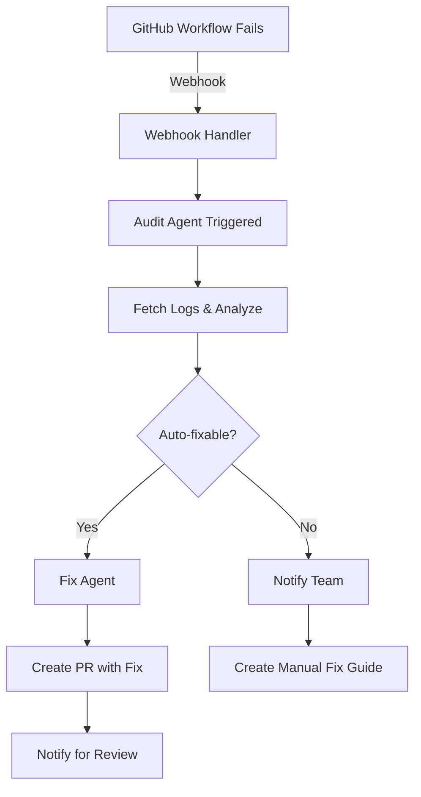

# GitHub Copilot Integration Guide

**Purpose:** Automate workflow failure detection and recovery using GitHub Copilot
**Created:** 2025-12-26
**For:** Automated workflow debugging and fixing

---

## Problem Statement

**Current Situation:**
- GitHub shows "workflow run failed" message
- Manual investigation required
- No automated debugging
- Time wasted on repetitive fixes

**Desired Solution:**
- Automatic failure detection
- AI-powered root cause analysis
- Automated fix proposals
- Integration with Claude Code

---

## Copy-Paste Instructions for GitHub Copilot

### 1. Setup: GitHub Copilot Chat

**Copy this to GitHub Copilot Chat:**

```
I need help setting up automated workflow failure detection and recovery for my GitHub Actions. Here's what I have:

Repository: dws6
Workflows: 12 GitHub Actions in .github/workflows/
Recent Failure: sync-site-content.yml failed with rsync error

I want to:
1. Automatically detect when any workflow fails
2. Generate root cause analysis
3. Propose automated fixes
4. Integrate with Claude Code for implementation

Can you help me:
A) Set up GitHub webhook to notify on workflow failures
B) Create a failure detection script
C) Build an audit agent that analyzes failures
D) Create a fix agent that proposes solutions

I have a workflow registry at .workflows/registry/WORKFLOW_REGISTRY.json
```

### 2. Debugging Specific Failure

**When you see "workflow failed", copy this to Copilot:**

```
@workspace The GitHub Action "sync-site-content.yml" just failed.

Please:
1. Read the workflow file at .github/workflows/sync-site-content.yml
2. Identify what went wrong
3. Check if this is a known issue
4. Propose a fix

The workflow is supposed to sync dws10.com/ to landing-pages/dws10-com/
Error message was: "rsync failed - directory not found"

What's the root cause and how do I fix it?
```

### 3. Create Automated Fix Script

**Copy this to Copilot:**

```
@workspace Create a Node.js script that:

1. Monitors GitHub Actions for failures (via GitHub API)
2. When a workflow fails:
   - Fetches the workflow logs
   - Analyzes the error
   - Determines root cause
   - Generates fix proposal
3. Saves audit report to .workflows/audit/failures/
4. Optionally creates a PR with the fix

The script should:
- Poll GitHub API every 5 minutes
- Only process new failures
- Support common failure types: build errors, test failures, deployment issues, sync failures
- Use the workflow registry at .workflows/registry/WORKFLOW_REGISTRY.json

File location: .workflows/agents/audit-agent.js
```

### 4. Integrate with Claude Code

**Copy this to Copilot:**

```
@workspace I want Claude Code to automatically respond to workflow failures.

When a GitHub Action fails, I want:
1. GitHub sends webhook to trigger audit
2. Audit agent analyzes failure
3. Claude Code receives notification
4. Claude Code reviews audit report
5. Claude Code creates fix and PR

Can you:
A) Create webhook receiver endpoint
B) Create audit trigger script
C) Create Claude Code integration
D) Set up notification system

Files:
- Webhook receiver: .workflows/agents/webhook-receiver.js
- Claude trigger: .workflows/agents/trigger-claude.js
- Config: .workflows/config/claude-integration.json
```

---

## Copilot Prompts for Common Issues

### Sync Workflow Failed

```
@workspace The sync-site-content workflow failed.

Workflow file: .github/workflows/sync-site-content.yml
Error: rsync command failed
Exit code: 23

The workflow tries to sync:
- Source: dws10.com/
- Destination: landing-pages/dws10-com/

Please:
1. Identify why rsync is failing
2. Check if directories exist
3. Fix the workflow
4. Test the fix

Generate the fix as a code block I can apply directly.
```

### Build Failure

```
@workspace Build workflow failed.

Workflow: .github/workflows/deploy-pilot.yml
Error: npm install failed
Exit code: 1

Please:
1. Check package.json dependencies
2. Identify problematic dependency
3. Propose fix
4. Update workflow if needed
```

### Test Failure

```
@workspace Tests failing in CI.

Workflow: .github/workflows/security-check-pr.yml
Error: 3 tests failed
Tests: security-scan, vulnerability-check, dependency-audit

Please:
1. Analyze test failures
2. Identify common cause
3. Propose fixes
4. Update tests if needed
```

---

## Automated Failure Detection Setup

### Step 1: Create GitHub Webhook

**Copy this to Copilot:**

```
@workspace Help me set up a GitHub webhook for workflow failures.

I want to:
1. Create webhook endpoint that receives workflow_run events
2. Filter for status: "failure"
3. Trigger audit agent when failure detected
4. Send notification to team

Webhook URL will be: https://my-server.com/webhooks/workflow-failure

Please generate:
A) Webhook configuration (JSON)
B) Endpoint handler (Node.js/Express)
C) Audit trigger code
D) Notification sender

Save to: .workflows/agents/webhook-handler.js
```

### Step 2: GitHub API Monitoring

**Copy this to Copilot:**

```
@workspace Create a GitHub API monitor for workflow failures.

The script should:
1. Use GitHub REST API to check workflow runs
2. Run every 5 minutes (cron or interval)
3. Check last 100 workflow runs
4. Identify new failures since last check
5. For each new failure:
   - Fetch workflow logs
   - Create audit report
   - Trigger fix agent if auto_fix: true in registry
6. Update registry with latest status

Use:
- GitHub token from environment: GITHUB_TOKEN
- Repository: owner/dws6
- Registry: .workflows/registry/WORKFLOW_REGISTRY.json

Save to: .workflows/agents/monitor-workflows.js
```

### Step 3: Audit Agent

**Copy this to Copilot:**

```
@workspace Create an audit agent for workflow failures.

Input: GitHub workflow run ID
Output: Audit report in JSON format

The agent should:
1. Fetch workflow run details via GitHub API
2. Download workflow logs
3. Parse logs to find errors
4. Classify error type:
   - build_error
   - test_failure
   - deployment_error
   - sync_error
   - permission_error
   - timeout
   - unknown
5. Identify root cause
6. Propose fix strategy
7. Estimate fix complexity
8. Save report to: .workflows/audit/failures/[workflow-id]-[date].json

Report format should match:
{
  "audit_id": "...",
  "timestamp": "...",
  "workflow": {...},
  "failure": {...},
  "analysis": {...},
  "fix_strategy": {...},
  "recommended_actions": [...]
}

Save to: .workflows/agents/audit-agent.js
```

### Step 4: Fix Agent

**Copy this to Copilot:**

```
@workspace Create a fix agent for workflow failures.

Input: Audit report JSON
Output: Fix implementation (file changes or PR)

The agent should:
1. Read audit report
2. Determine if auto-fixable
3. If auto-fixable:
   - Apply fix to workflow file
   - Create branch: fix/[workflow-id]-[date]
   - Commit fix
   - Push branch
   - Create PR
4. If not auto-fixable:
   - Create detailed fix guide
   - Notify team
   - Log for manual review

Common fixes:
- Missing directory → Create directory in workflow
- Wrong path → Fix path in workflow
- Permission error → Update workflow permissions
- Timeout → Increase timeout value
- Dependency error → Update package.json or workflow

Save to: .workflows/agents/fix-agent.js
```

---

## Example Automated Workflow

### Full Automation Flow

**When workflow fails:**



**Setup with Copilot:**

```
@workspace Set up the complete automated workflow failure recovery system.

Components needed:
1. GitHub webhook receiver (.workflows/agents/webhook-handler.js)
2. Audit agent (.workflows/agents/audit-agent.js)
3. Fix agent (.workflows/agents/fix-agent.js)
4. Notification system (.workflows/agents/notifier.js)
5. Configuration (.workflows/config/automation.json)

Workflow:
1. GitHub sends webhook on workflow failure
2. Webhook handler validates and triggers audit agent
3. Audit agent analyzes failure and creates report
4. If auto-fixable, fix agent creates PR
5. If not auto-fixable, notification sent to team
6. All actions logged to .workflows/audit/

Please generate all files with:
- Error handling
- Logging
- Configuration via environment variables
- GitHub API integration
- PR creation via GitHub API
```

---

## Claude Code Integration

### Trigger Claude on Failure

**Copy this to Copilot:**

```
@workspace Create Claude Code integration for workflow failures.

When audit agent completes, trigger Claude Code to:
1. Review audit report
2. Understand the failure
3. Propose comprehensive fix
4. Implement fix if approved
5. Test the fix
6. Create PR

Integration method:
- Claude Code API or CLI
- Pass audit report as context
- Provide workflow file path
- Give Claude permission to edit files

Create:
A) Claude trigger script (.workflows/agents/trigger-claude.js)
B) Claude prompt template (.workflows/templates/claude-fix-prompt.md)
C) Configuration (.workflows/config/claude-config.json)

The trigger should:
- Format audit report for Claude
- Include relevant files in context
- Specify expected output (fix code)
- Handle Claude's response
- Apply fix if valid
```

---

## Notification Setup

### Slack Notifications

**Copy this to Copilot:**

```
@workspace Set up Slack notifications for workflow failures.

When workflow fails, send Slack message with:
- Workflow name
- Failure time
- Error summary
- Link to audit report
- Link to GitHub Actions run
- Quick actions (Trigger fix agent, View logs, Acknowledge)

Create:
- Slack webhook integration
- Message formatter
- Button actions handler

Save to: .workflows/agents/slack-notifier.js

Message format:
🚨 **Workflow Failed**
Workflow: [name]
Time: [timestamp]
Error: [summary]

[View Audit Report] [Trigger Fix] [View Logs]
```

### Email Notifications

**Copy this to Copilot:**

```
@workspace Set up email notifications for workflow failures.

Send email to team when workflow fails:
- Subject: [URGENT] Workflow Failed: [workflow-name]
- Body: Formatted audit report
- Attachments: Full logs
- Links: GitHub run, audit report, fix PR (if created)

Use workflow registry to get notification emails.

Save to: .workflows/agents/email-notifier.js
```

---

## Testing & Validation

### Test Audit Agent

**Copy this to Copilot:**

```
@workspace Create test suite for audit agent.

Test cases:
1. Build failure detection
2. Test failure analysis
3. Deployment error parsing
4. Sync error identification
5. Unknown error handling
6. Log parsing accuracy
7. Root cause determination

Mock workflow runs with different failure types.
Validate audit report accuracy.

Save to: .workflows/agents/tests/audit-agent.test.js
```

### Test Fix Agent

**Copy this to Copilot:**

```
@workspace Create test suite for fix agent.

Test cases:
1. Auto-fix detection
2. PR creation
3. Fix validation
4. Edge cases (complex failures)
5. Rollback if fix fails

Mock audit reports with different fix strategies.
Validate fix correctness.

Save to: .workflows/agents/tests/fix-agent.test.js
```

---

## Monitoring Dashboard

### Create Dashboard

**Copy this to Copilot:**

```
@workspace Create a monitoring dashboard for workflows.

Dashboard should show:
1. Today's workflow runs (success/failure)
2. This week's statistics
3. This month's statistics
4. Failure trend chart
5. Most failing workflows
6. Auto-fix success rate
7. Recent audit reports
8. Active fixes (PRs)

Tech stack:
- Backend: Node.js + Express
- Frontend: HTML/CSS/JS (simple, no framework)
- Data: Read from .workflows/registry/ and .workflows/audit/

Save to: .workflows/dashboard/
```

---

## Quick Reference Commands

### Check Workflow Status
```bash
# Today's failures
node .workflows/agents/audit-agent.js --today

# This week's failures
node .workflows/agents/audit-agent.js --week

# Specific workflow
node .workflows/agents/audit-agent.js --workflow sync-site-content
```

### Trigger Fix Agent
```bash
# Latest failure
node .workflows/agents/fix-agent.js --latest

# Specific audit
node .workflows/agents/fix-agent.js --audit audit-20251226-0930
```

### Manual Audit
```bash
# Audit specific run
node .workflows/agents/audit-agent.js --run-id 12345678

# Audit with verbose logging
node .workflows/agents/audit-agent.js --run-id 12345678 --verbose
```

---

## Environment Variables Needed

```bash
# .env file
GITHUB_TOKEN=ghp_xxxxxxxxxxxxx
GITHUB_OWNER=blogtheristo
GITHUB_REPO=dws6
SLACK_WEBHOOK_URL=https://hooks.slack.com/services/xxx
CLAUDE_API_KEY=sk-ant-xxxxxxxxxxxxx
SMTP_HOST=smtp.gmail.com
SMTP_USER=notifications@dws.com
SMTP_PASS=xxxxxxxxxxxxx
```

---

## Next Steps

### Immediate Actions

1. **Copy Section 1 to GitHub Copilot** - Get help setting up webhook
2. **Copy Section 2 to GitHub Copilot** - Debug the current failure (sync-site-content)
3. **Copy Section 3 to GitHub Copilot** - Create audit agent
4. **Copy Section 4 to GitHub Copilot** - Create fix agent

### Full Setup (Copy to Copilot)

```
@workspace I want to set up the complete automated workflow failure recovery system as described in .workflows/GITHUB_COPILOT_GUIDE.md

Please create all the necessary files:
1. Webhook handler
2. Audit agent
3. Fix agent
4. Notification system
5. Claude Code integration
6. Monitoring dashboard

Start with the most critical components first.
```

---

**Created:** 2025-12-26
**Purpose:** Enable automated workflow debugging with GitHub Copilot and Claude Code
**Status:** Ready to use
**Next:** Copy prompts to GitHub Copilot Chat and start automation
