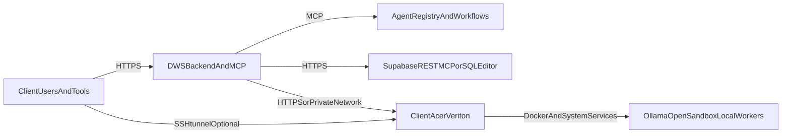

# Client Offers: Control Room and Situation Room on Acer Veriton

***
# VERSION AND AGENT HISTORY

Version: 1.0

Sessions & Modifications:
  - Version: 1.0 | Tool: GPT-5.4 | Session: 2026-03-11 | Date: 11.03.2026 | Changes: Initial client-offer definition for Control Room Acer Veriton and Situation Room Acer Veriton-backed, including capability mapping to agents, MCP tools, and backend services

Session Links & References:
  - Source plan: `client_edge_rollout_f94083cd.plan.md`

Document Status:
  - Created: 11.03.2026
  - Last Modified: 11.03.2026
  - Language: English
  - Languages Available: English
  - Publication Status: ACTIVE

***

**Version:** 1.0
**Purpose:** Define the two Acer Veriton-based client delivery packages and map them to the existing DWS6 implementation
**Audience:** Sales, Solutions Engineering, Delivery, DevOps, Security
**Updated:** 11.03.2026

---

## 1. Executive Summary

DWS6 should be sold and implemented to enterprise clients as two named Veriton-backed delivery packages:

1. **Control Room Acer Veriton**
2. **Situation Room Acer Veriton-backed**

They share the same Veriton edge stack, Docker runtime, MCP integration pattern, and security model. The difference is packaging:

- **Control Room** focuses on local control, execution, sandboxing, and operator-facing actions
- **Situation Room** focuses on orchestration, analysis, reporting, and decision support backed by the same edge infrastructure

Both offers use the DWS backend and MCP as the control plane, while the Acer Veriton acts as the client-side edge node.

---

## 2. Shared Architecture

### 2.1 Control Plane

The product contract remains in the DWS backend:

- Express backend and API routes in `src/app.ts`
- Agent API in `src/agents/routes.ts`
- In-process MCP exposure in `src/mcp/agent-server.ts`
- Multi-agent orchestration in `mcp-hub/server.py`

### 2.2 Edge Plane

The Veriton host runs local services such as:

- Ollama for local inference
- OpenSandbox for isolated task execution
- Optional containerized worker services for client-specific adapters

### 2.3 Data Plane

Supabase remains the operational database and auth layer, but client workflows should prefer:

- HTTPS APIs
- MCP tools
- Supabase REST or SQL Editor for admin operations

Direct `DATABASE_URL` access is admin-only and should not be the primary client integration path.

---

## 3. Offer 1: Control Room Acer Veriton

### 3.1 Positioning

Control Room is the client's local operational AI room. It is deployed on the Acer Veriton at the client site or trusted edge environment.

### 3.2 Core Value

- Local operational control with client-owned hardware
- Lower-latency and higher-sovereignty execution
- Safe isolated execution through OpenSandbox
- MCP-exposed operational tools for internal automation
- Admin/operator access through HTTPS, MCP, or SSH tunnel

### 3.3 Core Components

| Layer | Implementation |
|------|----------------|
| Edge host | Acer Veriton GN100 or approved equivalent |
| Runtime | Docker + local services |
| Inference | Ollama by default |
| Isolation | OpenSandbox (`SANDBOX_STAGE=opensandbox`) |
| Control plane | DWS backend + MCP Hub |
| Operator access | SSH tunnel or trusted private network |

### 3.4 Typical Use Cases

- Local site operations
- Private code and data analysis
- Sandboxed agent execution
- Internal workflow automation
- Edge-side model serving for Cursor, Continue, and Cline

---

## 4. Offer 2: Situation Room Acer Veriton-backed

### 4.1 Positioning

Situation Room is the client's investigation, reporting, and decision-support layer. It uses the same Veriton edge stack for local execution and inference, but it is orchestrated through the DWS backend and agent workflows.

### 4.2 Core Value

- Multi-agent synthesis and reporting
- Decision support with local execution where needed
- Dashboard-ready report generation and investigation workflows
- Stronger separation between operator actions and strategic analysis

### 4.3 Core Components

| Layer | Implementation |
|------|----------------|
| Orchestration | DWS backend + `mcp-hub/server.py` |
| Reports/API | `src/routes/situation-room.routes.ts` |
| Agents | Registry in `src/agents/index.ts` |
| Edge backing | Same Veriton host used by Control Room |
| Data sources | Supabase REST, pipeline outputs, MCP workflows |

### 4.4 Typical Use Cases

- Carbon and compliance reporting
- Risk investigation
- Executive or project-level summaries
- Workflow-driven analysis
- Multi-agent incident or project review

---

## 5. Capability Mapping

### 5.1 Control Room Capability Mapping

| Capability | Existing DWS6 Implementation | Why It Fits Control Room |
|-----------|-------------------------------|--------------------------|
| Local inference | Ollama guidance in `Admin/Acer-Veriton-GN100/README.md` | Client-owned local model execution |
| Sandboxed execution | `src/sandbox/index.ts`, `mcp-hub/services/opensandbox_mcp.py` | Safe task execution on the Veriton |
| Field/site operations | `SiteSenseAgent`, `ScheduleGeniusAgent`, `ConstructionAgent`, `LogisticsAgent` in `src/agents/index.ts` | Operational and edge-relevant workflows |
| Agent access | `src/agents/routes.ts`, `src/mcp/agent-server.ts` | MCP and API access to local-control workflows |
| Admin diagnostics | `scripts/test-db-connection.ts` plus new connectivity scripts | Operational support and deployment validation |

### 5.2 Situation Room Capability Mapping

| Capability | Existing DWS6 Implementation | Why It Fits Situation Room |
|-----------|-------------------------------|----------------------------|
| Situation reports | `src/routes/situation-room.routes.ts` | Native reporting endpoint already exists |
| Compliance synthesis | `ComplianceAgent`, `ComplianceResearcherAgent`, `AthenaAgent` | Reporting and investigation layer |
| Multi-agent orchestration | `mcp-hub/server.py`, `src/agents/workflows.ts` | Decision-support workflows |
| Research and market intelligence | `IrisAgent`, `DeepWikiExtractorAgent`, `EmissionsDataAnalystAgent` | Investigation and synthesis use cases |
| Content and briefing outputs | `ApolloAgent`, `ContentBriefAgent`, `SeoAuditAgent`, `LeadFeedbackAgent` | Report-ready and explainable outputs |
| Executive/project summaries | `AtlasAgent`, `HermesAgent`, `QualityGateAgent` | High-level synthesis and quality framing |

### 5.3 Shared MCP and Product Rules

Both offers must continue to satisfy the repo's Build for Agents rule from `CLAUDE.md`:

- CLI or operator entrypoint exists
- JSON output exists
- MCP endpoint exists
- documentation exists
- tool or workflow discovery remains available

---

## 6. Implementation Boundaries

### 6.1 What Runs on Veriton

- Ollama
- OpenSandbox
- local Docker services and adapters
- client-side diagnostics
- optionally containerized OpenAI-compatible inference on supported hardware

### 6.2 What Stays in DWS Backend

- orchestration
- `/mcp` exposure
- agent registry and workflows
- JWT-protected API routes
- centralized reporting, governance, and audit patterns

### 6.3 What Should Not Be the Default

- direct Postgres access from client tools
- ad hoc venv-based vLLM installs on unsupported hardware
- exposing local inference publicly without firewall or tunnel restrictions

---

## 7. Commercial Packaging Guidance

### 7.1 Control Room

Sell as the operational local AI room:

- edge execution
- secure local inference
- operator workflows
- internal automation
- sandboxed task execution

### 7.2 Situation Room

Sell as the analytical and reporting layer:

- investigation
- reporting
- decision support
- dashboard-backed summaries
- multi-agent synthesis

### 7.3 Combined Sale

The preferred enterprise offer is both packages together:

- **Control Room** provides the local execution foundation
- **Situation Room** provides the analytical and reporting layer
- one Veriton architecture can back both, with redundancy options as needed

---

## 8. Delivery Checklist

- Confirm Acer Veriton hardware, OS, and network prerequisites
- Confirm Docker and service runtime strategy
- Confirm Ollama mode: SSH tunnel or trusted direct host access
- Confirm OpenSandbox host reachability from DWS backend
- Confirm HTTPS/MCP paths before any direct DB path
- Confirm client admin/operator tool configs (Continue, Cursor, Cline) against the Veriton host
- Confirm security scope, firewall rules, and logging expectations

---

## 9. Related Files

- `Admin/Acer-Veriton-GN100/README.md`
- `Situation/DWS_IQ6_USER_MANUAL.md`
- `Situation/user-storyboard.md`
- `Situation/admin-storyboard.md`
- `Admin/ADMIN_MANUAL_SUPABASE_EN_v1.md`
- `Admin/SECURITY_COMPLIANCE.md`
- `docs/CLOUD_ENVIRONMENTS.md`
- `src/agents/index.ts`
- `src/agents/routes.ts`
- `src/mcp/agent-server.ts`
- `src/routes/situation-room.routes.ts`
- `mcp-hub/server.py`
