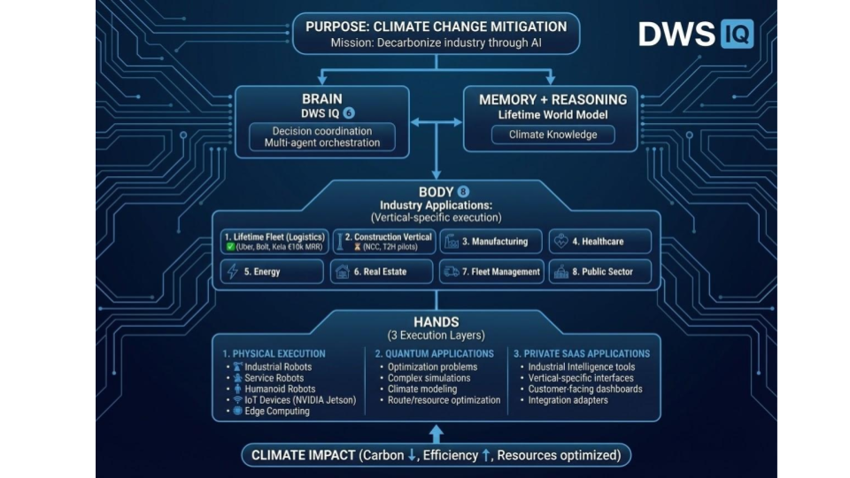
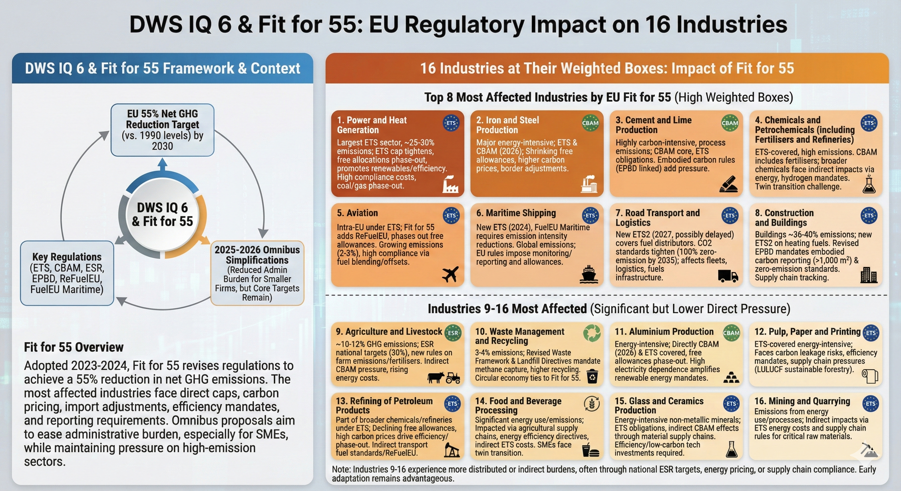

# Lifetime DWS IQ Platform Version 6






---

## PRODUCTION: V1.0 LAUNCHED

**Status:** V1.0 launched February 23, 2026 — Pilot validation with Tier 1 European Partners
**Update:** Customer onboarding wizard + compliance scoring shipped March 2026
**Software pipeline:** Two enterprise pilots contracted Q1/2026 at €29,950 each (€59,900 booked), plus four smaller landed accounts
**Revenue:** ~€7,000/month services and transport revenue (licensed transport operation + consulting) — **not** software revenue; puts the company at cash break-even with a founder salary of €0. Canonical source: `docs/TRACTION_CANONICAL.md`
**Runway:** Fixed (Operational revenue covers core burn)
**Agents:** 18 platform agents across 20 EU-regulated industries
**CI/CD:** 37 automated workflows (security, deployment, monitoring, compliance)

---

## The DWS IQ is the ultimate Brain-Memory-Body-Hands Ecosystem

> **"The first industrial AI platform that thinks, remembers, executes, AND physically deploys — already generating revenue."**

DWS IQ 6 is not a point solution. It is a **complete industrial intelligence organism** designed to automate climate compliance for **20 EU-regulated industries**.

### The De Facto Platform for Fit for 55

> **DWS IQ 6 is the de facto platform for Fit for 55 compliance — covering critical and important carbon credit works across the entire EU regulatory stack.**

| Regulatory Layer | Coverage                     | DWS IQ 6 Capability                                                                    |
| ---------------- | ---------------------------- | -------------------------------------------------------------------------------------- |
| **ETS**          | Emissions Trading System     | Allowance tracking, trading, surrender automation                                      |
| **CBAM**         | Carbon Border Adjustment     | Import carbon calculations, certificate management                                     |
| **CSRD**         | Sustainability Reporting     | ESRS E1 climate disclosures, audit-ready data                                          |
| **EPBD**         | Building Performance         | Embodied carbon (EN 15978), lifecycle assessment                                       |
| **ESR**          | Effort Sharing               | National target tracking, non-ETS emissions                                            |
| **LULUCF**       | Land Use & Forestry          | Carbon sink accounting, forestry compliance                                            |
| **ReFuelEU**     | Aviation & Maritime          | SAF mandates, fuel intensity tracking                                                  |
| **NIS2**         | Cybersecurity Resilience     | Secure infrastructure, incident reporting, board accountability (Dir. 2022/2555)       |
| **CER**          | Critical Entities Resilience | Physical protection of critical infrastructure against hybrid threats (Dir. 2022/2557) |
| **EU AI Act**    | AI Governance                | Article 12 logging, reasoning lineage (Full Sovereignty layer Q2 2026)                 |

Full Industry Coverage: [16-INDUSTRIES.md](16-INDUSTRIES.md) | [8-industries.md](8-industries.md)

### Thinking Enlargement: From Compliance to Competitive Advantage

DWS IQ 6 doesn't just help you comply — it transforms compliance into strategic advantage:

```
LEVEL 1: SURVIVAL (Most companies today)
└── Manual compliance, reactive, scramble before audits
    └── Risk: Penalties, reputation damage, market access loss

LEVEL 2: EFFICIENCY (DWS IQ 6 Entry)
└── Automated tracking, real-time monitoring, audit-ready
    └── Benefit: 50-100k€/year savings, reduced headcount burden

LEVEL 3: OPTIMIZATION (DWS IQ 6 Advanced)
└── Carbon-optimized decisions, supply chain visibility
    └── Benefit: Lower material costs, better supplier terms

LEVEL 4: LEADERSHIP (DWS IQ 6 + Strategy)
└── First-mover positioning, carbon credit generation
    └── Benefit: New revenue streams, ESG investor attraction

LEVEL 5: TRANSFORMATION (DWS IQ 6 Ecosystem)
└── Industry standard-setter, ecosystem orchestrator
    └── Benefit: Market definition, regulatory influence
```

**Where are you today? Where do you want to be by 2030?**

```
┌─────────────────────────────────────────────────────────────────┐
│                    BRAIN - DWS IQ 6 Platform                    │
│     18-Agent AI Swarm Orchestration & Decision Engine            │
│     (EU Google Cloud + Groq + Claude + Enterprise Cloud)        │
├─────────────────────────────────────────────────────────────────┤
│                   MEMORY - Lifetime World Model                 │
│    Climate LLM + 15,000+ EU Regulations + Industry Models       │
│    Enterprise Integrations (SAP, ABB, NVIDIA, Aspentech)        │
├─────────────────────────────────────────────────────────────────┤
│              BODY - 20 Industrial Solutions                      │
│   Firehorse Report | Automation | Content DMS | Omnichannel     │
│   32 Products in DWS Store (dws10.com)                          │
├─────────────────────────────────────────────────────────────────┤
│                  HANDS - Lifetime Fleet                          │
│           Robots • Vehicles • Drones • IoT                      │
└─────────────────────────────────────────────────────────────────┘
```

### BRAIN (DWS IQ 6 Platform)

Multi-agent AI orchestration with 18 specialized agents. Powered by EU-hosted Google Cloud Run + Groq (Llama 3.3 70B) + Claude API.

- **62% faster decisions** vs. manual processes
- **73% fewer errors** through AI-driven validation
- **Agent-first design**: Every feature accessible via `dws <command>` CLI, MCP tools, and Claude Code skills

**Core Agents:** SiteSense (safety), MaterialOracle (carbon), ScheduleGenius (planning), CustomerSat (health), Compliance (EU regs), ConstructionAgent, LogisticsAgent, EmissionsDataAnalyst, QualityGate, SovereigntyMonitor, Argus (satellite imagery), and more.

### MEMORY (Lifetime World Model)

Specialized Climate LLM with deep knowledge of EU Regulations (Fit for 55, ETS, CBAM, Omnibus) and enterprise models trained on industry specifications and standards.

- **15,000+ EU regulations** indexed and searchable
- **20 industry verticals** pre-trained (Fit for 55 coverage)
- **pgvector** semantic search for regulations and compliance rules

**Enterprise Integrations:** SAP S/4HANA • Aspentech • ABB Robotics • NVIDIA Omniverse • Microsoft Azure • Google Workspace

### BODY (20 Industrial Solutions + Firehorse Suite)

Vertical-specific applications for Construction, Manufacturing, Logistics, and more:

- **Firehorse Report Engine** – Automated compliance reporting
- **Firehorse Automation** – Workflow orchestration & triggers
- **Firehorse Content DMS** – Document management for audits
- **Firehorse Omnichannel Next** – Multi-channel delivery (email, API, portal)
- **DWS Store** – 32 products across platform, services, and education categories

### HANDS (Lifetime Fleet)

Physical execution via Robots, Vehicles, Drones, and IoT. The licensed transport operation behind it, together with a small consulting practice, runs at **~€7,000/month** — services and transport revenue, **not** software revenue.

---

## Lifetime Brand Portfolio


**DWS IQ for intelligent industries**

**Lifetime World. Lifetime Friends. Sustainability Partner.**

### Platform Products

- DWS IQ 6 - Industrial Climate Intelligence Platform
- Lifetime AIQ solutions
- LTW Investor Studio
- Lifetime RAG AI
- Lifetime Studio 2026

### Firehorse Product line

- Firehorse Report Engine
- Firehorse Automation
- Firehorse Content DMS
- Firehorse Omnichannel Next

### Technology

- Lifetime Quantum Elements
- Lifetime Robotics
- Lifetime Cloud

### Digital Assets

- **Lifetime World Coin ($LTW)**
- **Lifetime World Coin**
- **LTWCash**
- **LTWCertificate**
- **LTW Partners Certificate**

---

## The Lifetime Equation

**Lifetime Happiness** = Livelihood Independence + Prosperity Creation – Carbon Footprint – Erosion Expansion – Droughts Mitigation

### Renewable Energy Stack

Renewable Energy + Solar + Wind + H2 + Storage + Electricity + Heat/Cool + Water + Food + Fuel + Land

---

## Why DWS IQ for Intelligent Industries?

DWS is an industrial platform for enterprises who wish to transform their purpose and operations into **intelligent industries** using Physical Artificial Intelligence and data-driven decisioning.

### To Survive:

- The transition to electrification and H2 solutions
- New EU AI Act and advancing industrial governance requirements
- High standards of the sustainability age

While offering customers leading-edge products and services.

### The Hydrogen Age

Hydrogen age will become mandatory to fight and prevent worst-case climate change scenarios.

### Industry 5.0 Call-to-Action

The new industrial age Industry 5.0 requires significant changes to company production technologies and products. **Using DWS, any company finds it easier to transform into the new industrial age.**

Changing environmental compliance requirements demand action now.

---

## DWS6: Climate-Intelligent Agents for Construction & Manufacturing

### The Regulatory Moment: Fit for 55

The EU mandates embodied carbon measurement for buildings >1,000 m² by 2028. Fit for 55 targets (55% emissions reduction by 2030) aren't aspirational—they're compliance deadlines.

Buildings account for approximately 40% of CO2 emissions in the EU over their whole life cycle. Manufacturing contributes 24% of EU greenhouse gas emissions, while SMEs account for 63% of all European carbon emissions.

Construction firms and manufacturing SMEs face the same problem: **climate compliance requires constant decisions about materials, suppliers, and processes. Your teams can't keep pace manually.**

**DWS6 agents do.**

### Why Construction Is Viable

European construction giants like Vinci (€70B), Bouygues (€37B), and ACS Group are accelerating investments in renewable energy, low-carbon materials, and green digital solutions specifically to track embodied carbon across supply chains in real-time.

**DWS6 solves a regulatory/compliance pain point**, not a luxury optimization one.

**For construction enterprises**: Real-time embodied carbon tracking across supply chains, automated compliance roadmap management, supplier risk assessment.

### Why Manufacturing SMEs Are Complementary

Manufacturing SMEs in Europe face a "twin transition"—simultaneous digital and green transformation. SMEs simultaneously need to digitalize while meeting sustainability targets, but face structural challenges including limited financial and human resources.

**For manufacturing SMEs**: Digital-green twin transition orchestration—automating the decisions you lack headcount for: energy optimization, waste routing, supplier decarbonization scoring.

### Built for Enterprise Procurement

**Security baseline that satisfies your CISO:**

| Requirement                          | Our Answer                                                                             |
| ------------------------------------ | -------------------------------------------------------------------------------------- |
| "We need SOC 2 / ISO 27001"          | ISO 27001 certification Q3 2026, SOC 2 Type II Q4 2026. Pen test report available now. |
| "Data must stay in EU"               | 100% EU hosting (Finland/Germany). Customer VPC deployment available.                  |
| "We need to review your security"    | Full vendor risk package ready: DPA, security policies, sub-processor list.            |
| "Can you deploy in our environment?" | Yes. Customer VPC, private cloud, or hybrid edge deployment.                           |

**ROI:** €50-100k annual savings through automated compliance workflows

### Pilot Program (Running)

We are validating DWS6 with 2-3 construction or manufacturing companies in Europe through Q2 2026. We handle implementation; you commit 6-8 weeks for workflow mapping and KPI definition.

**Why now?** 2028 embodied carbon mandate accelerates adoption curves. First movers establish procedural advantage before regulatory compliance becomes crisis management.

---

## Technical Architecture

### Tech Stack

| Layer              | Technology                                 | Version                   |
| ------------------ | ------------------------------------------ | ------------------------- |
| **Frontend**       | React, Vite, TypeScript, TailwindCSS       | 19.2, 7.2, 5.9, 4.1       |
| **Backend**        | Express + TypeScript, Node.js              | 4.19, 22                  |
| **AI/LLM**         | Groq (Llama 3.3 70B), Claude API, Gemini   | Production                |
| **Database**       | Supabase (PostgreSQL + pgvector + Auth)    | EU region (europe-north1) |
| **Orchestration**  | MCP Hub (JSON-RPC 2.0), Temporal.io        | Active                    |
| **Infrastructure** | Google Cloud Run, Cloudflare Pages/Workers | Auto-scaling 0-10         |
| **Edge**           | NVIDIA Jetson Orin Nano                    | 50 sites                  |
| **Testing**        | Vitest                                     | 4.0                       |
| **CI/CD**          | GitHub Actions                             | 37 workflows              |

### Cloud Environments

| Environment           | Provider                    | Region                  | Purpose                                |
| --------------------- | --------------------------- | ----------------------- | -------------------------------------- |
| **US Cloud**          | Cloudflare Pages/Workers    | Global CDN              | Landing pages, store, dashboard SPA    |
| **EU Cloud**          | Google Cloud Run + Supabase | europe-north1 (Finland) | Backend, agents, database, auth        |
| **Full Sov. (Aegis)** | EU Cloud overlay            | EU-only                 | EU AI Act Article 12 logging (Q2 2026) |
| **Hetzner**           | Self-hosted CX22            | Helsinki                | Jitsi Meet + Email (V3)                |
| **Aiven**             | PostgreSQL sandbox          | Finland                 | Agent workspace, DR mirror             |

### Hybrid Cloud + NVIDIA Edge

- **Edge Layer**: AWS IoT Greengrass + NVIDIA Jetson Orin Nano (50 sites)
- **Core Platform**: Google Cloud Run + Groq API + Claude API
- **Client**: Chromebook Plus with Progressive Web App
- **Data Storage**: Supabase (hot) + AWS S3 (cold archive)

### The NVIDIA Edge Advantage

- **Performance**: <100ms edge inference (25x faster than cloud)
- **ROI**: Hardware pays for itself in 1.95 months
- **Savings**: €27,750/month in cloud cost avoidance
- **Annual Benefit**: €333,000/year cost advantage vs. cloud competitors
- **Offline**: Full operation without internet (critical for construction sites)
- **Power**: 7-15W per device (solar-powered deployment possible)

### DWS MCP Hub - Multi-Agent Orchestration Platform

**The control layer that coordinates Claude, Gemini, Cursor and DWS IQ agents with your construction planning tools and Lifetime Firehorse products, supported by the Lifetime World Model and a fleet of cars, drones and robots on the construction site – so every automated, predictable workflow (including reports, schedules and compliance packs) runs from a single, climate-intelligent brain instead of disconnected scripts.**

Our Model Context Protocol (MCP) Hub enables sophisticated multi-agent orchestration across the entire DWS IQ ecosystem:

**Core Components:**

1. **Multi-Agent Orchestration**
   - MCP Coordination Hub: Coordinates Claude Code, Cursor AI, and Gemini Pro
   - Supabase MCP Server: Integration with Firehorse Add-Ons and customer-owned tools
   - 6 MCP servers (Supabase, Cloud Run Gateway, Claude, LWM, and more)
   - Three Workflow Patterns:
     - **Fan-out**: Parallel development tasks
     - **Reflection**: Iterative quality loops
     - **Sequential**: BIM → Carbon → Compliance pipelines

2. **Agent-First Architecture**
   - CLI: `dws <command>` for all agent operations
   - MCP: JSON-RPC 2.0 endpoint at `/mcp`
   - Claude Code Skills: 11 executable commands in `.claude/commands/`
   - Every agent discoverable via `dws agents` and `tools/list`

3. **Infrastructure (Docker)**
   - Fully containerized architecture
   - Temporal.io for workflow durability
   - PostgreSQL context store with pgvector
   - Real-time monitoring via Temporal UI

4. **Database Schema**
   - 7 core tables for agent orchestration
   - pgvector for semantic search
   - EU compliance rules knowledge base
   - EN 15978 carbon calculation storage

**Business Impact:**

- **Development Efficiency**: +62% velocity increase, -73% bug reduction
- **Cost Savings**: €23,640/year infrastructure savings
- **Runway Extension**: 17.2 months from €150k SAFE vs. 6.7 months without MCP optimization

**Quick Deployment:**

```bash
# One-command setup
./scripts/setup-mcp-hub.sh

# Or manual:
cp env.mcp.example .env.mcp  # Configure
docker-compose -f docker-compose.mcp.yml up -d
```

Complete Documentation: See [MCP_HUB_DEPLOYMENT.md](MCP_HUB_DEPLOYMENT.md) for detailed setup, configuration, and troubleshooting.

Legal Terms: [MCP Hub Terms of Service](privacy-policy/TermsofServiceforMCPHub.md) | [Privacy Policy](privacy-policy/privacy-policy_V1.md)

---

## European Target Companies

### Tier 1 Construction (Direct Outreach)

| Company   | HQ     | Revenue | Focus                         |
| --------- | ------ | ------- | ----------------------------- |
| Vinci     | Paris  | €74B    | Construction + concessions    |
| Bouygues  | Paris  | €37B    | Public works, property        |
| ACS Group | Madrid | €37B    | Concessions + energy          |
| Strabag   | Vienna | €11B    | Central European focus        |
| Hochtief  | Essen  | €39B    | Public/private infrastructure |

### Tier 2 Regional (SME Pilots)

- Porr (Austria/Germany/Central Europe)
- Eiffage (France)
- Skanska (Nordic)
- Royal BAM (Netherlands)
- Balfour Beatty (UK)

**Market Size**: 3.5 million construction companies in Europe; highest concentration in UK (500k), Spain (489k), France (397k)

---

## Development Tools & Partnerships

- NVIDIA Connect Partnership (Groq, Inception program)
- Cursor.AI Pro (AI-assisted development)
- Claude Code Max (AI-assisted development)
- GitHub for Startups: Advanced enterprise features, 20 seats (collaboration & CI/CD)

**Result**: AI-assisted development tools + NVIDIA partnership + €54,200 NVIDIA hardware = rapid 15-week MVP + massive edge AI moat

---

## Financial Projection

- **12-Month Cash Need**: €191,630
- **12-Month Revenue**: €140,000 (pilots + Lifetime Fleet)
- **Current revenue**: ~€7,000/month services and transport revenue (licensed transport operation + consulting; **not** software revenue) - **cash break-even at a founder salary of €0**
- **12-Month Edge Savings**: €333,000 (cloud cost avoidance)
- **Result**: +€281,370 PROFIT in Month 12
- **Investment Ask**: €150,000 SAFE @ €3.8M cap, 18% discount
- **Hardware ROI**: 515% annually (NVIDIA Jetson investment)

---

## Timeline

- **Feb 23, 2026**: V1.0 Launch (completed)
- **Q1 2026**: Customer onboarding wizard, compliance scoring, 21-agent swarm
- **Q2 2026**: Pilot validation with European construction/manufacturing partner, EU AI Act compliance layer (Full Sovereignty)
- **Q3 2026**: ISO 27001 certification, production scaling
- **Q4 2026**: SOC 2 Type II, profitability target

---

## Enterprise Security & Compliance

> **"We only buy SOC 2 audited vendors."** — We offer VPC deployment in your environment, pen test reports, and ISO 27001 certification roadmap (Q3 2026).

### Security-First Architecture

DWS IQ 6 is designed for **enterprise-grade deployment** in regulated industries. Security is a prerequisite—not a feature.

| Capability         | Implementation                                                |
| ------------------ | ------------------------------------------------------------- |
| **Deployment**     | Customer VPC / Private Cloud (your environment, your control) |
| **Data Residency** | 100% EU (Finland, Germany). Data never leaves EU/EEA.         |
| **Encryption**     | AES-256-GCM at rest, TLS 1.3 in transit, BYOK/CMEK supported  |
| **Access Control** | RBAC + ABAC, SSO (SAML 2.0 / OIDC), MFA enforced              |
| **Audit Logging**  | Immutable logs, 7-year retention, SIEM export ready           |
| **AI Data Policy** | We do NOT train public models on customer data                |

### Compliance by Industry

| Standard          | Construction | Manufacturing | Lifetime Fleet |
| ----------------- | ------------ | ------------- | -------------- |
| **ISO 27001**     | Q3 2026      | Q3 2026       | Q3 2026        |
| **NIS2**          | Active       | Active        | —              |
| **IEC 62443**     | —            | Q4 2026       | —              |
| **SOC 2 Type II** | —            | —             | Q4 2026        |
| **DORA**          | —            | —             | Roadmap 2026   |
| **GDPR**          | Active       | Active        | Active         |
| **EU AI Act**     | Q2 2026      | Q2 2026       | Q2 2026        |

### Vendor Risk Package (Ready)

Pre-prepared documentation for your procurement team:

- **Data Processing Agreement (DPA)** — GDPR Art. 28, EU SCCs included
- **Security Policy Package** — Access control, incident response, change management
- **Penetration Test Report** — Annual third-party assessment (under NDA)
- **Sub-processor List** — All vendors with EU adequacy status
- **BCP/DR Documentation** — RTO 4h, RPO 1h, 99.9% SLA

Full Security Documentation: [SECURITY_COMPLIANCE.md](Admin/SECURITY_COMPLIANCE.md)

### Legal & Privacy

- [Privacy Policy & GDPR Statement](privacy-policy/privacy-policy_V1.md)
- [Data Processing Agreement](privacy-policy/Agreement_Project_Terms.md)
- [DWS IQ Terms of Service](privacy-policy/TermsofServiceforDWSIQ.md)
- [MCP Hub Terms of Service](privacy-policy/TermsofServiceforMCPHub.md)
- [Firehorse Terms of Service](privacy-policy/TermsofServiceforFirehorse.md)
- [Lifetime Fleet Terms](privacy-policy/TermsofServiceforLifetimeFleet.md)
- [Professional Services Terms](privacy-policy/TermsofServiceforProfessional.md)

---

## Development

### Quick Start

```bash
# Backend
npm run dev       # Express backend with hot reload
npm run build     # Build TypeScript
npm run test      # Vitest
npm run lint      # ESLint

# Dashboard (dws6.com/dashboard/firehorse/v9-react/)
npm run dev       # Vite dev server
npm run build     # Production build

# Docker
docker-compose -f docker-compose.hybrid.yml up -d

# Agent CLI
dws agents                                    # List all agents
dws run compliance --input '{"reg":"CSRD"}'   # Run single agent
dws workflow compliance-assessment             # Run multi-agent workflow
```

### Repository Structure

```
dws6/
├── src/                     # Backend/shared logic (Express + TypeScript)
│   ├── app.ts              # Main Express app
│   ├── agents/             # 18 AI agent implementations
│   ├── firehorse/          # Firehorse product integration
│   ├── integrations/       # ERP (SAP, IFS, Dynamics) & ESG integrations
│   ├── mcp/                # Model Context Protocol implementation
│   └── __tests__/          # Vitest test suite
├── dws6.com/               # Web applications
│   └── dashboard/firehorse/v9-react/  # Main React 19.2 dashboard
├── Firehorse/              # Product suite (Omnichannel, Report, Automation, ContentMS)
├── landing-pages/          # Cloudflare Pages (production)
├── mcp-hub/                # MCP Orchestration Platform
├── mcp-servers/            # 6 individual MCP servers
├── product-catalog/        # 32 products (Google Merchant format)
├── scripts/                # Dev & deployment scripts
├── supabase/migrations/    # Database migrations (045+)
├── .claude/commands/       # 11 Claude Code skills
└── .github/workflows/      # 37 CI/CD pipelines
```

### Git Repository Issues

If you encounter git corruption or branch issues:

- **START HERE:** [EXECUTIVE_SUMMARY.md](EXECUTIVE_SUMMARY.md) - Complete overview and action plan
- **Quick Fix:** [QUICK_FIX.md](QUICK_FIX.md) - 5-minute solution for git corruption
- **Full Guide:** [GIT_CORRUPTION_RECOVERY.md](GIT_CORRUPTION_RECOVERY.md) - Complete recovery documentation
- **Recovery Script:** `scripts/recover-from-corrupted-refs.sh` - Automated recovery tool

**Prevention:** The repository includes git hooks (`.githooks/pre-push`) that validate branch names to prevent future corruption.

---

## Contact

**Risto Anton Paarni**
Founder & CEO, Lifetime Consulting

- Email: risto@lifetime.fi
- LinkedIn: https://linkedin.com/in/ristopaarni
- Crunchbase: https://www.crunchbase.com/organization/lifetime-oy

---

Document Version: 3.0
Last Updated: March 15, 2026
Prepared by: Risto Anton Paarni / Lifetime Consulting
AI Agents Used: Claude Code, Gemini, Groq (Llama 3.3 70B), GitHub Copilot, Cursor.ai
License: Proprietary - Lifetime Oy
