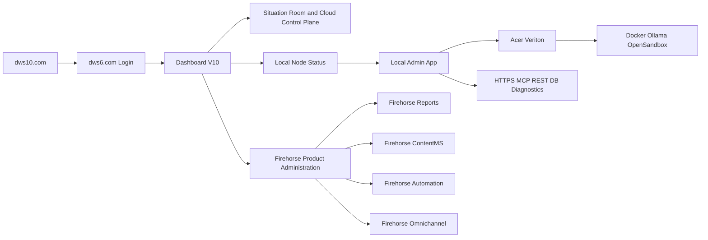

# Admin Storyboard - DWS IQ 6 Veriton Operations

***
# VERSION AND AGENT HISTORY

Version: 1.1

Sessions & Modifications:
  - Version: 1.1 | Tool: GPT-5.4 | Session: 2026-03-11 | Date: 11.03.2026 | Changes: Expanded storyboard to cover the logical admin path across DWS IQ 6 and Firehorse products, including Dashboard V10 oversight, Firehorse product administration, and Veriton local operations
  - Version: 1.0 | Tool: GPT-5.4 | Session: 2026-03-11 | Date: 11.03.2026 | Changes: Initial admin storyboard for public entry, dws6.com login, Dashboard V10 oversight, local admin app, Veriton services, and diagnostics paths

Session Links & References:
  - Related admin docs: `Admin/ADMIN_MANUAL.md`, `Admin/Acer-Veriton-GN100/VERITON_EDGE_STACK_RUNBOOK.md`

Document Status:
  - Created: 11.03.2026
  - Last Modified: 11.03.2026
  - Language: English
  - Languages Available: English
  - Publication Status: ACTIVE

***

## 1. Purpose

This storyboard shows the intended administrator workflow for managing both DWS IQ 6 and Firehorse products in a Veriton-backed client deployment.

---

## 2. Admin Control Journey

---

## 3. Story Beats

### Beat 1: Access and authenticate

- admin signs in via `dws6.com`
- admin lands in Dashboard V10 with appropriate org and system visibility

### Beat 2: Observe platform state

- admin reviews dashboard state
- admin checks situation outputs, Firehorse product state, alerts, and local-node health

### Beat 3: Choose the right admin surface

- use **Dashboard V10** for cloud-side oversight and tenant-level visibility
- use **Situation Room** for high-level reporting and investigation
- use **Firehorse Reports** for report-engine and template operations
- use **Firehorse ContentMS** for content, asset, and template governance
- use **Firehorse Automation** for workflow configuration and operational automations
- use **Firehorse Omnichannel** for campaign and communication administration
- use the **local admin app** only when Veriton-local services need intervention

### Beat 4: Move into local administration

- if local intervention is needed, admin opens the local admin app
- local admin app becomes the restricted surface for Veriton operations

### Beat 5: Operate the Veriton stack

- inspect Docker runtime
- inspect Ollama endpoint mode
- inspect OpenSandbox availability
- run connectivity diagnostics
- recover or restart services if required

### Beat 6: Confirm service restoration

- verify local service health
- verify dashboard visibility is restored
- verify Firehorse product surfaces continue to work through the normal browser flow
- return normal users to Dashboard V10 and Control Room flow

---

## 4. Product Logic by Admin Goal

| Admin goal | Primary surface |
|------------|-----------------|
| Tenant, org, and platform oversight | Dashboard V10 |
| Executive reporting and operational visibility | Situation Room |
| Report engine and output governance | Firehorse Reports |
| Asset, template, and content governance | Firehorse ContentMS |
| Automation and scheduler operations | Firehorse Automation |
| Outreach and campaign administration | Firehorse Omnichannel |
| Local runtime maintenance | Local admin app |

---

## 5. Admin Principles

- Dashboard V10 is the oversight plane
- Firehorse products are administered as task-specific product planes behind the same authenticated environment
- Local admin app is the maintenance plane
- Direct DB access is break-glass only
- HTTPS, MCP, and REST are the default supported paths
- Operator and admin permissions remain clearly separated

---

## 6. Related Documents

- `Admin/ADMIN_MANUAL.md`
- `Admin/Acer-Veriton-GN100/CLIENT_VERITON_OFFERS_EN_v1.md`
- `Admin/Acer-Veriton-GN100/VERITON_EDGE_STACK_RUNBOOK.md`
- `Admin/Firehorse_Omnichannel_Next_Admin_Manual.md`
- `Situation/user-storyboard.md`

