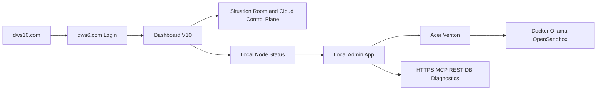

# Admin Storyboard - DWS IQ 6 Veriton Operations

***
# VERSION AND AGENT HISTORY

Version: 1.0

Sessions & Modifications:
  - Version: 1.0 | Tool: GPT-5.4 | Session: 2026-03-11 | Date: 11.03.2026 | Changes: Initial admin storyboard for public entry, dws6.com login, Dashboard V10 oversight, local admin app, Veriton services, and diagnostics paths

Session Links & References:
  - Related admin docs: `Admin/ADMIN_MANUAL.md`, `Admin/Acer-Veriton-GN100/VERITON_EDGE_STACK_RUNBOOK.md`

Document Status:
  - Created: 11.03.2026
  - Last Modified: 11.03.2026
  - Language: English
  - Languages Available: English
  - Publication Status: ACTIVE

***

## 1. Purpose

This storyboard shows the intended administrator workflow for managing the DWS IQ 6 Veriton-backed client deployment.

---

## 2. Admin Control Journey

---

## 3. Story Beats

### Beat 1: Access and authenticate

- admin signs in via `dws6.com`
- admin lands in Dashboard V10 with appropriate org and system visibility

### Beat 2: Observe system state

- admin reviews dashboard state
- admin checks situation outputs, alerts, and local-node health

### Beat 3: Move into local administration

- if local intervention is needed, admin opens the local admin app
- local admin app becomes the restricted surface for Veriton operations

### Beat 4: Operate the Veriton stack

- inspect Docker runtime
- inspect Ollama endpoint mode
- inspect OpenSandbox availability
- run connectivity diagnostics
- recover or restart services if required

### Beat 5: Confirm service restoration

- verify local service health
- verify dashboard visibility is restored
- return normal users to Dashboard V10 and Control Room flow

---

## 4. Admin Principles

- Dashboard V10 is the oversight plane
- Local admin app is the maintenance plane
- Direct DB access is break-glass only
- HTTPS, MCP, and REST are the default supported paths
- Operator and admin permissions remain clearly separated

---

## 5. Related Documents

- `Admin/ADMIN_MANUAL.md`
- `Admin/CLIENT_VERITON_OFFERS_EN_v1.md`
- `Admin/Acer-Veriton-GN100/VERITON_EDGE_STACK_RUNBOOK.md`
- `Situation/user-storyboard.md`

