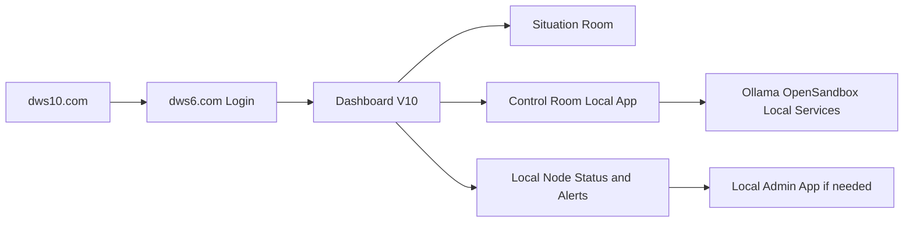

# User Storyboard - DWS IQ 6 Veriton Journey

***
# VERSION AND AGENT HISTORY

Version: 1.0

Sessions & Modifications:
  - Version: 1.0 | Tool: GPT-5.4 | Session: 2026-03-11 | Date: 11.03.2026 | Changes: Initial user storyboard for dws10.com entry, dws6.com login, Dashboard V10, Situation Room, Control Room local app, and local admin escalation

Session Links & References:
  - Related user manual: `Situation/DWS_IQ6_USER_MANUAL.md`

Document Status:
  - Created: 11.03.2026
  - Last Modified: 11.03.2026
  - Language: English
  - Languages Available: English
  - Publication Status: ACTIVE

***

## 1. Purpose

This storyboard shows the intended end-user journey for the modern DWS IQ 6 client setup with public web entry, authenticated dashboard, and Acer Veriton-backed local applications.

---

## 2. Primary Journey

---

## 3. Story Beats

### Beat 1: Discover and enter

- user starts at `dws10.com`
- sees the product, packaging, and call to action
- proceeds to authenticated environment

### Beat 2: Authenticate

- user logs in through `dws6.com`
- organization and role determine the dashboard view

### Beat 3: Use Dashboard V10

- user lands in the main browser workspace
- sees projects, reports, workflow state, and local node status

### Beat 4: Choose work mode

- user opens Situation Room for analysis and reporting
- or launches Control Room for local execution work

### Beat 5: Escalate only if needed

- if local services are degraded, user sees status or alerting
- admin or support opens the local admin app for recovery

---

## 4. UX Principles

- Browser-first for normal work
- Local app only when local resources matter
- Admin surface separated from operator surface
- Clear distinction between Situation Room and Control Room
- Secure login always starts in `dws6.com`

---

## 5. Related Documents

- `Situation/DWS_IQ6_USER_MANUAL.md`
- `Admin/CLIENT_VERITON_OFFERS_EN_v1.md`
- `Situation/admin-storyboard.md`

