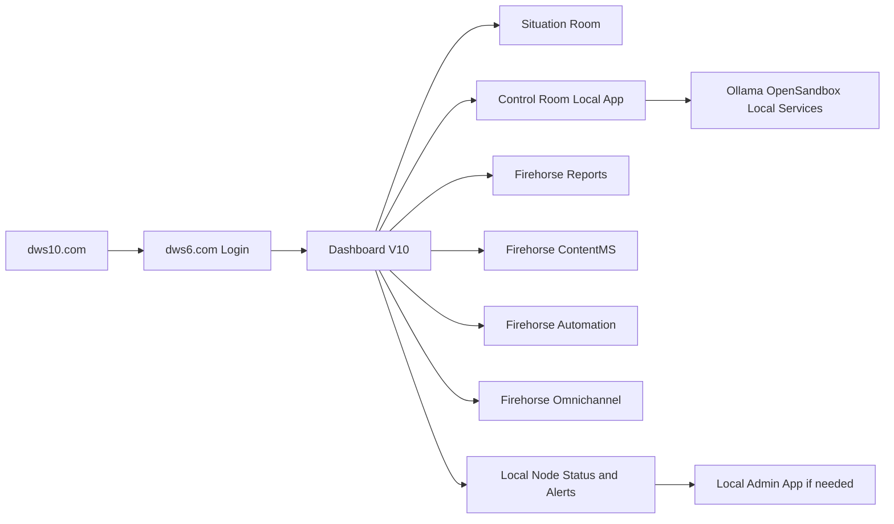

# User Storyboard - DWS IQ 6 Veriton Journey

***
# VERSION AND AGENT HISTORY

Version: 1.1

Sessions & Modifications:
  - Version: 1.1 | Tool: GPT-5.4 | Session: 2026-03-11 | Date: 11.03.2026 | Changes: Expanded storyboard to cover the logical user path across DWS IQ 6 and Firehorse products, including Dashboard V10, Situation Room, Control Room, Reports, ContentMS, Automation, and Omnichannel
  - Version: 1.0 | Tool: GPT-5.4 | Session: 2026-03-11 | Date: 11.03.2026 | Changes: Initial user storyboard for dws10.com entry, dws6.com login, Dashboard V10, Situation Room, Control Room local app, and local admin escalation

Session Links & References:
  - Related user manual: `Situation/DWS_IQ6_USER_MANUAL.md`

Document Status:
  - Created: 11.03.2026
  - Last Modified: 11.03.2026
  - Language: English
  - Languages Available: English
  - Publication Status: ACTIVE

***

## 1. Purpose

This storyboard shows the intended end-user journey across the DWS IQ 6 platform and Firehorse products, starting from public entry, moving through secure login, and then into the correct product surface for the user's task.

---

## 2. Primary Journey

---

## 3. Story Beats

### Beat 1: Discover and enter

- user starts at `dws10.com`
- sees the product, packaging, and call to action
- proceeds to authenticated environment

### Beat 2: Authenticate

- user logs in through `dws6.com`
- organization and role determine the dashboard view

### Beat 3: Land in Dashboard V10

- user lands in the main browser workspace
- sees projects, reports, workflow state, Firehorse product entry points, and local node status

### Beat 4: Choose the right product path

- user opens **Situation Room** for executive analysis, summaries, and decision support
- user opens **Control Room** for local execution work and edge-backed operational actions
- user opens **Firehorse Reports** to generate or review formal reports
- user opens **Firehorse ContentMS** to manage content, templates, and reusable assets
- user opens **Firehorse Automation** to run workflow-based outbound or internal automations
- user opens **Firehorse Omnichannel** for sales, outreach, campaign, and communication flows

### Beat 5: Escalate only if needed

- if local services are degraded, user sees status or alerting
- admin or support opens the local admin app for recovery

---

## 4. Product Logic by User Goal

| User goal | Primary product surface |
|-----------|-------------------------|
| See project and organization state | Dashboard V10 |
| Review strategic status or risks | Situation Room |
| Use local edge execution or local AI resources | Control Room |
| Produce formal deliverables and compliance outputs | Firehorse Reports |
| Manage reusable assets and templates | Firehorse ContentMS |
| Trigger automations and scheduled flows | Firehorse Automation |
| Run outreach, communication, or campaign work | Firehorse Omnichannel |

---

## 5. UX Principles

- Browser-first for normal work
- Local app only when local resources matter
- Admin surface separated from operator surface
- Clear distinction between Situation Room and Control Room
- Firehorse products are accessed as task-specific product surfaces after `dws6.com` login
- Secure login always starts in `dws6.com`

---

## 6. Related Documents

- `Situation/DWS_IQ6_USER_MANUAL.md`
- `Admin/Acer-Veriton-GN100/CLIENT_VERITON_OFFERS_EN_v1.md`
- `Admin/Firehorse_Omnichannel_Next_Admin_Manual.md`
- `Situation/admin-storyboard.md`

