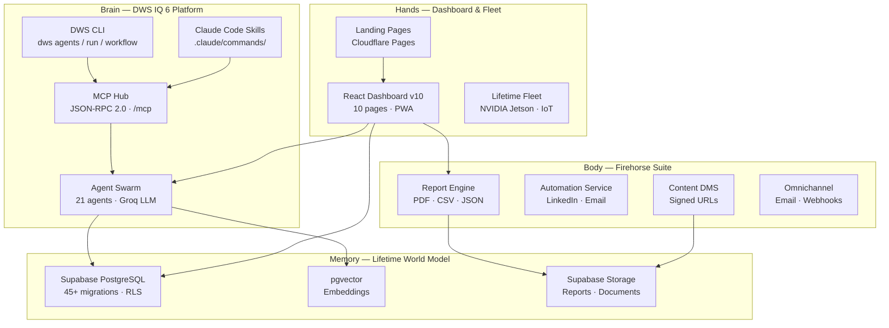
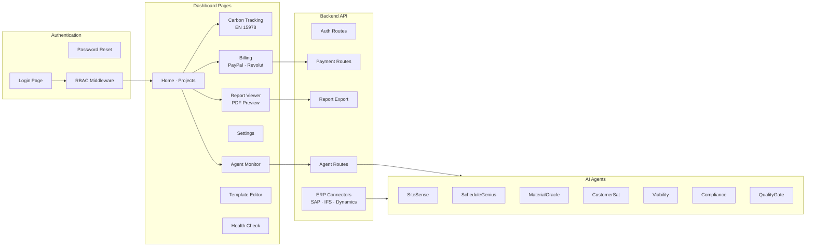
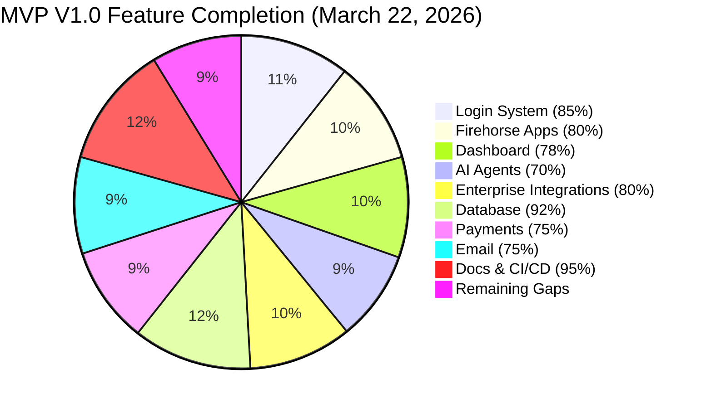
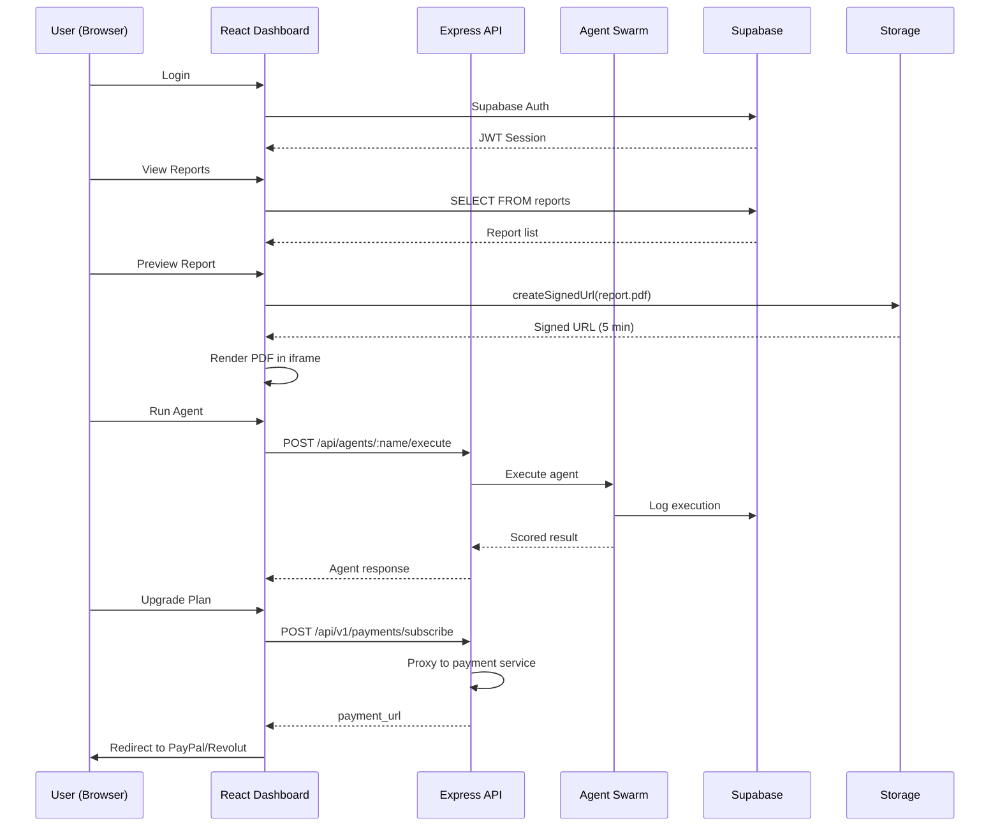
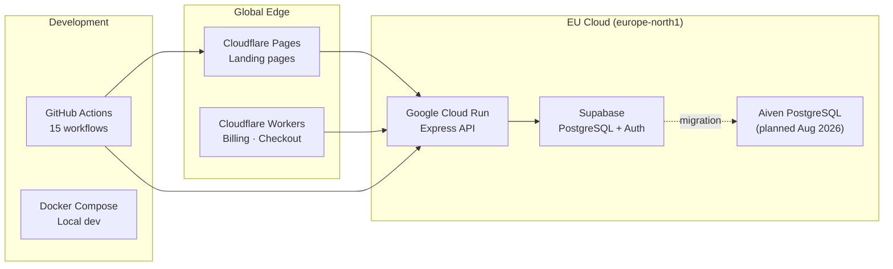

# DWS IQ 6 — MVP Architecture Diagram

VERSION AND AGENT HISTORY
- Version: 1.0
- Date: 2026-03-22
- Author: Claude Code
- Introduced-In: PR (pending)

## System Architecture (Brain-Memory-Body-Hands)

## MVP Feature Flow

## MVP Completion Status

## Data Flow

## Deployment Architecture

