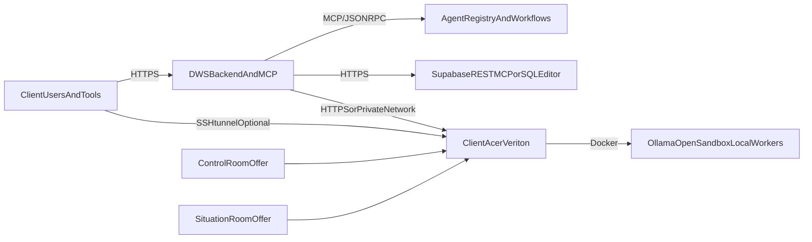

# Client Veriton Deployment Plan

## Recommended Topology

Use two productized client deployments built on the same Veriton edge pattern:

This follows the existing repo split:

- MCP/agent orchestration and API control plane in the DWS backend and MCP Hub, as described in [CLAUDE.md](CLAUDE.md), [AGENTS.md](AGENTS.md), and [docs/CLOUD_ENVIRONMENTS.md](docs/CLOUD_ENVIRONMENTS.md)
- Client-hosted inference on hardware like GN100 / DGX as an edge service, not as a replacement for the control plane, per [Admin/Acer-Veriton-GN100/README.md](Admin/Acer-Veriton-GN100/README.md)
- MCP or HTTPS for remote operations instead of raw TCP dependencies where possible, per [Admin/ADMIN_MANUAL_SUPABASE_EN_v1.md](Admin/ADMIN_MANUAL_SUPABASE_EN_v1.md)

## Product Framing

### 1. Control Room Acer Veriton

Position this as the client’s local operational AI room:

- Veriton-hosted local inference
- Dockerized local services
- MCP-exposed operational tools
- secure admin/operator access through HTTPS, MCP, or SSH tunnel

### 2. Situation Room Acer Veriton-backed

Position this as the decision and reporting layer backed by the same edge infrastructure:

- DWS backend + agent workflows as orchestration/control plane
- Veriton-hosted services as local execution/inference plane
- MCP-backed workflows for investigation, analysis, and reporting

These should be sold and implemented as two named delivery packages, not as a generic “edge option”.

## What To Standardize For These Offers

### 1. Control plane

Keep DWS backend + `/mcp` + MCP Hub as the product contract.

Use existing patterns from:

- [src/app.ts](f:/2026/Repos2026/dws6/src/app.ts)
- [src/mcp/agent-server.ts](f:/2026/Repos2026/dws6/src/mcp/agent-server.ts)
- [mcp-hub/server.py](f:/2026/Repos2026/dws6/mcp-hub/server.py)

Client implementations should interact through:

- HTTPS API
- MCP tools
- CLI with structured JSON output

Avoid making direct database connections the primary integration path for clients.

### 2. Data plane

Use Supabase via REST/MCP/SQL Editor operationally, not raw `DATABASE_URL` from end-user tools unless explicitly required.

Reason:

- repo evidence shows MCP/HTTPS works more reliably under VPN than direct `5432`
- this is already documented in [Admin/ADMIN_MANUAL_SUPABASE_EN_v1.md](f:/2026/Repos2026/dws6/Admin/ADMIN_MANUAL_SUPABASE_EN_v1.md)

For client rollouts:

- default to MCP or app-layer operations
- reserve direct Postgres for admin-only migration or break-glass workflows
- ship `db:test`-style diagnostics for admins, not for normal users

### 3. Inference plane

Treat local LLMs as swappable inference backends.

Primary client-ready option:

- Ollama on edge host, bound safely

Recommended modes:

- safest: `127.0.0.1:11434` + SSH tunnel for admins/IDEs
- trusted private network: `0.0.0.0:11434` with firewall restriction

Documented precedent already exists in:

- [Admin/Acer-Veriton-GN100/README.md](f:/2026/Repos2026/dws6/Admin/Acer-Veriton-GN100/README.md)

For advanced/OpenAI-compatible clients:

- support vLLM only as a containerized option on supported client hardware
- do not make venv-based vLLM the default client deployment path

## Delivery Pattern

### Base Veriton Stack

Each client deployment should standardize on:

- Acer Veriton edge host
- Docker as the local runtime
- Ollama as the default local inference service
- OpenSandbox as the controlled execution/sandbox layer where needed
- MCP/HTTPS as the integration path back to DWS

### Offer Layering

- `Control Room` = operator-facing local control and execution layer on Veriton
- `Situation Room` = orchestration, reporting, and decision-support layer, Veriton-backed but controlled by DWS backend + agent workflows

This keeps the same infrastructure underneath both offers while allowing different client packaging and pricing.

## Client Implementation Rules

### Networking

- Prefer HTTPS/MCP over raw DB sockets
- Assume VPN and DoH can break hostname-based DB bypasses
- For edge inference, document both direct host access and SSH tunnel mode
- Expose Ollama only on trusted networks; otherwise tunnel it

### Security

- keep `service_role` and all secrets server-side only
- explicit CORS allowlists only
- RBAC + JWT on all agent/API routes
- audit logging and Article 12 style reasoning lineage where client requires it
- no community-installed MCP tools in client deployments

### Productization

Every client deployment should still satisfy the repo’s “Build for Agents” rule from [CLAUDE.md](f:/2026/Repos2026/dws6/CLAUDE.md):

- CLI exists
- JSON output exists
- MCP endpoint exists
- docs exist
- skills or equivalent operator affordances exist

## What To Build Next For Client Readiness

- A formal `Control Room` and `Situation Room` product implementation doc, anchored to Acer Veriton
- A single `Veriton Edge Stack Runbook` covering Docker services, Ollama, OpenSandbox, firewall, SSH tunnel, and health checks
- A capability mapping from each offer to existing DWS agents, MCP tools, and workflows
- A `Client Connectivity Diagnostics` script set that checks MCP, HTTPS API, Supabase REST, and optional direct DB separately
- A config template for Veriton-hosted inference endpoints so Cursor/Continue/Cline are documented consistently
- A container-first local inference option for supported hardware, with Ollama as default and vLLM as advanced mode only

## Suggested File Targets For Future Implementation

- [Admin/SECURITY_COMPLIANCE.md](f:/2026/Repos2026/dws6/Admin/SECURITY_COMPLIANCE.md)
- [docs/CLOUD_ENVIRONMENTS.md](f:/2026/Repos2026/dws6/docs/CLOUD_ENVIRONMENTS.md)
- [Admin/Acer-Veriton-GN100/README.md](f:/2026/Repos2026/dws6/Admin/Acer-Veriton-GN100/README.md)
- [Admin/ADMIN_MANUAL_SUPABASE_EN_v1.md](f:/2026/Repos2026/dws6/Admin/ADMIN_MANUAL_SUPABASE_EN_v1.md)
- [docs/MCP_CONFIGURATION.md](f:/2026/Repos2026/dws6/docs/MCP_CONFIGURATION.md)
- [Admin/ADMIN_MANUAL.md](f:/2026/Repos2026/dws6/Admin/ADMIN_MANUAL.md)

## Assumptions

- The primary client offer is Veriton-backed, not cloud-only
- `Control Room` and `Situation Room` are the names of the delivery packages
- MCP/HTTPS reliability is more important than maximizing direct raw-database access

