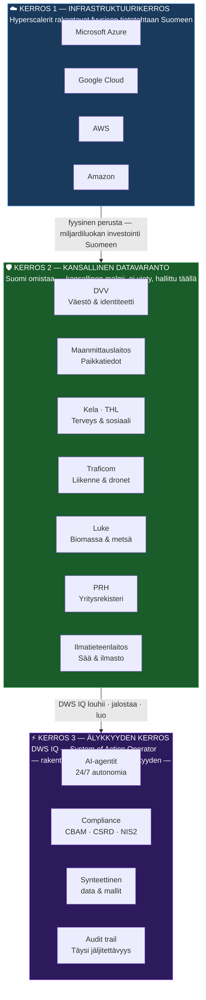
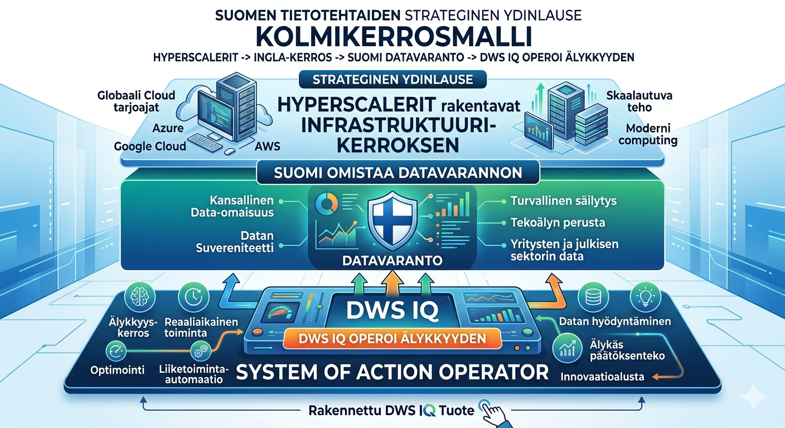

# Tietotehdas vs. Datakeskus — Suomen uusi kansallisvarallisuus

# Data Factory vs. Data Centre — Finland's New National Wealth

---

# VERSION AND AGENT HISTORY

Version: 1.3

Sessions & Modifications:

- Version: 1.0 | Tool: Claude Code (Sonnet 4.6) | Session: claude/data-centre-factory-docs-eav19 | Date: 10.05.2026 | Changes: Initial — conceptual framework for distinguishing passive data storage (datakeskus) from active data creation and mining (tietotehdas) as national wealth
- Version: 1.1 | Tool: Claude Code (Sonnet 4.6) | Session: claude/data-centre-factory-docs-eav19 | Date: 10.05.2026 | Changes: Added section 6 — Google Cloud "System of Action" / Agentic Data Cloud framework mapped to tietotehdas model; action implications for DWS IQ
- Version: 1.2 | Tool: Claude Code (Sonnet 4.6) | Session: claude/data-centre-factory-docs-eav19 | Date: 10.05.2026 | Changes: Added section 6.6 — Gemini Enterprise Agent Platform as tietotehdas tuotekerros; fleet governance, Memory Bank, Agent Identity mapped to DWS IQ architecture; build-vs-buy analysis
- Version: 1.3 | Tool: Claude Code (Sonnet 4.6) | Session: claude/data-centre-factory-docs-eav19 | Date: 10.05.2026 | Changes: Added section 2a — Kansallinen strategia / kolmikerrosmalli; DWS as intelligence layer on hyperscaler-built physical infrastructure over Finnish national data reserves

Session Links & References:

- Claude Code (claude/data-centre-factory-docs-eav19): https://github.com/blogtheristo/dws6/commits/claude/data-centre-factory-docs-eav19
- Google Cloud article (Andi Gutmans, 22.04.2026): https://cloud.google.com/transform/shift-system-of-action-architecting-the-agentic-data-cloud-ai
- Google Cloud article (Gerstenhaber & Bachman, 22.04.2026): https://cloud.google.com/blog/products/ai-machine-learning/introducing-gemini-enterprise-agent-platform
- Related: docs/field-notes/2026-04-18-eu-green-hydrogen-additionality-finland-datacentres.md
- Related: docs/field-notes/2026-04-06-synthetic-data-pipeline-cbam.md
- Related: docs/field-notes/2026-04-20-siemens-synthetic-data-partnership-wedge.md

Document Status:

- Created: 10.05.2026
- Last Modified: 10.05.2026 (v1.2)
- Language: Finnish + English
- Publication Status: INTERNAL — conceptual framework note

---

## 1. Peruskäsite / Core Concept

**Datakeskus tallettaa. Tietotehdas luo.**

| Käsite                         | Rooli                                | Arvo                          | Analogia    |
| ------------------------------ | ------------------------------------ | ----------------------------- | ----------- |
| **Datakeskus** (Data Centre)   | Passiiviinen varastointi             | Vuokratuotto kiinteistönä     | Pankkiholvi |
| **Tietotehdas** (Data Factory) | Aktiivinen tiedon luonti ja jalostus | Kansallinen tuotantokyvykkyys | Kultakaivos |

A **data centre** is real estate — it stores bits. Its value accrues to the landlord and the hyperscaler, not to Finland.

A **data factory** is productive infrastructure — it _mines_, _refines_, and _generates_ new information from existing data reserves. Its value compounds locally.

---

## 2. Miksi ero on strategisesti kriittinen / Why the Distinction is Strategically Critical

Finland has attracted significant hyperscaler investment (Microsoft, Google, AWS) in data centre capacity, primarily because of:

- Cheap, cold-climate cooling (natural free cooling months)
- Stable green electricity grid (Nordpool FI low spot prices)
- Political stability and NATO membership (2023)
- Fiber connectivity to rest of Europe

This is **datakeskuskapasiteetti** — storage real estate. Finland earns:

- Construction employment (one-time)
- Property taxes
- Electricity revenue
- A small number of permanent operations jobs

What Finland does **not** automatically earn is the _output_ of the data processed inside those centres. That value flows to the hyperscaler, its customers, and their jurisdictions.

---

## 2a. Kansallinen strategia — Kolmikerrosmalli / National Strategy — Three-Layer Model

**Strateginen ydinlause — perustajan lausunto (Risto Anton Paarni / Lifetime Oy, 10.05.2026):**

> Tämä on Suomen tietotehtaiden strateginen ydinlause — kolmikerrosmalli jossa hyperscalerit rakentavat infrastruktuuri-kerroksen, Suomi omistaa datavarannon, ja rakentamani tuote DWS IQ operoi älykkyyden (System Of Action Operator).

_"Rakentamani tuote"_ on tietoinen perustajan klaimi — ei yrityskopio. Tämä lause on founder statement, joka yhdistää henkilökohtaisen omistautumisen ja kansallisen strategiset merkityksen.

---

**Kanoninen positiointikieli johdettuna ydinlauseesta:**

**Investoriversio (lyhyt):**

> Hyperscalerit rakentavat infrastruktuurin, Suomi omistaa datavarannon, ja DWS operoi älykkyyden.

**Homepage-versio:**

> DWS on älykkyyden operointikerros, jossa infrastruktuuri voi olla globaali, datavaranto pysyy Suomessa, ja päätösvalta säilyy täällä.

**Laaja kontekstilause (pitch / policy):**

> DWS noudattaa kansallista strategiaa: kansainväliset toimijat rakentavat fyysiset tietotehtaat Suomeen, jotta datavarannot voidaan louhia täällä, pitää ohjaus Suomessa ja ottaa hyötykäyttöön DWS:n kaltaisilla järjestelmillä.

Tämä ei ole opportunistinen positiointi — se on tietoinen linjaus kansalliseen infrastruktuuristrategiaan. Kolmikerrosmalli:

_Kolmikerrosmalli — Suomen tietotehtaiden strateginen ydinlause (Risto Anton Paarni / Lifetime Oy, 10.05.2026)_

**Strateginen logiikka:**

Hyperscalerit investoivat Suomeen sen fyysisten etujen vuoksi (halvat elektroniset, kylmä ilmasto, poliittinen vakaus, NATO, valokuitu). He rakentavat **infrastruktuurikerroksen** — mutta eivät automaattisesti ota datavarannon hallintaa eikä tuota älykkyyden kerrosta.

**Tässä on Suomen ikkuna:** Kansainväliset toimijat tarvitsevat paikallisen kumppanin, joka:

- tuntee suomalaiset rekisterit ja niiden semantiikan
- noudattaa GDPR:ää ja suomalaista tiedonhallintalakia natiivisti
- pitää ohjauksen ja tuloksen Suomessa — ei ulkopuolisella lainkäyttöalueella
- on jo rakentanut System of Action -arkkitehtuurin (DWS IQ)

**DWS:n rooli kolmikerroksessa:**

| Kerros                   | Toimija                              | DWS:n suhde                                   |
| ------------------------ | ------------------------------------ | --------------------------------------------- |
| Fyysinen infrastruktuuri | Microsoft, Google, AWS               | Asiakas / partneri — käyttää infrastruktuuria |
| Datavarantokerros        | Suomen valtio, rekisteriviranomaiset | Lisenssinsaaja / API-kumppani                 |
| Älykkyyden kerros        | DWS IQ                               | **Omistaja ja operaattori**                   |

**Investorinarratiivi tästä:**

Hyperscalerit investoivat miljardit Suomeen. He rakentavat kultakaivoksen maahan. DWS on se järjestelmä, joka osaa kaivaa. Ilman DWS:ää (tai vastaavaa) infrastruktuuri on tyhjillään seisova rakennus. DWS tekee siitä tuottavan.

---

## 3. Tietotehdas — Kultakaivos-malli / Data Factory — The Gold Mine Model

Suomalainen kultakaivos-analogia:

> Kaivos ei vain säilö kultaa — se **louhii** ja **jalostaa** sitä. Tulos on uutta varallisuutta, joka jää alueelle.

A **tietotehdas** does the same with data:

1. **Louhinta (Mining)** — extracts signal from raw data reserves (public registers, industrial telemetry, scientific datasets)
2. **Jalostus (Refining)** — structures, labels, validates, and enriches raw data into usable information assets
3. **Luonti (Creation)** — generates net-new synthetic data, models, and knowledge artifacts that did not exist before

The output — structured datasets, trained models, knowledge graphs, compliance signals — is **exportable intellectual property** that accrues to Finnish entities.

---

## 4. Suomen tietovarannot / Finland's Data Reserves

Finland holds unusually rich, high-quality data reserves by EU standards:

| Varanto                               | Sisältö                            | Potentiaali                             |
| ------------------------------------- | ---------------------------------- | --------------------------------------- |
| **DVV (Digi- ja väestötietovirasto)** | Population register, identity      | eIDAS-compliant identity base           |
| **Maanmittauslaitos**                 | Land registry, geospatial          | 3D urban modelling, property AI         |
| **Kela / THL**                        | Health and social data             | Clinical AI, preventive care models     |
| **Traficom**                          | Traffic, transport, drone registry | Mobility AI, LWM use cases              |
| **Luke (Luonnonvarakeskus)**          | Forestry, agriculture, fisheries   | Biomass modelling, carbon accounting    |
| **Ilmatieteenlaitos**                 | Weather, climate time series       | Energy forecasting, site suitability    |
| **Patentti- ja rekisterihallitus**    | Company registry, trade marks      | B2B intelligence, CBAM supplier mapping |

These are **kansalliset tietovarannot** — national data reserves. They are the ore. A tietotehdas is the equipment to mine them.

---

## 5. DWS IQ -kytkös / DWS IQ Connection

DWS IQ 6/7 is architecturally a **tietotehdas**:

- Ingests raw regulatory, procurement, and industrial data (louhinta)
- Structures it into CBAM filings, compliance assessments, site safety scores (jalostus)
- Generates synthetic training sets, knowledge artifacts, agent outputs (luonti)

The **SyntheticDataAgent** (Agent 19), **Material Oracle**, **Regulatory Radar**, and **SiteSense** agents are tietotehdas components — each transforms raw data into exportable value.

This positions DWS not as a software vendor but as a **data refinery operator** — closer to Neste's role in bio-refining than to a traditional SaaS company.

---

## 6. Google Cloudin validointi — "System of Action" / External Validation

**Andi Gutmans, VP/GM Data Cloud, Google Cloud, 22.04.2026:**

> _"Traditional data platforms were designed as Systems of Intelligence — reactive, reporting-focused. The agentic era requires a fundamental shift to a System of Action — proactive, autonomous execution."_

Google on itsenäisesti päätynyt täsmälleen samaan jakolinjaan kuin tietotehdas-malli. Artikkeli on strategisesti merkittävä, koska se tulee maailman suurimmalta data-infrastruktuuritoimittajalta — ei akateemisesta kirjallisuudesta.

### 6.1 Kehysvastaavuus / Framework Mapping

| Google Cloud -käsite       | Tietotehdas-vastine           | Merkitys                                                             |
| -------------------------- | ----------------------------- | -------------------------------------------------------------------- |
| **System of Intelligence** | Datakeskus                    | Passiivinen varastointi, reaktiivinen raportointi                    |
| **System of Action**       | Tietotehdas                   | Proaktiivinen toiminta, autonominen suoritus                         |
| **Dark Data**              | Aktivoimattomat tietovarannot | 90 % datasta on piilotettu — sopimuksissa, kuvissa, sähköpostissa    |
| **Knowledge Flywheel**     | Jalostusprosessi              | Jatkuva merkityksien rikastaminen — raakadata → konteksti → toiminta |
| **Agentic Data Cloud**     | Tietotehtaan infrastruktuuri  | Tekninen alusta, jolla tietotehdas operoi                            |
| **Walled Garden**          | Siiloutuminen                 | Datavarantojen siiloutuminen estää arvon synnyn                      |
| **Trust Gap**              | Luottamuspuute                | Agentit tarvitsevat liiketoimintakontekstin, ei pelkkää raakadataa   |

### 6.2 Neljä rakenteellista virhettä — Suomen kontekstissa

Google tunnistaa neljä syytä, miksi pelkkä datakeskus ei riitä:

**1. Walled Garden — Siiloutuminen**
Suomalaiset julkiset rekisterit ovat siiloja: DVV, Maanmittauslaitos, Kela, Traficom eivät puhu keskenään. Tietotehdas tarvitsee **zero-copy federation** -tyyppisen yhdistämiskerroksen.

**2. Trust Gap — Luottamuspuute**
Agentit, jotka saavat pelkästään raakadataa, "hallusinoivat ja tuottavat virheellisiä tuloksia" (Gutmans). Suomen julkiset rekisterit ovat teknisesti tarkkoja mutta semanttisesti niukkoja — niiltä puuttuu liiketoimintakonteksti. Tietotehdas rakentaa **Knowledge Catalog** -kerroksen, joka lisää merkityksen raakadatan päälle.

**3. Time Factor — Aikajänne**
Agentit tarvitsevat reaaliaikaisen pääsyn sekä historialliseen analytiikkadataan että operatiivisiin järjestelmiin yhtäaikaisesti. Suomen julkisten rekisterien nykyinen API-kypsyys on epätasainen — osa on reaaliaikaisia, osa päivittäisiä tai viikoittaisia eräajoja.

**4. Cost Spiral — Kustannuskierre**
Hajaantunut, ei-AI-optimoitu stack aiheuttaa kustannusten räjähtämisen agenttivolyymeissa. Tietotehtaan on rakennettava **pystyintegroitu** infrastruktuuri — ei kokoelma erillisiä palveluita.

### 6.3 MCP — Yhteinen standardi

Google nimeää **Model Context Protocol (MCP):n** universaaliksi agenttistandardiksi:

> _"Open Model Context Protocol (MCP) — universal toolbox for agents"_

DWS IQ käyttää jo MCP:tä (`mcp-hub/`, `mcp-servers/`). Tämä on ulkoinen vahvistus siitä, että DWS:n arkkitehtuurivalinnat ovat oikeassa suunnassa. Google, Anthropic ja DWS ovat kaikki rakentaneet MCP:n varaan.

### 6.4 Tuotantomittarit — Markkinan koko

Google raportoi:

- **>1 miljardia kyselyä** käännetty AI-avusteisella datamigtraatiolla (2x YoY)
- **BigQuery + Gemini:** 30x kasvu YoY datan käsittelyssä
- **MCP Server + BigQuery:** 20x kasvu viimeisen 6 kuukauden aikana

Nämä luvut kertovat, että siirtymä System of Action -malliin on jo käynnissä teollisuuden mittakaavassa — ei tulevaisuuden spekulaationa.

### 6.5 Action — Mitä tämä tarkoittaa DWS:lle

| Toimenpide                                | Prioriteetti | Kuvaus                                                                                            |
| ----------------------------------------- | ------------ | ------------------------------------------------------------------------------------------------- |
| **MCP-katalogi julkisille rekistereille** | Korkea       | Rakenna MCP-serverit DVV-, Traficom- ja PRH-rajapinnoille — tietotehdas-pääsy ilman siiloutumista |
| **Knowledge Catalog -prototyyppi**        | Korkea       | Lisää semanttinen kerros DWS IQ:n agenttimuistiin — raakadata → kontekstualisoitu tieto           |
| **Google Cloud -kumppanuusarviointi**     | Keski        | Agentic Data Cloud tarjoaa valmiin infrastruktuurin; arvioi BigQuery + Gemini vs. oma stack       |
| **"Dark Data" -inventaario**              | Keski        | Kartoita, mitkä suomalaiset tietovarannot ovat aktivoimattomia ja GDPR-compliant hyödynnettävissä |
| **System of Action -positioning**         | Korkea       | DWS IQ:n myyntinarratiivi: "emme ole SaaS-toimittaja, olemme System of Action -operaattori"       |

### 6.6 Gemini Enterprise Agent Platform — Tietotehtaan tuotekerros

Samana päivänä (22.04.2026) Google julkaisi **Gemini Enterprise Agent Platformin** — kaiken Vertex AI:n korvanneen agenttihallinnan alustan. Jos System of Action -artikkeli oli strategia, tämä on sen tuoteimplementaatio.

> _"Agents that act with the same independence and reliability as a member of your team."_
> — Gerstenhaber & Bachman, Google Cloud, 22.04.2026

**Neljä pilaria — Build / Scale / Govern / Optimize:**

| Pilari       | Keskeinen työkalu                                                                        | Tietotehdas-vastine                                  |
| ------------ | ---------------------------------------------------------------------------------------- | ---------------------------------------------------- |
| **Build**    | Agent Studio (low-code), ADK (code-first), Agent Garden (templates)                      | Tietotehtaan agenttikomponenttien kehittäminen       |
| **Scale**    | Agent Runtime (sub-second cold start), Memory Bank (pitkäkestoinen konteksti)            | Tietotehtaan 24/7 -operaatio agenttivolyymeissa      |
| **Govern**   | Agent Identity (kryptograafiset IDs), Agent Gateway ("air traffic control"), Model Armor | Julkisten tietovarantojen käyttövaltuuksien hallinta |
| **Optimize** | Agent Simulation, Agent Evaluation, Agent Observability, Agent Optimizer                 | Tietotehtaan laadunvarmistus ja suorituskyky         |

**Miksi Govern-pilari on ratkaisevin tietotehtaalle:**

Suomalaisten julkisten rekisterien käyttö edellyttää täsmällistä valtuutushallintaa. Googlen **Agent Identity** — kryptograafiset tunnisteet ja auditoitavat valtuutuspolitiikat — tarjoaa teknisen pohjan, jota esimerkiksi DVV:n tai Kelan datan agenttikäyttö vaatii.

- **Agent Gateway:** Yksi sisääntulopiste kaikille agenteille → jäljitettävyys jokaisesta datakosketuksesta
- **Model Armor:** Suojaus prompt injectionia vastaan — kriittinen, kun agentit käsittelevät julkista henkilödataa
- **Agent Anomaly Detection:** Tilastolliset mallit + LLM-as-a-judge poikkeavan käytöksen tunnistamiseen

**Mittakaava:**

- **6 biljoonaa tokenia kuukaudessa** käsitelty ADK:n kautta
- Sub-sekunnin käynnistysaika uusille agenteille
- Tuki **monipäiväisille autonomisille työnkuluille**

**Mallikirjasto — DWS:n kannalta olennainen yksityiskohta:**

Google Agent Platform tukee **Anthropic Claude Opus, Sonnet ja Haiku** -malleja natiivisti 200+ mallin ekosysteemissä. DWS IQ:n Anthropic-pohjainen agenttiarkkitehtuuri on suoraan yhteensopiva — ei migraatioestettä.

### 6.7 Build vs. Buy — Tietotehdas-infrastruktuurin strateginen valinta

Kaksi Googlen artikkelia yhdessä tekevät valinnan konkreettiseksi:

|                         | Rakennetaan itse (DWS IQ + Anthropic + MCP)                                      | Ostetaan Googleltä (Gemini Enterprise Agent Platform) |
| ----------------------- | -------------------------------------------------------------------------------- | ----------------------------------------------------- |
| **Kustannus**           | Kehitysaika, oma ylläpito                                                        | Käyttömaksupohjainen (per token/kuukausi)             |
| **Kontrolli**           | Täysi — oma data, oma logiikka                                                   | Osittainen — Google hoitaa infrastruktuurin           |
| **Nopeus markkinoille** | Hitaampi (rakentaminen)                                                          | Nopeampi (valmis alusta)                              |
| **Suvereniteetti**      | Korkea — voidaan ajaa EU:ssa tai on-prem                                         | Matala — Google Cloud riippuvuus                      |
| **MCP-yhteensopivuus**  | Natiiivi (jo käytössä)                                                           | Natiiivi (Google tukee MCP:tä)                        |
| **Governance**          | Rakennettava itse                                                                | Valmis (Agent Identity, Agent Gateway, Model Armor)   |
| **DWS-suositus**        | **Oma agenttitaso** + selektiivinen Google-infrastruktuuri governance-kerrokseen |                                                       |

**Johtopäätös:** DWS IQ:n agenttiliiketoimintalogiikka pysyy omana. Googlen Govern-pilari (Agent Identity, Model Armor, Agent Gateway) on arvioitava erikseen governance-kerroksena, erityisesti jos/kun DWS alkaa operoida julkisten tietovarantojen päällä.

### 6.8 Kanoninen positiointikieli / Canonical Positioning Language

Kahdesta Google-artikkelista ja tietotehdas-konseptista kristallisoitu DWS IQ:n virallinenpositiointilause. Näitä käytetään sellaisenaan — ei parafraaseja.

**Investorilause (FI):**

> Emme ole SaaS-toimittaja, vaan _System of Action -operaattori_, joka vie säädellyn työn hallitusti maaliin audit traililla.

**Homepage-lause (FI):**

> DWS ei ole SaaS, vaan _System of Action -operaattori_ eurooppalaiselle teollisuudelle, jossa compliance voi pysäyttää tai vapauttaa rahaa.

**Investor sentence (EN):**

> We are not a SaaS vendor — we are a _System of Action operator_ that carries regulated work reliably to completion with a full audit trail.

**Homepage sentence (EN):**

> DWS is not SaaS — it's a _System of Action operator_ for European industry, where compliance can freeze or release money.

**Miksi nämä lauseet toimivat:**

| Elementti                         | Selitys                                                                           |
| --------------------------------- | --------------------------------------------------------------------------------- |
| _"ei SaaS"_                       | Erottaa kilpailijoista — SaaS raportoi, System of Action tekee                    |
| _"vie maaliin"_                   | Outcome-lupaus, ei feature-lupaus                                                 |
| _"audit traililla"_               | Konkretisoi luotettavuuden — compliance vaatii jäljitettävyyttä                   |
| _"pysäyttää tai vapauttaa rahaa"_ | Taloudellinen mekanismi selväksi — compliance ei ole kulu, vaan kassavirran avain |

**Käyttökonteksti:** §22 DWS_BRAND_STANDARD.md • investor-pitch-deck.md Technical Moat • dws10.com hero • myyntiesitykset

---

## 7. Politiikkakytkös / Policy Dimension

Finland's current data centre policy debate focuses on:

- Energy consumption and green PPA requirements (→ additionality principle, see 2026-04-18 field note)
- Data sovereignty and GDPR transfer rules
- Investment incentives vs. tax revenue

The missing policy frame is: **should Finland capture value from data processing, not just data storage?**

This would require:

1. **Tietotehdas-statuksen** luominen — a regulatory category for data factories distinct from data centres
2. **Julkisten tietovarantojen kaupallistamisen pelisäännöt** — clear rules for commercializing public data reserves (currently fragmented across sector laws)
3. **Data-royalty-mekanismit** — revenue-sharing when public data generates commercial products (analogous to natural resource royalties)

---

## 8. Yhteenveto / Summary

|                         | Datakeskus                            | Tietotehdas                         |
| ----------------------- | ------------------------------------- | ----------------------------------- |
| **Suomeen jäävä arvo**  | Kiinteistötuotto, sähkö, rakentaminen | IP, osaaminen, vientikelpoinen data |
| **Työllistävyys**       | Matala, pysyvä                        | Korkea, osaamisintensiivinen        |
| **Kansallinen omistus** | Hyperscalerit omistavat               | Suomalaiset voivat omistaa          |
| **Analogia**            | Varastorakennus                       | Kultakaivos                         |
| **DWS-rooli**           | Asiakas (infrastruktuuri)             | Operaattori (arvoketju)             |

**Tietotehdas on Suomen seuraava kansallisvarallisuuden muoto.** Datakeskukset ovat välttämätön infrastruktuuri, mutta kansallinen kilpailuetu syntyy jalostusportaassa — siinä, mitä tiedolle tehdään, ei siitä, missä se säilytetään.

---

## 9. Avoimet kysymykset / Open Questions

- Miten julkiset tietovarannot saadaan turvallisesti tietotehdaskäyttöön GDPR:n puitteissa?
- Mikä on Suomen valtion rooli tietotehtaan omistajana vs. sääntelynä?
- Voisiko DWS IQ rakentaa ensimmäisen kaupallisen tietotehdas-pilottisopimuksen jonkin julkisen rekisterin kanssa?
- Millä lisenssimallilla tietotehdas-output hinnoitellaan (per käyttö, per malli, per lisenssi)?
