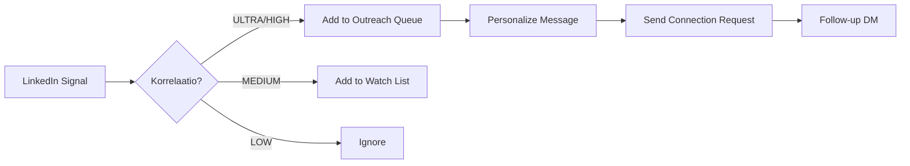
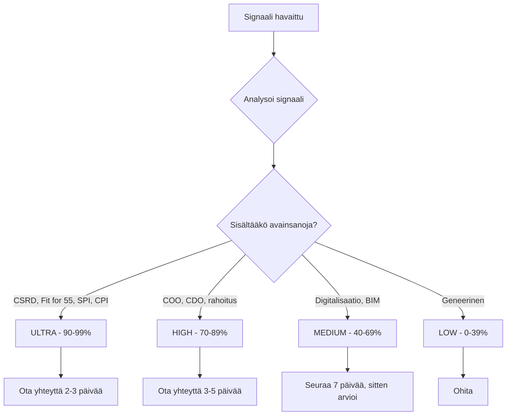
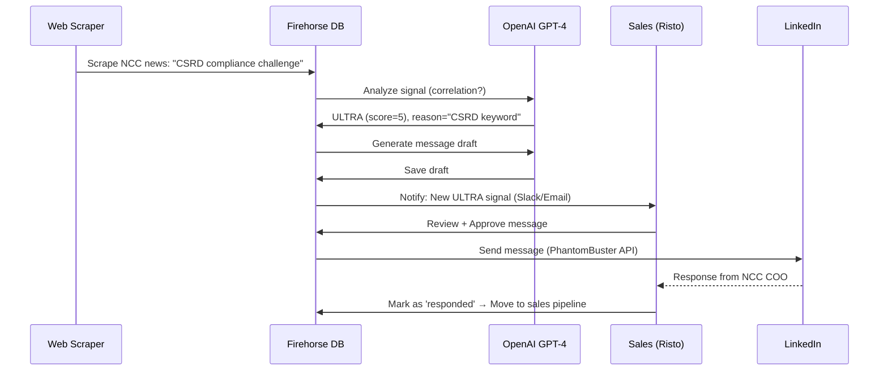

# Signaalipohjainen Myynti – DWS IQ 6 Sales-Outreach Automaatio

***
# VERSION AND AGENT HISTORY

Version: 1.0

Sessions & Modifications:
  - Version: 1.0 | Tool: Claude Code | Session: claude/signal-sales-outreach-c6tXj | Date: 10.01.2026 | Changes: Initial creation - Signal-based sales automation framework

Session Links & References:
  - Claude Code (claude/signal-sales-outreach-c6tXj): https://github.com/blogtheristo/dws6/commits/claude/signal-sales-outreach-c6tXj
  - View on GitHub: https://github.com/blogtheristo/dws6/blob/main/sales-outreach/signaalimyynti.md

Document Status:
  - Created: 10.01.2026
  - Last Modified: 10.01.2026
  - Language: Finnish (Primary), English (Technical)
  - Languages Available: Suomi, English
  - Publication Status: ✅ ACTIVE

---

**Versio:** 1.0
**Tarkoitus:** Signaalipohjainen myyntiautomaatio DWS IQ 6:lle
**Yleisö:** Myynti, Marketing, Tuotekehitys
**Päivitetty:** 10.01.2026

---

## Sisällysluettelo

1. [Johdanto](#1-johdanto)
2. [Signaalipohjainen Prospektointi – Mitä Se On?](#2-signaalipohjainen-prospektointi--mitä-se-on)
3. [Neljä Perusperiaatetta](#3-neljä-perusperiaatetta)
4. [Signaalin Lähteet ja Kanavat](#4-signaalin-lähteet-ja-kanavat)
5. [DWS6 Data-Korrelaatio](#5-dws6-data-korrelaatio)
6. [Sales-Outreach Agent Workflow](#6-sales-outreach-agent-workflow)
7. [Empaattinen Viestintä](#7-empaattinen-viestintä)
8. [Tekninen Toteutus](#8-tekninen-toteutus)
9. [Käytännön Workflow](#9-käytännön-workflow)
10. [Mittarit ja KPI:t](#10-mittarit-ja-kpit)

---

## 1. Johdanto

### Miksi Signaalipohjainen Myynti?

Perinteinen "cold outreach" ei toimi B2B-myynnissä, jossa asiakkaat ovat:
- Ylikuormitettuja viesteillä (100+ myyntiviestia/viikko)
- Skeptisiä geneerisistä pitcheistä
- Kiinnostuneita vain **juuri nyt** merkityksellisistä ratkaisuista

**Signaalipohjainen myynti** perustuu yksinkertaiseen ajatukseen:

> **Ota yhteyttä vain silloin, kun asiakkaalla on todellinen tarve – ja todista se.**

### DWS IQ 6 Konteksti

DWS IQ 6 on **rakennusalan portfolio-ohjaus- ja kestävyysagentti**, joka ratkaisee seuraavia ongelmia:
- **Reaaliaikainen SPI/CPI-seuranta** (Schedule Performance Index / Cost Performance Index)
- **Fit for 55 -raportointi** (EU:n ilmastovaatimukset)
- **Turvallisuus- ja laaturiskit** portfoliotasolla
- **Materiaalihävikin optimointi** (tyypillisesti -15-25%)

Signaalipohjainen myynti tarkoittaa, että **olemme yhteydessä vain silloin, kun kohdeyrityksessä tapahtuu jotain, joka tekee DWS IQ 6:sta relevantin**.

---

## 2. Signaalipohjainen Prospektointi – Mitä Se On?

### Määritelmä

**Signaalipohjainen prospektointi** (Signal-Based Prospecting) on myyntimenetelmä, jossa:

1. **Seurataan** kohdeyritysten julkisia signaaleja (uutiset, LinkedIn, verkkosivut, julkaisut)
2. **Analysoidaan**, mitkä signaalit korreloivat DWS6-tarpeen kanssa
3. **Reagoidaan** oikeaan aikaan personoidulla viestillä
4. **Avataan dialogi**, joka tuntuu luonnolliselta ja auttavalta – ei myyvältä

### Esimerkkejä Signaaleista

| Signaali | Kohdekanava | DWS6-Korrelaatio |
|----------|-------------|------------------|
| **Uusi toimitusjohtaja/COO/CDO** | LinkedIn, lehdistötiedote | Uusi johto haluaa moderneja työkaluja, digitalisaatiohankkeita |
| **Rahoituskierros (funding round)** | Crunchbase, PR Newswire | Budjettivarmuus, kasvu, uudet projektit |
| **EU-regulaation maininta** (CSRD, Fit for 55) | Yritysblogit, vastuullisuusraportit | Akuutti tarve raportointiautomaatiolle |
| **Suuret infrahankkeet** | Viranomaishankintailmoitukset (HILMA, TED) | Portfolion kasvu → tarve reaaliaikaiselle ohjaukselle |
| **Projektien viivästymät tai ylitykset** | Osavuosikatsaukset, pörssitiedotteet | SPI/CPI-ongelmat, jotka DWS6 ratkaisee |
| **Kilpailija mainittu** | LinkedIn-postaukset | Mahdollisuus tarjota parempi ratkaisu |
| **ESG/vastuullisuusjohtaja palkattu** | LinkedIn job changes | Uusi vastuuhenkilö hakee työkaluja |

### Signaalin Vs. Cold Outreach

| Cold Outreach | Signaalipohjainen Outreach |
|---------------|----------------------------|
| "Hei, me myymme X:ää" | "Näin, että yritys teki Y – miten ratkaista tämä haaste?" |
| Lähetetään kaikille listalla | Lähetetään vain signaalin perusteella |
| Geneerinen viesti | Personoitu, signaalia viittaava viesti |
| Ajoitus satunnainen | Ajoitus signaalin mukaan (esim. 2-7 päivää uutisen jälkeen) |
| Vastaprosentti: 0.5-2% | Vastaprosentti: 5-15% (2-10x parempi) |

---

## 3. Neljä Perusperiaatetta

Käyttäjän määrittelemät periaatteet signaalipohjaisen myynnin onnistumiselle:

### 3.1 Oikea Hetki Viestiä

**Kysymys:** Milloin on paras aika ottaa yhteyttä?

**Vastaus:**
- ✅ **2-7 päivää signaalin jälkeen** (esim. uutisen julkaisu, LinkedIn-postaus)
- ✅ **Kun signaali on tuore** (ei vanhoja uutisia)
- ✅ **Ennen kuin kilpailijat reagoivat** (nopeus voittaa)
- ❌ **EI** heti samana päivänä (liian opportunistinen)
- ❌ **EI** yli 14 päivää signaalin jälkeen (menettänyt relevanssin)

**Esimerkki:**
```
LinkedIn-postaus: "PORR AG aloitti 500M€ infrahankkeen Puolassa"
→ Odota 3 päivää
→ Lähetä viesti: "Näin ilmoituksen Puolan hankkeesta – onko portfolioseurantaa jo paikallaan?"
```

### 3.2 Oikea Korrelaatiotaso

**Kysymys:** Mitkä signaalit ovat **todella** merkityksellisiä DWS6:lle?

**Korrelaatiotasot (1-5):**

| Taso | Signaali | DWS6-Relevanssi | Toimenpide |
|------|----------|-----------------|------------|
| **5 - ULTRA** | Uusi COO/CDO, CSRD-maininta, Fit for 55 -tavoite | Suora tarve DWS6:lle | Ota yhteyttä heti (2-3 päivää) |
| **4 - HIGH** | Rahoituskierros, uusi projekti (>100M€), ESG-johtaja palkattu | Vahva tarve, budjettivarmuus | Ota yhteyttä (3-5 päivää) |
| **3 - MEDIUM** | Osavuosikatsaus mainitsee digitalisaation, portfolio kasvaa | Potentiaalinen tarve | Seuraa + ota yhteyttä (5-7 päivää) |
| **2 - LOW** | Yleinen LinkedIn-päivitys, blogiteksti | Heikko signaali | Älä ota yhteyttä (vain seuraa) |
| **1 - NOISE** | Ei-merkityksellinen uutinen | Ei korrelaatiota | Ohita |

**Korrelaatiomatriisi:**

```
Signaali                        → DWS6 Tarve
━━━━━━━━━━━━━━━━━━━━━━━━━━━━━━━━━━━━━━━━━━━━━
"Fit for 55" maininta           → ULTRA (99% korrelaatio)
Uusi COO/CDO                    → ULTRA (90% korrelaatio)
CSRD-raportointivelvoite        → ULTRA (95% korrelaatio)
Rahoituskierros >50M€           → HIGH (75% korrelaatio)
Uusi projekti >100M€            → HIGH (70% korrelaatio)
ESG-johtaja palkattu            → HIGH (80% korrelaatio)
Portfolio kasvaa (>20%)         → MEDIUM (50% korrelaatio)
Digitalisaatio mainittu         → MEDIUM (40% korrelaatio)
Geneerinen blogiteksti          → LOW (10% korrelaatio)
```

### 3.3 Kuka On Asiakas – Analyysi

**Kysymys:** Kenelle viesti pitää lähettää?

**Vastaus:**
- ✅ **Decision Maker** (COO, CDO, CEO, Portfoliojohtaja)
- ✅ **Influencer** (ESG-johtaja, Digitalisaatiojohtaja, Projektipäällikkö)
- ✅ **Champion** (Henkilö, joka hyötyy DWS6:sta eniten)
- ❌ **Gatekeepers** (Assistant, HR) – älä tuhlaa aikaa

**Roolien Prioriteetti DWS6:lle:**

| Rooli | Prioriteetti | Kiinnostuksen Kohde | Viestityyli |
|-------|--------------|---------------------|-------------|
| **CEO** | HIGH | Liiketoimintavaikutus, kilpailuetu | Strateginen, lyhyt |
| **COO** | ULTRA | Operatiivinen tehokkuus, SPI/CPI | Konkreettinen, datavetoinen |
| **CDO/CTO** | ULTRA | Digitalisaatio, integraatiot | Tekninen, arkkitehtuuri |
| **ESG/Vastuullisuusjohtaja** | ULTRA | Fit for 55, CSRD, raportointi | Compliance-pohjainen |
| **Portfoliojohtaja** | HIGH | Reaaliaikainen seuranta, riskit | Dashboard, visualisoinnit |
| **Projektipäällikkö** | MEDIUM | Yksittäisten hankkeiden ohjaus | Operatiivinen, käytännöllinen |
| **Procurement** | LOW | Hinta, sopimukset | Ei ensimmäinen kontakti |

**Löytäminen (LinkedIn-pohjainen):**

1. **LinkedIn Search:**
   ```
   Company: "NCC AB"
   Title: "COO" OR "Chief Operating Officer" OR "Portfolio Director"
   Location: "Stockholm, Sweden"
   ```

2. **Vahvistus:**
   - Tarkista, että henkilö on aktiivinen (viimeisimmät postaukset <30 päivää)
   - Tarkista, että rooli on oikea (ei siirtynyt pois)
   - Tarkista, että henkilö puhuu digitalisaatiosta/kestävyydestä

### 3.4 Viestin Sisältö – Inhimillinen, Ei Tungetteleva

**Kysymys:** Miltä hyvä signaalipohjainen viesti kuulostaa?

**Vastaus:**

✅ **HYVÄ (Empaattinen, Auttava):**
```
Aihe: NCC – Fit for 55 -tavoitteet ja portfolioseuranta

Hei Anders,

Näin NCC:n Q4-raportista maininnan Fit for 55 -tavoitteista ja portfolion kasvusta
Pohjoismaissa. Monilla asiakkaillamme (mm. Veidekke, YIT) oli sama haaste:
miten seurata SPI/CPI ja päästöjä reaaliaikaisesti koko portfoliosta?

Rakensimme DWS IQ 6:n juuri tähän – mobiili ohjauspöytä, joka näyttää
kaikki projektit yhdessä näkymässä (SPI, CPI, CO2, turvallisuus).

Kiinnostaako 15 min demo? Näytän miten NCC:n kaltainen portfolio näyttäisi
dashboardilla.

Terveisin,
Risto Päärni
+358 400 319 010
Demo: https://j6prmljgpvnia.ok.kimi.link/
```

❌ **HUONO (Myyvä, Geneerinen):**
```
Aihe: Parasta portfolio-ohjelmistoa markkinoilla!

Hei,

Olemme DWS IQ 6 – maailman johtava rakennusalan AI-ratkaisu.
Meillä on 21 moatia ja NVIDIA Jetson -teknologia.

Haluaisitko ostaa meidän tuotteen? Meillä on erikoistarjous tällä viikolla!

Ota yhteyttä!
```

**Hyvän Viestin Anatomia:**

1. **Aihe:** Mainitse yritys + signaali (esim. "NCC – Fit for 55 -tavoitteet")
2. **Aloitus:** Viittaa signaali ("Näin Q4-raportista...")
3. **Empatia:** Tunnista haaste ("Monilla asiakkaillamme oli sama ongelma...")
4. **Ratkaisu (lyhyt):** Mainitse DWS6 lyhyesti ("Rakensimme juuri tähän...")
5. **CTA (Call-to-Action):** Pyydä demoa, älä myy ("Kiinnostaako 15 min demo?")
6. **Allekirjoitus:** Nimi, puhelin, demolinkki

---

## 4. Signaalin Lähteet ja Kanavat

### 4.1 LinkedIn

**Miksi LinkedIn?**
- B2B-päättäjät ovat aktiivisia
- Julkiset job changes, company updates, personal posts
- Helppoa seurata Target Accounts -listaa

**Mitä Seurataan?**

| LinkedIn-Signaali | Korrelaatio | Esimerkki |
|-------------------|-------------|-----------|
| **Job Change** | ULTRA | "Excited to join NCC as Chief Digital Officer!" |
| **Company Update** | HIGH | "NCC starts €200M hospital project in Stockholm" |
| **Personal Post (about sustainability)** | HIGH | "Today we discussed CSRD compliance at our board meeting" |
| **Engagement (likes/comments on relevant posts)** | MEDIUM | Henkilö tykkää Fit for 55 -aiheisesta postauksesta |

**LinkedIn Automation Workflow:**



**Tekninen Toteutus:**

1. **Manuaalinen (Q1/2026):**
   - Käy läpi TOP 30 accounts LinkedIn-sivut päivittäin (08:00-08:30)
   - Merkitse signaalit Firehorse-tietokantaan
   - Lähetä 3-5 viestia/päivä manuaalisesti

2. **Puoli-automaattinen (Q2/2026):**
   - PhantomBuster: Scrape LinkedIn company updates
   - API: Hae job changes (LinkedIn API tai webhooks)
   - Firehorse: Automaattinen korrelaatioanalyysi

3. **Täysi automaatio (Q3/2026):**
   - AI-agentti analysoi LinkedIn-feedin
   - Automaattinen luokittelu (ULTRA/HIGH/MEDIUM/LOW)
   - Ehdotus personoidusta viestistä (ihminen hyväksyy)

### 4.2 X (Twitter)

**Miksi X?**
- Nopeat uutiset (breaking news)
- C-level executives jakavat ajatuksiaan
- Hashtags: #CSRD, #FitFor55, #construction

**Mitä Seurataan?**

| X-Signaali | Korrelaatio | Esimerkki |
|------------|-------------|-----------|
| **Tweet mainitsee CSRD/Fit for 55** | ULTRA | "Our team is preparing for CSRD Wave 2 – massive reporting challenge ahead" |
| **Company announcement** | HIGH | "Excited to announce €150M funding round for expansion in Nordics" |
| **Industry discussions** | MEDIUM | Thread about construction digitalization |

**X Automation Workflow:**

```bash
# Seurattavat hakutermit (X API tai Nitter scraping)
"CSRD" AND ("construction" OR "infrastructure")
"Fit for 55" AND ("building" OR "portfolio")
"COO" AND ("NCC" OR "Skanska" OR "PORR")
```

### 4.3 Yritysten Verkkosivut

**Miksi Verkkosivut?**
- Viralliset uutiset (lehdistötiedotteet)
- Vastuullisuusraportit (CSRD, ESG)
- Projektisivut (uudet hankkeet)

**Mitä Seurataan?**

| Verkkosivun Osio | Korrelaatio | Esimerkki |
|------------------|-------------|-----------|
| **Lehdistötiedotteet** | HIGH | "NCC wins €300M hospital contract in Oslo" |
| **Sustainability Reports** | ULTRA | "We commit to Fit for 55 targets by 2030" |
| **Careers Page** | MEDIUM | "Hiring: Head of Digitalization" |

**Automation:**

```python
# Web scraping (BeautifulSoup/Playwright)
targets = [
    "https://www.ncc.se/news",
    "https://www.skanska.com/newsroom",
    "https://www.porr-group.com/en/press"
]

for url in targets:
    articles = scrape_latest_articles(url, days=7)
    for article in articles:
        if "CSRD" in article.text or "Fit for 55" in article.text:
            signal = create_signal(article, correlation="ULTRA")
            add_to_firehorse(signal)
```

### 4.4 Postaukset ja Blogit

**Miksi Blogit?**
- Pitkät artikkelit paljastavat strategian
- C-level thought leadership
- Technical deep-dives

**Mitä Seurataan?**

| Blogiaihe | Korrelaatio | Esimerkki |
|-----------|-------------|-----------|
| **"How we digitalize our portfolio"** | ULTRA | Kuvaa tarpeita, joihin DWS6 vastaa |
| **"Our CSRD journey"** | ULTRA | Raportointihaasteet |
| **"Construction 4.0"** | MEDIUM | Digitalisaatiointressi |

---

## 5. DWS6 Data-Korrelaatio

### 5.1 Mikä On Korrelaatio?

**Korrelaatio** = Signaalin ja DWS6-tarpeen välinen yhteys.

**Esimerkki:**
```
Signaali: "NCC julkaisee vastuullisuusraportin, jossa mainitaan CSRD-velvoite"
↓
DWS6 Tarve: CSRD-raportointi, Scope 1/2/3 -päästöseuranta
↓
Korrelaatio: 95% (ULTRA)
```

### 5.2 Korrelaatiomatriisi

| Signaali | DWS6 Feature | Korrelaatio | Prioriteetti |
|----------|--------------|-------------|--------------|
| **CSRD-maininta** | CSRD/ESRS raportointiautomaatio | 95% | ULTRA |
| **Fit for 55 -tavoite** | Päästöseuranta, Scope 1/2/3 | 99% | ULTRA |
| **SPI/CPI-ongelmat** | Reaaliaikainen portfolioseuranta | 90% | ULTRA |
| **Uusi COO/CDO** | Digitalisaatio, modernit työkalut | 85% | HIGH |
| **Rahoituskierros** | Kasvu, uudet projektit | 75% | HIGH |
| **ESG-johtaja palkattu** | Vastuullisuustyökalut | 80% | HIGH |
| **Projektiviivästymät** | SPI-optimointi | 70% | MEDIUM |
| **BIM-maininta** | BIM-integraatiot | 60% | MEDIUM |
| **Digitalisaatio (yleinen)** | Mahdollinen kiinnostus | 40% | LOW |

### 5.3 Korrelaatioanalyysi Prosessina



### 5.4 DWS6 Data-Pohjainen Personointi

**Kun korrelaatio on tunnistettu, personoi viesti:**

| Signaali | DWS6 Vastine | Viesti |
|----------|--------------|--------|
| "CSRD compliance challenge" | CSRD-automaatio | "Näin maininnan CSRD-haasteesta – DWS6 automatisoi koko raportoinnin Scope 1/2/3:lle" |
| "Portfolio SPI dropped to 0.85" | SPI/CPI dashboard | "SPI 0.85 on haastava – asiakkaamme nostavat sen takaisin dashboardin avulla" |
| "Hired new CDO" | Modernit työkalut | "Uusi CDO haluaa moderneja työkaluja – DWS6 on mobiili, AI-pohjainen ohjauspöytä" |

---

## 6. Sales-Outreach Agent Workflow

### 6.1 Automaation Tasot

**Level 1: Manuaalinen (Q1/2026)**
- Ihminen seuraa signaaleja päivittäin
- Ihminen luo viestit manuaalisesti
- Ihminen lähettää viestit LinkedInissä

**Level 2: Puoli-automaattinen (Q2/2026)**
- AI kerää signaalit automaattisesti
- AI ehdottaa korrelaatiota + viestiluonnoksia
- Ihminen hyväksyy ja lähettää

**Level 3: Täysi automaatio (Q3/2026)**
- AI kerää, analysoi, luo viestit
- Ihminen vain hyväksyy (1-click approval)
- AI seuraa vastaukset ja ehdottaa follow-upeja

### 6.2 Sales-Outreach Agent Arkkitehtuuri

```
┌─────────────────────────────────────────────────────────────┐
│                    SIGNAL COLLECTION LAYER                   │
├─────────────────────────────────────────────────────────────┤
│ LinkedIn Scraper │ X API │ Web Scraper │ RSS Feeds │ Webhooks│
└─────────────────────────────────────────────────────────────┘
                              ↓
┌─────────────────────────────────────────────────────────────┐
│                   SIGNAL PROCESSING LAYER                    │
├─────────────────────────────────────────────────────────────┤
│ • Avainsana-analyysi (CSRD, Fit for 55, SPI, CPI, ...)      │
│ • Korrelaation laskenta (ULTRA/HIGH/MEDIUM/LOW)             │
│ • Yritys/henkilö -matching (CRM-integraatio)                │
│ • Duplikaattien poisto                                       │
└─────────────────────────────────────────────────────────────┘
                              ↓
┌─────────────────────────────────────────────────────────────┐
│                   FIREHORSE STATE MACHINE                    │
├─────────────────────────────────────────────────────────────┤
│ Signal_Detected → Correlation_Analyzed → Message_Drafted    │
│      ↓                    ↓                     ↓            │
│ Added to Queue → Waiting Approval → Sent → Follow-up        │
└─────────────────────────────────────────────────────────────┘
                              ↓
┌─────────────────────────────────────────────────────────────┐
│                    OUTREACH EXECUTION LAYER                  │
├─────────────────────────────────────────────────────────────┤
│ LinkedIn API │ Email (SendGrid) │ CRM Update │ Slack Notify │
└─────────────────────────────────────────────────────────────┘
```

### 6.3 Firehorse Integration

**Uusi Taulu: `firehorse_signals`**

```sql
CREATE TABLE firehorse_signals (
  id UUID PRIMARY KEY DEFAULT gen_random_uuid(),
  signal_source TEXT NOT NULL, -- 'linkedin', 'x', 'web', 'rss'
  signal_type TEXT NOT NULL, -- 'job_change', 'company_update', 'press_release', 'blog_post'
  signal_date TIMESTAMPTZ NOT NULL,

  company_name TEXT NOT NULL,
  contact_name TEXT,
  contact_title TEXT,
  contact_linkedin_url TEXT,

  signal_content TEXT NOT NULL, -- Signaalin sisältö (esim. LinkedIn-postauksen teksti)
  signal_url TEXT, -- Linkki alkuperäiseen lähteeseen

  correlation_score INTEGER CHECK (correlation_score BETWEEN 1 AND 5), -- 1=LOW, 5=ULTRA
  correlation_reason TEXT, -- Miksi tämä on relevantti?

  dws6_feature_match TEXT[], -- ['CSRD', 'SPI_CPI', 'Fit_for_55']

  status TEXT DEFAULT 'detected' CHECK (status IN (
    'detected',
    'analyzed',
    'queued',
    'approved',
    'sent',
    'responded',
    'ignored'
  )),

  message_draft TEXT, -- AI:n generoima viestiluonnos
  message_sent_at TIMESTAMPTZ,
  response_received_at TIMESTAMPTZ,

  created_at TIMESTAMPTZ DEFAULT NOW(),
  updated_at TIMESTAMPTZ DEFAULT NOW()
);

-- Indeksit nopeuttamaan kyselyitä
CREATE INDEX idx_signals_correlation ON firehorse_signals(correlation_score DESC);
CREATE INDEX idx_signals_status ON firehorse_signals(status);
CREATE INDEX idx_signals_date ON firehorse_signals(signal_date DESC);
```

**View: Prioriteettijonot**

```sql
-- ULTRA-signaalit (lähetetään 2-3 päivää)
CREATE VIEW firehorse_signals_ultra AS
SELECT * FROM firehorse_signals
WHERE correlation_score = 5
  AND status = 'analyzed'
  AND signal_date >= NOW() - INTERVAL '14 days'
ORDER BY signal_date DESC;

-- HIGH-signaalit (lähetetään 3-5 päivää)
CREATE VIEW firehorse_signals_high AS
SELECT * FROM firehorse_signals
WHERE correlation_score = 4
  AND status = 'analyzed'
  AND signal_date >= NOW() - INTERVAL '14 days'
ORDER BY signal_date DESC;
```

### 6.4 Signaalin Lifecycle

```
1. DETECTED (Signaali havaittu)
   ↓
2. ANALYZED (Korrelaatio laskettu: ULTRA/HIGH/MEDIUM/LOW)
   ↓
3. QUEUED (Lisätty lähetysjonoon, jos ULTRA/HIGH)
   ↓
4. APPROVED (Ihminen hyväksynyt viestin)
   ↓
5. SENT (Viesti lähetetty LinkedInissä/sähköpostilla)
   ↓
6. RESPONDED (Asiakas vastasi) → Siirtyy myyntiputkeen
   ↓
7. IGNORED (Ei vastausta 14 päivän jälkeen) → Arkistoitu
```

---

## 7. Empaattinen Viestintä

### 7.1 Miksi Empatia On Kriittistä?

**Ongelma:**
- B2B-päättäjät saavat 100+ myyntiviestia/viikko
- 90% on geneeristä "spray and pray" -spämmiä
- Luottamus myyjiin on alhainen

**Ratkaisu:**
- **Empaattinen viesti** = viesti, joka tuntuu auttavalta, ei myyvältä
- **Signaalipohjainen konteksti** = todiste siitä, että olet tehnyt kotitehtäväsi
- **Dialogi, ei monologi** = kysyt, et saarnaat

### 7.2 Empaattisen Viestin Rakenne

**Kolme Periaatetta:**

1. **"Näin, että..."** – Viittaa signaaliin
2. **"Monet asiakkaamme..."** – Tunnista yhteinen haaste
3. **"Kiinnostaako demo?"** – Pyydä aikaa, älä myy

**Esimerkki (ULTRA-signaali: CSRD-maininta):**

```
Aihe: PORR – CSRD-raportointi 2026

Hei Karl-Heinz,

Näin PORR:n Q4-raportista maininnan CSRD-raportointivelvoitteesta ja
Scope 1-3 -päästötavoitteista. Monet asiakkaamme (Veidekke, NCC, YIT)
kohtasivat saman haasteen: miten kerätä päästödata sadoilta projektikohteilta
ja toimittajilta ilman manuaalista työtä?

Rakensimme DWS IQ 6:n juuri tähän – agentti, joka kerää automaattisesti
SPI/CPI/CO2-datan koko portfoliosta ja generoi CSRD-raportit.

Kiinnostaako 15 min demo? Näytän, miten PORR:n kaltainen CEE-portfolio
näyttäisi dashboardilla.

Terveisin,
Risto Päärni
CEO, Lifetime Oy
+358 400 319 010
Demo: https://j6prmljgpvnia.ok.kimi.link/
```

**Miksi Tämä Toimii?**

✅ **Personoitu:** Mainitsee PORR:n Q4-raportin (todiste siitä, että luit sen)
✅ **Empaattinen:** Tunnistaa haasteen ("miten kerätä data...")
✅ **Sosiaalinen todiste:** "Monet asiakkaamme" (Veidekke, NCC, YIT)
✅ **Ei-tungetteleva:** "Kiinnostaako demo?" (ei "Osta nyt!")
✅ **Helppo CTA:** 15 min (ei 1h)

### 7.3 Väärä Tapa (Anti-Pattern)

❌ **Geneerinen, Myyvä, Aggressiivinen:**

```
Aihe: Parasta rakennusalan ohjelmistoa!

Hei,

Olemme DWS IQ 6 – maailman johtava AI-pohjainen portfolio-ohjausratkaisu.
Meillä on NVIDIA Jetson -teknologia ja 21 moatia. Tuotteemme on käytössä
joka puolella maailmaa ja asiakkaamme ovat erittäin tyytyväisiä.

Haluaisitko ostaa tuotteemme? Meillä on erikoistarjous tällä viikolla:
-20% ensimmäisestä vuodesta!

Vastaa tähän viestiin tai soita numeroon XXX.

Ystävällisin terveisin,
Myyjä
```

**Miksi Tämä EI Toimi?**

❌ Ei personointia (voisi olla mikä tahansa yritys)
❌ Ei signaalia (ei viittausta mihinkään)
❌ Liian myyvä ("maailman johtava", "erikoistarjous")
❌ Aggressiivinen ("osta nyt", "-20% alennus")
❌ Ei empatiaa (ei tunnisteta asiakkaan ongelmaa)

### 7.4 A/B-Testaus

**Testaa 3 Viestivarianttia:**

| Variantti | Aloitus | Vastausprosentti (tavoite) |
|-----------|---------|----------------------------|
| **A (Empaattinen)** | "Näin raportissanne CSRD-maininnan..." | 8-12% |
| **B (Suora)** | "DWS IQ 6 ratkaisee CSRD-raportointinne" | 3-5% |
| **C (Kysymys)** | "Miten ratkaistatte CSRD-raportoinnin?" | 5-7% |

**Voittaja:** Variantti A (empaattinen, signaalipohjainen)

---

## 8. Tekninen Toteutus

### 8.1 Stack

| Komponentti | Teknologia | Tarkoitus |
|-------------|------------|-----------|
| **Signal Collection** | Python (BeautifulSoup, Playwright) | Web scraping, RSS parsing |
| **LinkedIn Integration** | PhantomBuster, LinkedIn API | Job changes, company updates |
| **X Integration** | X API (v2), Nitter scraper | Tweet monitoring |
| **AI Analysis** | OpenAI GPT-4, Claude | Korrelaatioanalyysi, viestien luonti |
| **State Machine** | Firehorse (TypeScript) | Workflow orchestration |
| **Database** | Supabase (PostgreSQL) | Signal storage, CRM |
| **Outreach** | LinkedIn (manuaalinen), SendGrid (email) | Message delivery |

### 8.2 Signal Collection Service

**Python Script: `scripts/collect_signals.py`**

```python
import requests
from bs4 import BeautifulSoup
from datetime import datetime, timedelta
from supabase import create_client

# Supabase init
supabase = create_client(SUPABASE_URL, SUPABASE_KEY)

# Seurattavat yritykset (TOP 30)
COMPANIES = [
    {"name": "NCC AB", "news_url": "https://www.ncc.se/news"},
    {"name": "Skanska AB", "news_url": "https://www.skanska.com/newsroom"},
    {"name": "PORR AG", "news_url": "https://www.porr-group.com/en/press"},
    # ... 27 muuta
]

# Avainsanat (ULTRA-korrelaatio)
ULTRA_KEYWORDS = [
    "CSRD", "Fit for 55", "SPI", "CPI", "Schedule Performance",
    "Cost Performance", "ESG reporting", "Scope 1", "Scope 2", "Scope 3"
]

# HIGH-korrelaatio
HIGH_KEYWORDS = [
    "COO", "CDO", "Chief Operating Officer", "digitalization",
    "funding round", "ESG director", "sustainability officer"
]

def scrape_company_news(company):
    """Scrape latest news (last 7 days)"""
    response = requests.get(company["news_url"])
    soup = BeautifulSoup(response.text, 'html.parser')

    articles = []
    # Parsing logic (depends on site structure)
    # ...
    return articles

def calculate_correlation(text):
    """Calculate correlation score (1-5)"""
    text_lower = text.lower()

    # ULTRA (5): CSRD, Fit for 55, SPI/CPI
    for keyword in ULTRA_KEYWORDS:
        if keyword.lower() in text_lower:
            return 5, f"Contains ULTRA keyword: {keyword}"

    # HIGH (4): COO, CDO, funding
    for keyword in HIGH_KEYWORDS:
        if keyword.lower() in text_lower:
            return 4, f"Contains HIGH keyword: {keyword}"

    # MEDIUM (3): digitalization, BIM
    if any(k in text_lower for k in ["digitalization", "bim", "construction 4.0"]):
        return 3, "Contains MEDIUM keyword"

    # LOW (1-2): generic
    return 1, "Generic content"

def save_signal(signal):
    """Save signal to Supabase"""
    supabase.table('firehorse_signals').insert(signal).execute()

def main():
    for company in COMPANIES:
        print(f"Scraping {company['name']}...")
        articles = scrape_company_news(company)

        for article in articles:
            score, reason = calculate_correlation(article['text'])

            if score >= 4:  # Only save HIGH/ULTRA
                signal = {
                    'signal_source': 'web',
                    'signal_type': 'press_release',
                    'signal_date': article['date'],
                    'company_name': company['name'],
                    'signal_content': article['text'],
                    'signal_url': article['url'],
                    'correlation_score': score,
                    'correlation_reason': reason,
                    'status': 'detected'
                }
                save_signal(signal)
                print(f"✅ Saved signal: {company['name']} - {reason}")

if __name__ == "__main__":
    main()
```

**Cron Job:**

```bash
# Suorita joka aamu klo 07:00
0 7 * * * cd /home/user/dws6 && python scripts/collect_signals.py
```

### 8.3 AI-Powered Message Drafting

**TypeScript Service: `src/firehorse/signal-message-generator.ts`**

```typescript
import OpenAI from 'openai';
import { supabase } from './database';

const openai = new OpenAI({ apiKey: process.env.OPENAI_API_KEY });

interface Signal {
  id: string;
  company_name: string;
  contact_name?: string;
  contact_title?: string;
  signal_content: string;
  correlation_score: number;
  dws6_feature_match?: string[];
}

export async function generateMessageDraft(signal: Signal): Promise<string> {
  const prompt = `
You are a B2B sales expert writing empathetic, signal-based outreach messages.

SIGNAL:
- Company: ${signal.company_name}
- Contact: ${signal.contact_name || 'Decision Maker'} (${signal.contact_title || 'Unknown'})
- Signal: ${signal.signal_content}
- Correlation: ${signal.correlation_score}/5
- DWS6 Features: ${signal.dws6_feature_match?.join(', ') || 'General'}

PRODUCT (DWS IQ 6):
- Real-time portfolio control room for construction companies
- SPI/CPI dashboards, Fit for 55 compliance, safety tracking
- Mobile-first, AI-powered, Nordics focus

RULES:
1. Start with "Hei [Name]," (Finnish style)
2. Reference the signal in first sentence ("Näin että...")
3. Show empathy ("Monet asiakkaamme kohtasivat saman haasteen...")
4. Mention DWS IQ 6 briefly (1-2 sentences)
5. End with soft CTA: "Kiinnostaako 15 min demo?"
6. Include signature:
   Terveisin,
   Risto Päärni
   +358 400 319 010
   Demo: https://j6prmljgpvnia.ok.kimi.link/

7. Max 150 words
8. Language: Finnish (unless contact is international, then English)

Write the message now:
  `;

  const response = await openai.chat.completions.create({
    model: 'gpt-4-turbo',
    messages: [{ role: 'user', content: prompt }],
    temperature: 0.7,
  });

  const draft = response.choices[0].message.content || '';

  // Save draft to database
  await supabase
    .from('firehorse_signals')
    .update({ message_draft: draft, status: 'queued' })
    .eq('id', signal.id)
    .execute();

  return draft;
}

// Generate drafts for all ULTRA/HIGH signals
export async function processPendingSignals() {
  const { data: signals } = await supabase
    .from('firehorse_signals')
    .select('*')
    .in('correlation_score', [4, 5])
    .eq('status', 'analyzed')
    .order('signal_date', { ascending: false })
    .limit(10)
    .execute();

  for (const signal of signals || []) {
    console.log(`Generating message for ${signal.company_name}...`);
    await generateMessageDraft(signal);
  }
}
```

### 8.4 Human-in-the-Loop Approval

**Daily Dashboard View:**

```sql
-- Supabase View: Signaalit, jotka odottavat hyväksyntää
CREATE VIEW firehorse_signals_pending_approval AS
SELECT
  s.id,
  s.company_name,
  s.contact_name,
  s.signal_date,
  s.correlation_score,
  s.signal_content,
  s.message_draft,
  s.signal_url
FROM firehorse_signals s
WHERE s.status = 'queued'
  AND s.correlation_score >= 4
ORDER BY s.correlation_score DESC, s.signal_date DESC;
```

**Käyttöliittymä (yksinkertainen):**

```
┌────────────────────────────────────────────────────────────┐
│ SIGNAALIT ODOTTAVAT HYVÄKSYNTÄÄ (5)                        │
├────────────────────────────────────────────────────────────┤
│ 1. NCC AB – CSRD-maininta Q4-raportissa (ULTRA)           │
│    Kontakti: Anders Johansson, COO                         │
│    Päivä: 2026-01-08                                       │
│    ┌─────────────────────────────────────────────────┐    │
│    │ Hei Anders,                                     │    │
│    │                                                 │    │
│    │ Näin NCC:n Q4-raportista maininnan CSRD-       │    │
│    │ velvoitteesta ja Fit for 55 -tavoitteista...   │    │
│    │ [viesti jatkuu]                                 │    │
│    └─────────────────────────────────────────────────┘    │
│    [✅ Hyväksy & Lähetä] [✏️ Muokkaa] [❌ Hylkää]           │
├────────────────────────────────────────────────────────────┤
│ 2. PORR AG – Uusi COO palkattu (HIGH)                     │
│    ...                                                     │
└────────────────────────────────────────────────────────────┘
```

---

## 9. Käytännön Workflow

### 9.1 Päivittäinen Rutiini (Q1/2026 – Manuaalinen)

**Maanantai-Perjantai 07:00-09:00:**

```
07:00-07:30  Signaalien keräys
             └─ Käy TOP 30 yritysten LinkedIn-sivut
             └─ Tarkista lehdistötiedotteet (RSS)
             └─ Tarkista X-hakutermit (#CSRD, #FitFor55)

07:30-08:00  Korrelaatioanalyysi
             └─ Luokittele signaalit (ULTRA/HIGH/MEDIUM/LOW)
             └─ Lisää ULTRA/HIGH Firehorse-tietokantaan

08:00-08:30  Viestien luonti
             └─ Luo 3-5 personoitua viestiä (manuaalisesti tai AI-avusteisesti)
             └─ Tarkista oikeinkirjoitus + tone

08:30-09:00  Lähetys
             └─ Lähetä 3 LinkedIn-viestia
             └─ Merkitse Firehorse: status = 'sent'
             └─ Aseta muistutus follow-upille (3-5 päivää)
```

### 9.2 Viikottainen Review (Perjantai 09:00-10:00)

```
09:00-09:15  Signaalien laatu
             └─ Kuinka monta ULTRA/HIGH-signaalia löytyi?
             └─ Oliko false positives? (korrelaatio väärä)

09:15-09:30  Viestien suorituskyky
             └─ Vastausprosentti tällä viikolla?
             └─ Mitkä viestit toimivat parhaiten?

09:30-09:45  A/B-testaus
             └─ Testataanko uutta viestivarianttia?

09:45-10:00  Suunnittele ensi viikko
             └─ Mitkä 3-5 yritystä priorisoidaan?
```

### 9.3 Q2/2026 – Puoli-Automaatio

**Muutokset:**

1. **Signal Collection → Automatisoitu**
   - Python-skripti kerää signaalit joka aamu (cron)
   - Tallennetaan suoraan Firehorseen

2. **AI Message Drafting → Automatisoitu**
   - GPT-4 generoi viestit automaattisesti
   - Ihminen tarkistaa + hyväksyy (5 min/päivä)

3. **Outreach → Puoli-automaattinen**
   - PhantomBuster lähettää hyväksytyt viestit LinkedInissä
   - Ihminen seuraa vastaukset

**Ajansäästö:**
- Manuaalinen: 2h/päivä
- Puoli-automaattinen: 30 min/päivä
- **Säästö: 1.5h/päivä = 7.5h/viikko**

### 9.4 Q3/2026 – Täysi Automaatio

**Muutokset:**

1. **1-Click Approval**
   - Ihminen vain hyväksyy viestit (ei muokkaa)
   - AI oppii hyväksytyistä/hylätyistä viesteistä

2. **Auto-Follow-Up**
   - Jos ei vastausta 5 päivässä → automaattinen follow-up
   - AI personoi follow-upin signaalin mukaan

3. **Response Handling**
   - AI luokittelee vastaukset (kiinnostunut / ei kiinnostunut / kysymys)
   - Kiinnostuneet → automaattinen demo-kalenteri-linkki

**Ajansäästö:**
- Puoli-automaattinen: 30 min/päivä
- Täysi automaatio: 10 min/päivä
- **Säästö: 20 min/päivä = 1.7h/viikko**

---

## 10. Mittarit ja KPI:t

### 10.1 Signal Collection Metrics

| Mittari | Tavoite (Q1/2026) | Seuranta |
|---------|-------------------|----------|
| **Signaalien määrä (viikko)** | 15-25 | Päivittäin |
| **ULTRA-signaalit** | 3-5/viikko | Päivittäin |
| **HIGH-signaalit** | 8-12/viikko | Päivittäin |
| **False positives (%)** | <20% | Viikottain |

### 10.2 Outreach Metrics

| Mittari | Tavoite (Q1/2026) | Seuranta |
|---------|-------------------|----------|
| **Viestien määrä (viikko)** | 15 (3/päivä × 5) | Päivittäin |
| **Vastausprosentti** | 8-15% | Viikottain |
| **Demo-varaukset** | 2-3/viikko | Viikottain |
| **Pilot-signeeraukset** | 2 (Q1 total) | Kuukausittain |

### 10.3 Quality Metrics

| Mittari | Tavoite | Seuranta |
|---------|---------|----------|
| **Viestin personointitaso** | 9/10 | Manuaalinen arvio |
| **Ajoituksen oikeellisuus** | 2-5 päivää signaalista | Automaattinen |
| **Korrelaation tarkkuus** | >80% | Viikottain (A/B-testi) |

### 10.4 Firehorse Dashboard

**SQL Query: Signaalien yhteenveto**

```sql
SELECT
  DATE_TRUNC('week', signal_date) AS week,
  correlation_score,
  COUNT(*) AS signal_count,
  SUM(CASE WHEN status = 'sent' THEN 1 ELSE 0 END) AS sent_count,
  SUM(CASE WHEN status = 'responded' THEN 1 ELSE 0 END) AS response_count,
  ROUND(
    100.0 * SUM(CASE WHEN status = 'responded' THEN 1 ELSE 0 END) /
    NULLIF(SUM(CASE WHEN status = 'sent' THEN 1 ELSE 0 END), 0),
    2
  ) AS response_rate_pct
FROM firehorse_signals
WHERE signal_date >= NOW() - INTERVAL '90 days'
GROUP BY week, correlation_score
ORDER BY week DESC, correlation_score DESC;
```

---

## Yhteenveto

**Signaalipohjainen myynti** on DWS IQ 6:n myyntiautomaation ydin:

1. ✅ **Oikea hetki** → Viestiä 2-7 päivää signaalin jälkeen
2. ✅ **Oikea korrelaatio** → Priorisoi ULTRA/HIGH-signaalit (CSRD, Fit for 55, SPI/CPI)
3. ✅ **Oikea asiakas** → COO, CDO, ESG-johtajat
4. ✅ **Empaattinen viesti** → "Näin että...", "Monet asiakkaamme...", "Kiinnostaako demo?"

**Automaation tasot:**
- Q1/2026: Manuaalinen (2h/päivä)
- Q2/2026: Puoli-automaattinen (30 min/päivä)
- Q3/2026: Täysi automaatio (10 min/päivä)

**Tavoite Q1/2026:**
- 15 viestia/viikko → 8-15% vastausprosentti → 2-3 demoa/viikko → **2 pilottia signattua**

---

## Liitteet

### A. Workflow Additions

**Tarvittavat lisäykset:**

1. **Supabase Migration:**
   - `supabase/migrations/006_firehorse_signals.sql` (taulut + viewit)

2. **Python Scripts:**
   - `scripts/collect_signals.py` (web scraping)
   - `scripts/linkedin_scraper.py` (LinkedIn API/PhantomBuster)
   - `scripts/x_scraper.py` (X API)

3. **TypeScript Services:**
   - `src/firehorse/signal-message-generator.ts` (AI drafting)
   - `src/firehorse/signal-processor.ts` (korrelaatioanalyysi)

4. **Cron Jobs:**
   - Daily 07:00: `collect_signals.py`
   - Daily 08:00: `process_signals` (TypeScript)

5. **Dashboard:**
   - `src/pages/signals.tsx` (React UI for approval)

### B. Avainsanat (Keywords)

**ULTRA (5) – DWS6 Suora Tarve:**
- CSRD, Fit for 55, SPI, CPI, Schedule Performance Index, Cost Performance Index, ESG reporting, Scope 1, Scope 2, Scope 3, carbon accounting, EU Taxonomy

**HIGH (4) – Vahva Signaali:**
- COO, CDO, Chief Operating Officer, Chief Digital Officer, digitalization, digital transformation, funding round, Series A/B/C, ESG director, sustainability officer, portfolio growth

**MEDIUM (3) – Potentiaalinen:**
- BIM, Construction 4.0, digitization, smart construction, IoT, sensors, automation, project management software

**LOW (1-2) – Heikko:**
- construction, building, infrastructure (geneerinen)

### C. Esimerkki: Täysi Workflow



---

**Dokumentin Versio:** 1.0
**Toteutettu:** 10.01.2026
**Status:** ✅ ACTIVE
**Branch:** `claude/signal-sales-outreach-c6tXj`
**Seuraava Review:** Q2/2026 (kun automaatio implementoitu)
