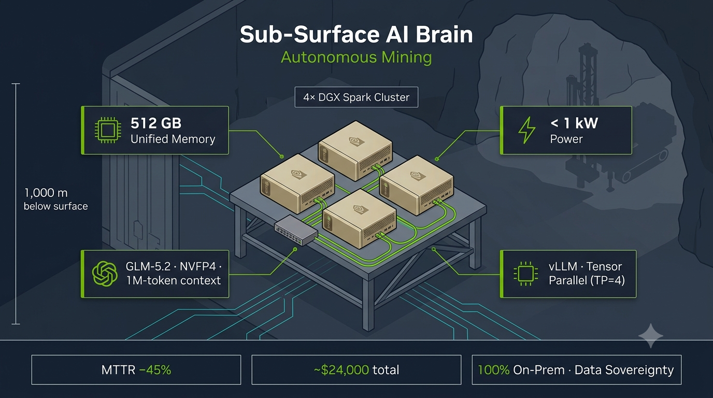

# 4× NVIDIA DGX Spark — Sub-Surface AI Brain for Autonomous Mining

---

# VERSION AND AGENT HISTORY

Version: 1.3

Sessions & Modifications:

- Version: 1.3 | Tool: Claude Code | Session: claude/dgx-spark-mining-case-gf1159 | Date: 26.06.2026 | Changes: Added the 4× setup infographic (docs/assets/images/dgx-spark-4x-sub-surface-ai-brain.png) as the lead visual.
- Version: 1.2 | Tool: Claude Code | Session: claude/dgx-spark-mining-case-gf1159 | Date: 26.06.2026 | Changes: Folded in verified facts from the nvidia/GLM-5.2-NVFP4 model card overview — ZAI's GLM-5.2 MoE for reasoning + coding, sparse attention with IndexShare indexer, quantized with NVIDIA TensorRT Model Optimizer, licensed for commercial or non-commercial use. Narrowed the caveat to the three still-unverified numeric specs (param count, NVFP4 size, context length).
- Version: 1.1 | Tool: Claude Code | Session: claude/dgx-spark-mining-case-gf1159 | Date: 26.06.2026 | Changes: Corrected the GLM-5.2 framing — NVIDIA publishes an official NVFP4 checkpoint (nvidia/GLM-5.2-NVFP4), so it is no longer a hypothetical/forward-looking model; cited the model-card URL in The Model and Assumptions. Noted that the live card could not be re-verified in-session (egress policy blocks huggingface.co) and specs should be confirmed at procurement.
- Version: 1.0 | Tool: Claude Code | Session: claude/dgx-spark-mining-case-gf1159 | Date: 26.06.2026 | Changes: Initial creation — industrial business case for a 4× DGX Spark edge cluster running a frontier MoE model at the mining face, with ROI table, hardware/software stack, operational workflow, and an Assumptions & Caveats section flagging the forward-looking model target and the single-box memory limit.

Session Links & References:

- Claude Code (claude/dgx-spark-mining-case-gf1159): https://github.com/blogtheristo/dws6/commits/claude/dgx-spark-mining-case-gf1159
- View on GitHub: https://github.com/blogtheristo/dws6/blob/main/docs/DGX_SPARK_4X_MINING_BUSINESS_CASE.md

Document Status:

- Created: 26.06.2026
- Last Modified: 26.06.2026
- Language: English
- Languages Available: English
- Publication Status: DRAFT

---

## Executive Summary

In deep-level underground mining, a single stalled autonomous rig costs **tens of thousands of dollars per hour** in lost production. Diagnosis is slow because the relevant knowledge — engineering schematics, historic telemetry, sensor streams, and OEM repair manuals — spans hundreds of thousands of pages, and the data cannot be shipped to a public cloud: fiber to the surface is latency-bound and physically fragile, and drilling telemetry is proprietary IP that must stay on the local network.

The proposal is a **"Sub-Surface AI Brain"**: a ruggedized mobile command container at the mining level housing a **4× NVIDIA DGX Spark** cluster. It pools **512 GB of unified memory** under **~1 kW** of draw, runs a frontier mixture-of-experts model with a **1M-token context window** entirely on-prem, and turns a critical fault code into a precise, page-cited repair strategy in seconds.

**Bottom line:** a **~$24,000** total outlay pays for itself by avoiding roughly **two hours** of mine-wide stoppage, while delivering full **data sovereignty** under Nordic privacy and industrial-security rules.

## The Scandinavian Context: Subterranean Autonomous Mining

This case is modeled on the heavy industrial and mining landscapes of northern Scandinavia — for example LKAB's iron-ore operations in Kiruna, Sweden, or Boliden's automated mines in Finland. Hundreds of meters below the surface, massive autonomous drilling rigs, haulage trucks, and loaders operate continuously.

### The Problem

When a multi-million-dollar autonomous rig suffers a complex mechanical or electronic failure, production stops, costing tens of thousands of dollars per hour.

- **The Documentation Crisis.** Engineering schematics, historic telemetry logs, sensor data, and repair manuals for a fleet of these machines span hundreds of thousands of pages. No engineer can read them under time pressure.
- **The Network Bottleneck.** You cannot send a 1-million-token technical payload up to a public cloud from 1,000 meters underground. Fiber connections to the surface have latency issues, are prone to physical breakage from blasting, and carry highly proprietary telemetry that cannot leave the local network.

## The Solution: The "Sub-Surface AI Brain"

Instead of building a hyper-expensive, dust-sensitive server room underground, the operator deploys a **4× DGX Spark cluster** directly inside a ruggedized mobile command container at the local mining level.

### How the Technical Stack Integrates

- **The Hardware.** Four DGX Spark units are networked on a single desk via a 200 Gbps Ethernet switch using their onboard ConnectX-7 NICs. This provides a localized pool of **512 GB of unified memory** drawing **under 1 kW** of power — easily sustained by local backup generators.
- **The Model.** ZAI's (Zhipu) **GLM-5.2** — a Mixture-of-Experts (MoE) model for reasoning and coding that uses **sparse attention with an IndexShare indexer** to sustain long context — in NVIDIA's officially published **NVFP4** checkpoint ([`nvidia/GLM-5.2-NVFP4`](https://huggingface.co/nvidia/GLM-5.2-NVFP4), quantized with NVIDIA TensorRT Model Optimizer, **licensed for commercial or non-commercial use**). At a 753B parameter scale and 4 bits per parameter, the weights occupy ≈ **376.5 GB**, fitting across the 512 GB pool and leaving roughly **135 GB** for the **1M-token context window** and system tasks.
- **The Inference Engine.** **vLLM** coordinates the cluster using Tensor Parallelism (TP = 4) over NCCL. (SGLang is a viable alternative.)

> See the _Assumptions & Caveats_ section for why the 4× cluster — not a single box — is required, and why vLLM (not Ollama) is mandatory at this scale.

## Operational Workflow

1. **Ingestion.** When a rig flags a critical failure code, the local maintenance engineer drops the machine's last 48 hours of high-frequency sensor telemetry alongside the entire ~800,000-word manufacturer repair manual directly into the system.
2. **Contextual Analysis.** Because the model holds a 1M-token context, it reads the _entire manual_ and the _entire sensor log_ simultaneously. It does not rely on lossy vector-search (RAG) approximations — it looks at the exact data.
3. **Actionable Output.** Within seconds the local cluster outputs a precise, page-cited repair strategy:

   > _"Telemetry indicates a micro-pressure drop in Hydraulic Valve B-4 at 03:14 AM, matching the wear symptoms described on Page 1,402 of the manual. Replace sealing ring X-9 and recalibrate via the local terminal."_

## Business Case & Financial ROI

| Investment Component                          | Cost (USD)   | Return Metric / Operational Savings                                                                                              |
| --------------------------------------------- | ------------ | -------------------------------------------------------------------------------------------------------------------------------- |
| **4× DGX Spark Nodes**                        | ~$18,000     | **Mean Time to Repair (MTTR):** reduced by **~45%** — engineers no longer dig through PDFs or wait for remote cloud diagnostics. |
| **200G Switch & DAC Cabling**                 | ~$6,000      | **Uptime Value:** avoiding just **two hours** of mine-wide stoppage covers the entire ~$24,000 hardware investment.              |
| **Software Stack (vLLM / open-source model)** | $0           | **Zero Cloud Data Fees:** eliminates recurring API token costs and data-egress charges over remote satellite/cellular links.     |
| **Total Initial Outlay**                      | **~$24,000** | **Data Sovereignty:** 100% on-prem; compliant with strict Nordic data-privacy and proprietary industrial-security guidelines.    |

> Hardware list prices vary by region and reseller; treat the figures as order-of-magnitude planning numbers, not a quote.

## Why the 4× Spark Setup Wins Here

A standard enterprise server (e.g. an 8× H100 system) is physically large, requires industrial-grade HVAC to survive ambient rock temperatures, needs specialized high-voltage power, and costs upwards of **$300,000**.

The 4× DGX Spark setup brings frontier-level reasoning to the industrial edge instead. It sits quietly on a standard desk in a dusty environment, runs on a standard wall outlet, and can be loaded onto a utility truck if the command center moves to a different level of the mine.

| Attribute        | 4× DGX Spark Cluster         | 8× H100 Enterprise Server  |
| ---------------- | ---------------------------- | -------------------------- |
| Indicative cost  | ~$24,000                     | $300,000+                  |
| Power            | < 1 kW (wall outlet)         | High-voltage feed required |
| Cooling          | Ambient / desk               | Industrial HVAC            |
| Footprint        | Single desk, truck-portable  | Rack + dedicated room      |
| Memory pool      | 512 GB unified               | Per-GPU VRAM pools         |
| Edge suitability | High (dust-tolerant, mobile) | Low (data-center bound)    |

## The DGX Spark: Hardware Notes

The **NVIDIA DGX Spark** is a compact, desktop AI computer powered by the **GB10 Grace Blackwell Superchip** (co-designed with MediaTek). It brings fifth-generation Tensor Cores and native FP4 support to the desk.

A single DGX Spark ships with **128 GB of coherent unified memory**, where the Blackwell GPU and the 20-core Arm CPU share the same LPDDR5x pool over an ultra-fast NVLink-C2C connection. This is structurally similar to Apple Silicon (Mac Studio), but with NVIDIA's AI instruction set.

### vLLM vs. Ollama on Spark

- **Ollama is well-suited to a _single_ Spark.** NVIDIA and the community target Ollama on the Spark for local, single-user agentic workflows and secure sandboxes. For models that fit one box (e.g. a 70B, or a compressed ~120B at FP4), Ollama is lightweight and efficient for single-request workloads.
- **vLLM is the heavy lifter for the _cluster_.** Pooling four Sparks to reach the ~400 GB needed for the 753B MoE requires tensor parallelism across devices over NCCL — which vLLM (or SGLang) orchestrates and Ollama does not.

## Assumptions & Caveats

This section makes the load-bearing assumptions explicit (Engineering Rule 1) and surfaces, rather than averages over, the trade-offs (Rule 7).

1. **The single box cannot run the 753B model — the cluster is mandatory.** One DGX Spark maxes out at 128 GB unified memory; NVIDIA rates a single Spark for inference on models up to **~200B** at FP4. The 753B MoE weights alone (~376.5 GB at NVFP4) require pooling **4+** Sparks over NCCL, or graduating to data-center Blackwell (DGX B200 / GB200 NVL72). This is _why_ the case is 4× and not 1×.
2. **GLM-5.2 NVFP4 is a real, NVIDIA-published checkpoint.** NVIDIA publishes the NVFP4 quant at [`nvidia/GLM-5.2-NVFP4`](https://huggingface.co/nvidia/GLM-5.2-NVFP4) — ZAI's GLM-5.2 MoE (reasoning + coding, sparse attention with IndexShare indexer), quantized with NVIDIA TensorRT Model Optimizer and **licensed for commercial or non-commercial use**. The architecture, quantization, and license are confirmed from the model card. What is **not yet re-verified in this session** are the precise numeric specs — parameter count (assumed 753B), NVFP4 size on disk (≈376.5 GB), and supported context length (assumed 1M) — because the environment's egress policy blocks `huggingface.co`, so the card's numbers could not be fetched directly here. Confirm these three figures and the recommended runtime (vLLM/SGLang/TensorRT-LLM) against the card before purchase. The design is model-agnostic regardless: if specs differ, the same cluster runs the best open-weight MoE that fits the 512 GB pool.
3. **KV-cache headroom is tight at 1M tokens.** The ~135 GB left after weights must cover the KV cache _and_ system overhead. Real 1M-token throughput depends on batch size, attention/KV-quantization, and TP overhead — benchmark on representative payloads before committing to the 1M-context claim in an SLA.
4. **ROI inputs are operator-specific.** The 45% MTTR reduction and the "two hours of stoppage = payback" figure are illustrative. Plug in the site's actual cost-per-hour of stoppage and baseline MTTR to produce a defensible number.
5. **Cluster networking is the integration risk.** Multi-Spark TP over 200 GbE / ConnectX-7 with NCCL is the part most likely to need tuning. De-risk with a bench proof-of-concept before the container goes underground.

## Summary Recommendation

- **Single DGX Spark desktop:** scale model ambitions to the box. Use **Ollama** to prototype local agents with models up to ~120–200B at FP4.
- **Determined to deploy the 753B-class MoE at the edge:** build a distributed cluster of **4+ Sparks** (or use cloud Blackwell) and run **vLLM** or **SGLang** to handle cross-device communication and the 1M-token context.

For the underground autonomous-mining use case — where data sovereignty, network isolation, power, cooling, and portability all bind — the **4× DGX Spark "Sub-Surface AI Brain"** delivers frontier reasoning at the mining face for roughly **1/12th** the cost of a data-center server, and pays for itself in about two hours of avoided downtime.
