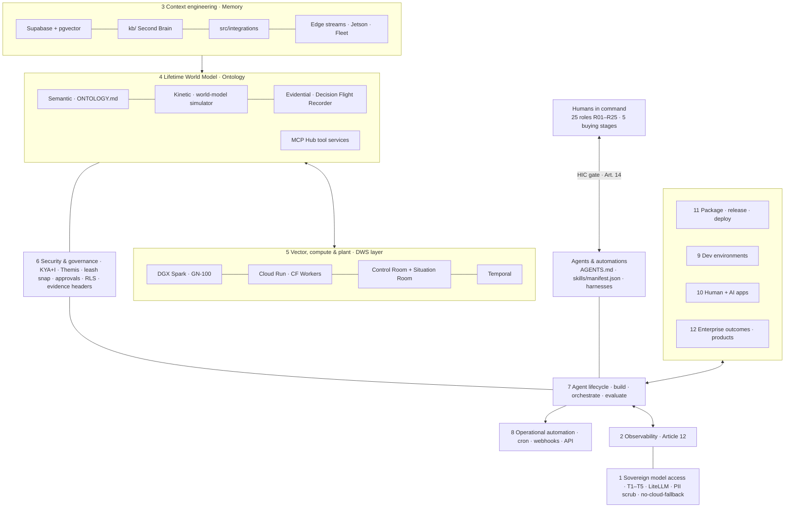

# DWS IQ Reference Architecture

<!-- Evidence: Tool=Claude Code Model=anthropic Agent=reference-architecture Date=2026-09-27 -->
<!-- Audit trail: git log -- docs/architecture/DWS_IQ_REFERENCE_ARCHITECTURE.md -->

---

# VERSION AND AGENT HISTORY

Version: 1.2 [Latest]

Sessions & Modifications:

- Version: 1.2 [Latest] | Tool: Claude Code | Session: claude/focused-ritchie-rou192 | Date: 27.09.2026 | Changes: IJS implemented (`GET /api/v1/kya/inference/:sessionId`, `src/identity/inference-jurisdiction.ts`, `dws kya inference`); HIC chose Connector Marketplace as the next Tier 3 item; superseded by the later #2187 record (Connector Marketplace stays Tier 3; Air-gapped Runtime and DGX Runtime Bundle → Tier 2) — HIC confirmed #2187 on 27.09.2026. | Harness: Claude Code + CLAUDE.md | HIC-approved-drift: none
- Version: 1.1 | Tool: Claude Code | Session: claude/focused-ritchie-rou192 | Date: 27.09.2026 | Changes: Recorded HIC decisions 27.09.2026 — IJS is the first P1; Ops Manager registered as planned in the product lifecycle ledger (conflict 1 resolved); public sites stay on Brand §2.1 Nordic. | Harness: Claude Code + CLAUDE.md | HIC-approved-drift: none
- Version: 1.0 | Tool: Claude Code | Session: claude/focused-ritchie-rou192 | Date: 27.09.2026 | Changes: Initial 12-layer reference architecture for the DWS IQ platform, benchmarked against the Palantir AIP architecture overview supplied by the HIC. Repository-evidence maturity per layer, two DWS-specific layers, ranked update proposals, surfaced conflicts. Visual view: `dws-iq-reference-architecture.html` (Gold Standard, DWS_BRAND_STANDARD.md §2.2). | Harness: Claude Code + CLAUDE.md + STANDARDS_ROUTING.md | HIC-approved-drift: none

Document Status:

- Created: 27.09.2026
- Last Modified: 27.09.2026
- Language: English
- Languages Available: EN
- Publication Status: DRAFT (HIC review)
- Classification: INTERNAL

Standards loaded: `DWS_TRUTH_STANDARD.md`, `DWS_ROLES_REGISTRY.md`, `DWS_BRAND_STANDARD.md` (§2.2, §22, §23), `DWS_MODEL_STANDARD.md` (§3, §4, §6, §9), `docs/DWS_DOCUMENT_STANDARD.md`, `docs/system-config/STANDARDS_ROUTING.md`.

---

## 1. Purpose

One picture of the DWS IQ platform, numbered to the 12-layer enterprise AI reference model so buyers, investors and engineers can compare it line by line. Maturity is a **repository inventory, not a deployment attestation**: _Live_ = code in repo with tests; _Partial_ = code exists, gap named; _Planned_ = spec or draft only.

The external benchmark is named here because this file is internal. Public copy keeps competitors implicit (`DWS_BRAND_STANDARD.md` §0).

Runtime roles follow `docs/architecture/openclaw-nemoclaw-adoption.md` §Decision: **Brain** = agent registry, model routing, KYA authorization · **Memory** = tenant-scoped Lifetime World Model · **Body** = Firehorse reporting, Article 12 evidence, approvals, Temporal workflows · **Hands** = constrained harness/skills, fleet actuation after safety gates. MCP is the interoperability boundary.

## 2. Diagram

## 3. Layer map

| #   | Reference layer        | DWS name                            | Key components (evidence)                                                                                                                                                                              | Maturity | Gap                                                                                                            |
| --- | ---------------------- | ----------------------------------- | ------------------------------------------------------------------------------------------------------------------------------------------------------------------------------------------------------ | -------- | -------------------------------------------------------------------------------------------------------------- |
| 1   | Secure LLM access      | Sovereign model access (T1–T5)      | `config/litellm-config.yaml`, `src/agents/model-selector.ts`, `src/agents/pii-scrubber.ts`, `src/services/redis-rate-limiter.service.ts`, `config/llm-registry.json`, `DWS_MODEL_STANDARD.md` §4/§6/§9 | Partial  | IJS on demand only (no push re-score on provider switch); no single gateway/catalogue with per-tenant metering |
| 2   | Observability          | Article 12 observability            | `src/observability/otel.ts`, `tracing.ts` (`withToolSpan`), `src/agents/article12-logger.ts`, `.ci-audit/runs`, `aspire/apphost.cs` (dev)                                                              | Partial  | No single production trace store or lineage view                                                               |
| 3   | Context engineering    | Context engineering                 | Supabase migrations + pgvector, `kb/`, `src/integrations/`, `src/agents/signal-poller.ts`, `infrastructure/jetson-orin`                                                                                | Partial  | Connector Marketplace Tier 3 (`INDEPENDENT_ONTOLOGY_DRAFT_VS_REPO.md`)                                         |
| 4   | Ontology               | Lifetime World Model                | `ONTOLOGY.md` v1.9, `ontology/enterprises`, `src/agents/world-model/`, `src/decision-journey/emitter.ts`, `mcp-hub/`, `src/mcp/agent-server.ts`                                                        | Partial  | No typed object/link/action runtime; per-industry LWM fine-tunes not built                                     |
| 5   | Vector, compute, tools | Vector, compute & plant (DWS layer) | pgvector, DGX Spark, Cloud Run, Temporal `src/temporal/`, Control Room + Situation Room                                                                                                                | Partial  | Air-gapped runtime and DGX runtime bundle Tier 3                                                               |
| 6   | Security & governance  | KYA+I and Themis                    | `src/identity/kya-engine.ts`, `src/agents/themis.agent.ts`, `src/temporal/approvals.ts`, `src/security/runtime-auth.ts`, RLS, `scripts/evidence-stamp.mjs`                                             | Live     | No scenario branching; Aegis air-gap not demonstrated                                                          |
| 7   | Agent lifecycle        | Agent Foundry                       | `src/agents/base.agent.ts`, `src/agents/workflow-v2/`, `src/evals/`, `src/autoresearch/`, `/swarm`, `src/mcp/nemoclaw-bridge.ts` (code only)                                                           | Live     | Swarm is a skill, not a runtime; no eval-gated promotion                                                       |
| 8   | Operational automation | Cron-works                          | `Cron-works.md`, `infrastructure/dgx-spark/cron-runner.ts`, `scripts/daily/`, webhook routes, `src/temporal/schedules.ts`                                                                              | Live     | —                                                                                                              |
| 9   | Dev environments       | Multi-harness                       | `opencode.json`, `.claude/`, `.cursor/rules`, `scripts/dws6-tmux-session.sh`, Truth §2I pins                                                                                                           | Live     | —                                                                                                              |
| 10  | Human + AI apps        | Control Room / Situation Room       | `dws6.com/dashboard/{control-room,situation-room,mission-control}`, Firehorse V10                                                                                                                      | Partial  | Ops Manager not a catalogue product                                                                            |
| 11  | Package, release       | Store + deploy lanes                | `dws10.com/config/products.json`, `Store/`, `skills/manifest.json`, Cloudflare Pages                                                                                                                   | Partial  | `deploy-cloudrun`, `deploy-dgx-spark`, `deploy-staging` workflows `.disabled`                                  |
| 12  | Enterprise automation  | Enterprise outcomes (products)      | `src/firehorse/`, Climate Intelligence, DWS IQ Aegis, KYA+I, LWM Suite, `src/agents/mgd-metrics.service.ts`                                                                                            | Partial  | Per-industry LWM fine-tunes (`DWS_DEPLOYMENT_STANDARD.md` §6.6)                                                |

## 4. Where DWS differs

**DWS adds:** jurisdiction as a routing input (Model Standard tier × room loadout, no-cloud-fallback); the physical plant as a layer (Plant and Perception Capital, Brand §23); agent identity before agent action (KYA+I, Themis per-tool signing, leash snap); an outcome metric (MGD / CRC).

**The reference model has, DWS lacks:** a typed ontology runtime; system-wide branching; one model gateway and catalogue; evaluation suites as a release gate; release channels per tenant.

## 5. Proposed updates (ranked)

| P     | Layer | Update                                                      | First step                                                                                                         | Unblocks                    |
| ----- | ----- | ----------------------------------------------------------- | ------------------------------------------------------------------------------------------------------------------ | --------------------------- |
| ✅ P1 | 1 · 6 | Ship the Inference Jurisdiction Score — **done 27.09.2026** | `GET /api/v1/kya/inference/:sessionId` from LiteLLM provider chain + model-selector tier; IJS + CLOUD Act flags    | R08 CIO · R15 CISO          |
| P1    | 4     | Typed ontology runtime (minimum viable)                     | One migration: object types, links, action types; each action bound to a Themis KYA scope; one industry first      | R11 Plant Dir · R12 Ops Dir |
| P1    | 2     | Decision Flight Recorder as the single trace store          | Finish Tier 2→1 of `decision-journey/emitter.ts`; join otel span + Article 12 log + KYA verdict on one decision ID | R15 CISO · auditors         |
| P2    | 1     | One model gateway and catalogue                             | Generate catalogue from Model Standard §3 via a truth script; CI fails on drift with `llm-registry.json`           | R09 CFO · R08 CIO           |
| P2    | 7     | Eval-gated agent promotion                                  | Run `src/evals` for changed agents in CI; publish to `.ci-audit`                                                   | R15 CISO · AI Act Art. 15   |
| P2    | 6     | Scenario branching                                          | Supabase branching + world-model simulator dry-run diff before release                                             | R12 Ops Dir                 |
| P3    | 11    | Re-enable deploy lanes with tenant release channels         | Re-enable `deploy-staging` first; define stable / early-access channels in `DWS_DEPLOYMENT_STANDARD.md`            | Delivery                    |
| P2    | 3     | Connector catalogue (HIC: Tier 3 → 2, next)                 | One MCP manifest per `src/integrations` connector, listed in MCP Hub                                               | R08 CIO                     |
| P3    | docs  | Supersede `00-MASTER-BLUEPRINT.md` (v1.0, 2026-01-18)       | Add superseded-by pointer to this file; keep original text                                                         | Investors · engineers       |

## 6. HIC decisions (27.09.2026)

1. **First P1: Inference Jurisdiction Score.** Typed ontology runtime and Decision Flight Recorder follow.
2. **Ops Manager: add to catalogue.** Registered as `ops-manager` (planned) in `config/truth/product-lifecycle-ledger.json`; gets a `products.json` record and public page when the HIC sets its price.
3. **Tier 3 (confirmed 27.09.2026): #2187 stands.** Air-gapped Sovereign Runtime and DGX Runtime Bundle → Tier 2 (roadmap); Connector Marketplace stays a Tier 3 draft.
4. **Public sites stay on Brand §2.1 Nordic Industrial.** Gold Standard (§2.2) is for internal and investor visuals.

## 7. Conflicts surfaced (Rule 7)

1. **Ops Manager** — CLAUDE.md Market Signal rule lists it as a DWS IQ product; the product registry does not carry it (thesis concept only, `PHD_FIREHORSE` §14.16.5). **Resolved 27.09.2026:** added as planned (§6).
2. **Delimiter rule** — `docs/DWS_DOCUMENT_STANDARD.md` §4.1 says `***`; CLAUDE.md (HIC 19.09.2026) says `---`. This file follows CLAUDE.md.
