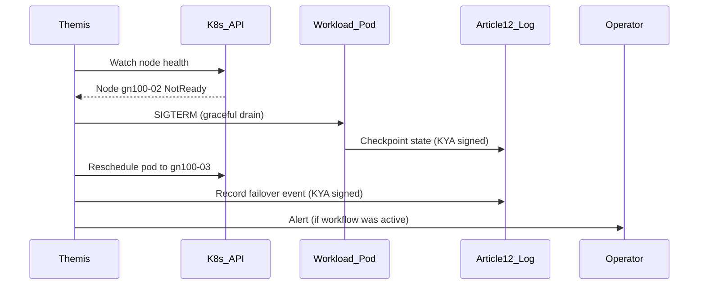

# Themis Control Plane Impact Analysis

## Executive Summary

The introduction of **NVIDIA AI Enterprise Infra 7.8 orchestration tiers (T0–T4)**, **DOCA microservices**, **Government Ready**, **NIM profiles**, and **multi-vendor OT integration (ABB, Siemens, Beckhoff, iPCMax)** significantly expands the operational surface of the **Themis Coordinator** agent.

Themis is no longer just a workflow coordinator — it becomes the **central nervous system** for sovereign multi-cluster, multi-vendor, air-gap-capable deployments.

---

## 1. New Themis Responsibilities

| Domain | New Responsibility | Source Plan |
|--------|-------------------|-------------|
| **Cluster Topology Awareness** | Know T0–T4 tier capabilities, node health, GPU Operator status | Kubernetes Plan |
| **NIM Profile Routing** | Route inference requests to correct NIM profile (Starter/Retrieval/Code/Biology) | NIM Profiles |
| **DOCA Security Integration** | Trigger Argus anomaly scans, request Flow Inspector PCAPs, correlate with workflows | DOCA Plan |
| **Gov Ready Compliance** | Ensure Article 12 audit trail continuity across T3/T4 FIPS/STIG boundaries | Gov Ready Plan |
| **Multi-vendor OT Gateway** | Normalize Siemens OPC UA, Beckhoff EtherCAT, ABB KNX/BACnet, iPCMax MQTT into unified event bus | Multi-vendor Reference |
| **Resource Scheduling** | Integrate with Run:ai (T4) for fair-share GPU allocation across agents | Kubernetes T4 |
| **Air-gap Operation** | Full offline coordination — no external API dependencies | All Plans |
| **Failover/Handoff** | Graceful workflow migration on T2 HA node failure | Kubernetes T2 |
| **GPU Time-slicing Awareness** | Schedule workloads respecting 4x time-slice limits on GB10 | vGPU Plan |
| **Model Bundle Lifecycle** | Coordinate monthly NIM refresh via Sovereign Model Updates Subscription | All Hardware |

---

## 2. Themis Architecture Updates Required

### 2.1 Cluster Registry (New CRD)

```yaml
# Themis needs a live registry of all clusters it coordinates
apiVersion: themis.dws.io/v1
kind: ClusterRegistry
metadata:
  name: customer-cluster-registry
spec:
  clusters:
    - clusterId: "ctrl-room-helsinki-01"
      tier: "T2"                    # T0|T1|T2|T3|T4
      orchestration: "k3s-ha"       # docker-compose|k3s|rke2
      nodes:
        - nodeId: "gn100-01"
          role: "worker"
          gpu: "GB10"
          timeSlicing: 4
          docaPackages: ["essential"]
          nimProfiles: ["starter", "retrieval"]
      govReady: false
      airGapCapable: true
      runaiEnabled: false
    - clusterId: "dgx-spark-tampere-01"
      tier: "T3"
      orchestration: "rke2-gov-ready"
      nodes: [...]
      govReady: true
      fipsEnabled: true
      stigProfile: "ubuntu-24.04-cis-1.23"
```

### 2.2 NIM Profile Router (New Sub-component)

```python
# themis/nim_router.py
class NIMProfileRouter:
    """
    Routes inference requests to the correct NIM profile based on:
    - Workload type (chat, RAG, code, biology)
    - Available GPU memory on target node
    - Time-slicing quota remaining
    - Gov Ready requirement (FIPS-validated NIMs only)
    """
    PROFILES = {
        "starter": {"models": ["nemotron-3-super", "llama-3.1-8b-instruct"], "vram_gb": 24},
        "retrieval": {"models": ["bge-m3", "bge-large-zh", "nemo-retriever-paddleocr"], "vram_gb": 16},
        "code": {"models": ["starcoder2-7b", "codellama-7b"], "vram_gb": 16},
        "biology": {"models": ["evo2-40b", "diffdock"], "vram_gb": 48, "requires_multi_node": True},
    }
    
    def route(self, request: InferenceRequest, cluster: ClusterRegistry) -> RouteDecision:
        # 1. Filter profiles by workload type
        # 2. Check GPU memory + time-slicing availability
        # 3. Enforce Gov Ready: only FIPS-validated NIMs on T3/T4
        # 4. Return target node + NIM service name + resource reservation
```

### 2.3 DOCA Security Event Handler (New Sub-component)

```python
# themis/doca_handler.py
class DOCAEventHandler:
    """
    Consumes DOCA Argus anomaly events, Flow Inspector PCAPs, Telemetry alerts.
    Correlates with running workflows and triggers Themis responses.
    """
    def on_argus_anomaly(self, event: ArgusEvent, cluster: ClusterRegistry):
        # 1. Identify affected workloads/nodes
        # 2. Check if any Themis-coordinated workflows running there
        # 3. If yes: pause workflow, snapshot state, alert operator
        # 4. Log to Article 12 with cryptographic binding
        # 5. Optionally trigger Flow Inspector PCAP capture
    
    def on_flow_inspector_pcap(self, pcap: PCAP, workflow_id: str):
        # 1. Store PCAP as evidence artifact in Article 12 log
        # 2. Tag with workflow_id, timestamp, cluster_id
        # 3. Make available for inspector handoff
```

### 2.4 Multi-vendor OT Normalizer (New Sub-component)

```python
# themis/ot_normalizer.py
class OTEventNormalizer:
    """
    Normalizes events from Siemens, Beckhoff, ABB, iPCMax into
    a unified CloudEvents schema for Themis workflow engine.
    """
    PROTOCOL_HANDLERS = {
        "siemens": OPCUAHandler(namespace="http://siemens.com/automation"),
        "beckhoff": EtherCATHandler(twinCAT3=True, xfc_enabled=True),
        "abb": KNXHandler(bacnet_ip=True, free_at_home=True),
        "ipcmax": MQTTHandler(modbus_gateway=True, can_gateway=True),
    }
    
    def normalize(self, raw_event: RawOTEvent, vendor: str) -> CloudEvent:
        handler = self.PROTOCOL_HANDLERS[vendor]
        return handler.to_cloudevent(raw_event)
    
    # Unified schema:
    # {
    #   "specversion": "1.0",
    #   "type": "dws.ot.sensor.reading",
    #   "source": "siemens/s7-1500/line-3/temperature",
    #   "subject": "sensor/temperature/zone-4",
    #   "time": "2026-08-30T14:30:00Z",
    #   "datacontenttype": "application/json",
    #   "data": {"value": 42.5, "unit": "celsius", "quality": "good"}
    # }
```

---

## 3. KYA Chain Enhancements

Themis maintains the **KYA (Know Your Agent)** chain — cryptographic audit trail of every agent decision.

### New KYA Fields Required

| Field | Purpose | Source |
|-------|---------|--------|
| `cluster_tier` | T0–T4 tier of executing cluster | Kubernetes Plan |
| `nim_profile` | NIM profile used for inference | NIM Profiles |
| `doca_services_active` | DOCA packages running on node | DOCA Plan |
| `gov_ready` | FIPS/STIG compliance status | Gov Ready Plan |
| `ot_vendor` | Source OT vendor (siemens/beckhoff/abb/ipcmax) | Multi-vendor |
| `time_slice_id` | Which GPU time-slice (1-4) executed | vGPU Plan |
| `runai_queue` | Run:ai queue/priority for GPU allocation | Kubernetes T4 |
| `air_gap_status` | online/degraded/severed | All Plans |

### KYA Signing Key Rotation

- **T0/T1/T2**: Monthly rotation (aligned with Sovereign Model Updates)
- **T3/T4 (Gov Ready)**: Weekly rotation + FIPS 140-3 validated HSM
- **Air-gap**: Local key generation, no external KMS

---

## 4. Sub-agent Coordination Updates

Themis coordinates these skilled agents — each now has deployment options:

| Agent | T0 (Docker) | T1 (k3s) | T2 (HA) | T3 (Gov Ready) | T4 (Full) |
|-------|-------------|----------|---------|----------------|-----------|
| **SiteSense** | ✅ | ✅ | ✅ | ✅ (Argus integration) | ✅ (SNAP storage) |
| **Material Oracle** | ✅ | ✅ | ✅ | ✅ (FIPS crypto) | ✅ |
| **Schedule Genius** | ✅ | ✅ | ✅ | ✅ | ✅ (Run:ai) |
| **Logistics** | ✅ | ✅ | ✅ | ✅ | ✅ |
| **Compliance** | ✅ | ✅ | ✅ | ✅ (STIG evidence) | ✅ |
| **Customer Sat** | ✅ | ✅ | ✅ | ✅ | ✅ |
| **Quality Gate** | ✅ | ✅ | ✅ | ✅ (FIPS validated) | ✅ |
| **Sovereignty** | ✅ | ✅ | ✅ | ✅ (CLOUD Act monitoring) | ✅ |
| **Viability** | ✅ | ✅ | ✅ | ✅ | ✅ |
| **Themis** (self) | ✅ | ✅ | ✅ | ✅ (HSM signing) | ✅ |

### Scheduling Policy

```yaml
# themis/scheduling_policy.yaml
default:
  # Prefer T2+ for production workloads
  min_tier: "T1"
  
gov_ready_workloads:
  min_tier: "T3"
  require_fips: true
  require_stig: true
  
biology_workloads:
  min_tier: "T2"
  require_multi_node: true
  nim_profile: "biology"
  
high_throughput_storage:
  min_tier: "T4"
  doca_package: "network-storage"
  
security_workloads:
  min_tier: "T3"
  doca_package: "security"
```

---

## 5. Failover & Handoff Procedures

### T2 HA Cluster Failover



### Air-gap Severed Uplink (Aegis Pilot KPI)

```python
# themis/airgap_handler.py
class AirGapHandler:
    def on_uplink_severed(self, cluster_id: str, duration: timedelta):
        # 1. Verify all Themis-coordinated workflows continue locally
        # 2. Confirm Article 12 log writes locally (no gaps)
        # 3. Verify operator kill-switch still functional
        # 4. If all 3 pass: log "AIR_GAP_KPI_PASS" to Article 12
        # 5. If any fail: log "AIR_GAP_KPI_FAIL" with details
        # 6. Generate Aegis Pilot acceptance report
```

---

## 6. Implementation Priority

| Phase | Component | Effort | Dependencies |
|-------|-----------|--------|--------------|
| **1** | Cluster Registry CRD + API | 2 weeks | Kubernetes Plan T1+ |
| **2** | NIM Profile Router | 1 week | NIM Operator deployed |
| **3** | DOCA Event Handler | 1.5 weeks | DOCA Essential/Security deployed |
| **4** | OT Event Normalizer | 2 weeks | Multi-vendor gateways deployed |
| **5** | KYA Enhancements | 1 week | All above |
| **6** | Scheduling Policy Engine | 1 week | Run:ai (T4) or K8s scheduler |
| **7** | Air-gap KPI Handler | 1 week | Aegis Pilot requirements |
| **8** | Integration Testing | 2 weeks | All above + staging cluster |

**Total: ~11 weeks** for full Themis v2.0 aligned with Infra 7.8.

---

## 7. Backward Compatibility

| Legacy Deployment | Themis v1.x | Themis v2.0 Support |
|-------------------|-------------|---------------------|
| Docker Compose single-node | ✅ | ✅ (T0 — no new features) |
| Docker Compose multi-node (bridge) | ✅ | ✅ (T0 equivalent) |
| No NIM Operator | ✅ | ✅ (falls back to local Ollama) |
| No DOCA | ✅ | ✅ (DOCA features disabled) |
| No Gov Ready | ✅ | ✅ (Gov Ready features disabled) |

**Migration**: Themis v2.0 detects cluster capabilities at startup and enables features progressively. No breaking changes for existing T0 deployments.

---

## 8. Testing Requirements

| Test | Scenario | Pass Criteria |
|------|----------|---------------|
| **T2 Failover** | Kill worker node mid-workflow | Workload reschedules < 60s, Article 12 no gaps |
| **T3 Gov Ready** | Deploy on RKE2 FIPS/STIG | All crypto FIPS-validated, STIG scan passes |
| **NIM Routing** | Submit biology workload to T1 cluster | Rejected (insufficient VRAM), routed to T2+ |
| **DOCA Argus** | Inject anomaly on BlueField DPU | Themis pauses affected workflows, logs to Art.12 |
| **Air-gap KPI** | Sever uplink for 30 min | All 3 Aegis KPIs pass (workflow, Art.12, kill-switch) |
| **Multi-vendor OT** | Send events from all 4 vendors | Normalized to CloudEvents, workflow triggers |

---

## 9. Documentation Updates Needed

| Document | Update |
|----------|--------|
| `Admin/THEMIS_OPERATIONS_MANUAL.md` | New cluster registry, NIM routing, DOCA handlers, OT normalizer |
| `docs/agents/themis.agent.ts` | New sub-components, scheduling policy, KYA fields |
| `src/agents/themis/` | Implementation of new sub-components |
| `src/agents/tools.ts` | New Themis tools: `register_cluster`, `route_inference`, `handle_doca_event` |
| `AgentFoundry/configs/templates/themis-coordinator.yaml` | New config fields for T0–T4, Gov Ready, NIM profiles |

---

## 10. Decision Log

| Date | Decision | Rationale |
|------|----------|-----------|
| 2026-08-30 | Themis v2.0 as backward-compatible capability expansion | Don't break existing T0 Docker Compose deployments |
| 2026-08-30 | NIM Profile Router as separate sub-component | Clean separation; testable independently |
| 2026-08-30 | DOCA Event Handler integrated into Themis | Themis is the workflow coordinator; security events affect workflows |
| 2026-08-30 | OT Normalizer in Themis (not separate agent) | Themis already handles multi-agent coordination; OT is another event source |
| 2026-08-30 | KYA key rotation weekly for Gov Ready | FIPS 140-3 best practice; aligns with STIG scan cadence |
| 2026-08-30 | Run:ai integration only for T4 | Run:ai is T4-only per Infra 7.8 compatibility |

---

**Document Status:** DRAFT
**Version:** 1.0
**Date:** 2026-08-30
**Owner:** Platform Team
**Next Review:** 2026-09-15 (after Themis v2.0 implementation starts)