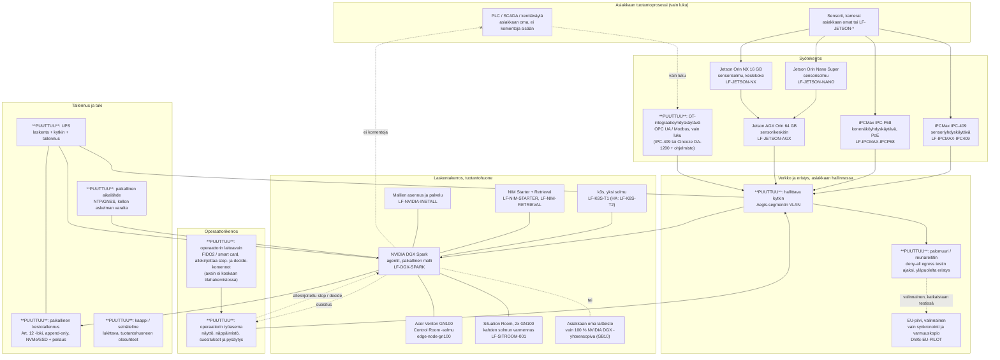

# Aegis-pilotti: laitekaavio (kokonaistoimitus)

---

# VERSION AND AGENT HISTORY

Version: 1.0 [Latest]

Sessions & Modifications:

- Version: 1.0 [Latest] | Tool: Claude Code (web) | Date: 01.10.2026 | Changes: Ensimmäinen kaavio hinnaston tuotteista (`dws10.com/config/products.json`). Puuttuvat osat nimetty. HIC 01.10.2026: pilotti on kokonaistoimitus. | Harness: Claude Code + CLAUDE.md

Document Status:

- Created: 01.10.2026
- Status: PENDING_REVIEW. Hinnat vain `products.json`:ssa, ei tässä tiedostossa.

---

## Periaate

**Laitteistosääntö (HIC 01.10.2026).** Pilotti toimitetaan meidän laitteillamme tai asiakkaan 100 % NVIDIA DGX -yhteensopivalla laitteistolla. Hinnastossa on yksi solmu (`edge-node-gn100`, `LF-DGX-SPARK`) ja kaksi solmua (`LF-SITROOM-001`), kaikki NVIDIA GB10 Grace Blackwell -luokkaa (1 PFLOPS FP4, 128 GB). IGX Orin ei ole DGX-yhteensopiva eikä kelpaa laskentasolmuksi.

Pilotin neljä paikallista vaatimusta (suoritus, identiteetti, loki, pysäytys) toteutuvat laitteistolla, joka on tuotantohuoneessa ja toimii ilman verkkoa. Kaavio on jaettu kerroksiin: syötteet, laskenta, operaattori, verkko ja tallennus. Hinnaston tuote on merkitty SKU:lla. Osa, jota hinnastossa ei ole, on merkitty **PUUTTUU**.

## Kaavio

## Hinnaston tuotteet pilotin kokonaistoimituksessa

| Kerros     | Tuote                             | SKU                                    | Rooli pilotissa                                       |
| ---------- | --------------------------------- | -------------------------------------- | ----------------------------------------------------- |
| Laskenta   | NVIDIA DGX Spark                  | `LF-DGX-SPARK`                         | Agentit ja paikallinen malli, oletusvalinta           |
| Laskenta   | Acer Veriton GN100 Control Room   | `edge-node-gn100`                      | Pienempi työnkulku tai toinen solmu                   |
| Laskenta   | Situation Room, kaksi solmua      | `LF-SITROOM-001`                       | Kun tarvitaan kahden solmun varmennus                 |
| Alusta     | k3s, yksi solmu                   | `LF-K8S-T1`                            | Suorituksen orkestrointi; HA `LF-K8S-T2`              |
| Alusta     | NIM Starter, NIM Retrieval        | `LF-NIM-STARTER`, `LF-NIM-RETRIEVAL`   | Mallipalvelu ja haku paikallisesti                    |
| Palvelu    | NVIDIA-mallien asennus ja palvelu | `LF-NVIDIA-INSTALL`                    | Käyttöönotto                                          |
| Syöte      | Jetson Orin Nano Super, NX, AGX   | `LF-JETSON-NANO`, `-NX`, `-AGX`        | Sensorisolmut ja keskitin                             |
| Syöte      | iPCMax IPC-409, IPC-P68           | `LF-IPCMAX-IPC409`, `LF-IPCMAX-IPCP68` | Sensori- ja konenäköyhdyskäytävät                     |
| Syöte      | Cincoze DA-1200                   | `LF-IPCMAX-CINCOZE-DA1200`             | Laajennettava reunatietokone, OT-yhdyskäytävän alusta |
| Pilvi      | DWS IQ EU Sovereign Pilot         | `DWS-EU-PILOT`                         | Valinnainen synkronointi, ei kriittisellä polulla     |
| Ohjelmisto | DWS IQ Aegis Pilot                | `DWS-AEGIS-PILOT-001`                  | Ajoympäristö, KYA-identiteetti, loki, pysäytys        |

## Puuttuvat osat (ei hinnastossa)

| #   | Osa                                   | Miksi pilotti tarvitsee sen                                                                         | Ehdotus                                              |
| --- | ------------------------------------- | --------------------------------------------------------------------------------------------------- | ---------------------------------------------------- |
| 1   | Operaattorin laiteavain               | Stop- ja decide-komennot allekirjoitetaan operaattorin avaimella, joka ei saa olla tilahakemistossa | FIDO2-avain tai smart card, SKU `LF-OP-KEY`          |
| 2   | Operaattorin työasema                 | Suositukset näytetään ja pysäytys tehdään täältä; ei saa riippua verkosta                           | Teollisuus-PC + näyttö, SKU `LF-OP-WS`               |
| 3   | Paikallinen kestotallennus            | Art. 12 -loki kirjoitetaan paikallisesti katkeamatta; append-only                                   | NVMe-pari peilattuna, SKU `LF-LEDGER-STORE`          |
| 4   | Hallittava kytkin                     | Aegis-segmentin VLAN-eristys, yksi eristysmenetelmistä Phase 0:n portaikossa                        | SKU `LF-NET-SWITCH`                                  |
| 5   | Palomuuri / reunareititin             | Deny-all egress testin ajaksi; eristys yläpuolelta, asiakkaan hallinnassa                           | SKU `LF-NET-EDGE-FW`; voi olla asiakkaan oma         |
| 6   | Paikallinen aikalähde                 | Lokin aikaleimat; kellon askelma eristetyllä sivustolla on todettu ongelma (`clock_step_back_ms`)   | NTP/GNSS-laite, SKU `LF-TIME-SRC`                    |
| 7   | UPS                                   | Katko ei saa katkaista lokia tai pysäytyspolkua                                                     | SKU `LF-UPS`                                         |
| 8   | Kaappi / seinäteline                  | Lukittava, tuotantohuoneen pöly ja lämpö                                                            | SKU `LF-RACK`                                        |
| 9   | OT-integraatioyhdyskäytävä, vain luku | PLC/SCADA-data sisään ilman kirjoituspolkua; "ei fyysistä ohjausta" todistetaan laitetasolla        | Cincoze DA-1200 + OPC UA -asiakas, SKU `LF-OT-GW-RO` |

## Hinnoittelu (HIC 01.10.2026: vaihtoehto A)

Pilotin hinta pysyy hinnaston mukaisena. Laitteisto laskutetaan hinnaston riveinä samalla tilauksella (laite + `LF-NVIDIA-INSTALL`), eikä se sisälly pilotin hyvitykseen. EN Store-sivun hinnoittelutaulukon Hardware-rivi päivitetty vastaavasti. `products.json` ei muuttunut.

## Puuttuvien osien hinnastolisäys (HIC 01.10.2026: kyllä)

Yhdeksän osaa lisätään hinnastoon omina SKU:ina. Lisäys tehdään erillisenä PR:nä, koska jokainen `products.json`-rivi vaatii hinnan, kuvan, tuotesivun, toimitusprofiilin ja hyväksymis-KPI:n (ks. `LF-IPCMAX-IPC409`-rivin kenttäjoukko) ja peilin `landing-pages/dws10-com/config/products.json` samassa commitissa. Hinnat antaa HIC; agentti ei keksi niitä.
