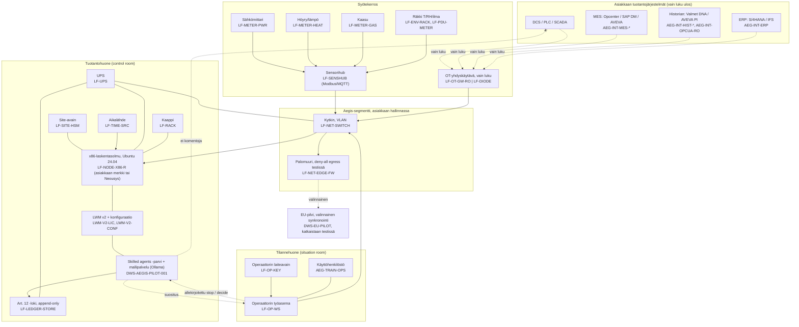

# Aegis-pilotti: SKU-ehdokkaat ja arkkitehtuuri (LWM v2, sensorit, MES, laitteisto)

---

# VERSION AND AGENT HISTORY

Version: 0.2 [Latest]

Sessions & Modifications:

- Version: 0.2 [Latest] | Tool: Claude Code (web) | Date: 01.10.2026 | Changes: Runko: LWM v2 -tarvearvio, MES/historian-liittimet, sensorikerros, ohjelmisto-SKU:t, laitteisto-SKU-paikat, arkkitehtuurikaavio. Laitteistohaku (x86 rugged -solmut, sensorihubit, tietoturva-/verkko-/aika-/UPS-laitteet) kesken; täytetään v0.2:een lähteineen. | Harness: Claude Code + CLAUDE.md

Document Status:

- Created: 01.10.2026
- Classification: INTERNAL
- Status: DRAFT, PENDING_REVIEW. Hinnat vain `dws10.com/config/products.json`:ssa; tässä vain markkinaviitteet ja `TBD`.

---

## 0. Sääntö

Jokainen toimitettava osa saa oman SKU:n. Ohjelmisto-SKU:t ovat Lifetime Oy:n tuotteita (lisenssi tai palvelu). Laitteisto-SKU:t myydään jälleenmyyjänä valmistajan takuulla. Hinta ja marginaali ovat HIC:n päätös; agentti antaa markkinaviitteen ja lähteen.

## 1. LWM v2: mitä pilotti tarvitsee siltä

**Lähtötilanne repossa.** `docs/lifetime-world-model-v2/PATH_B_MVP_SPEC.md` määrittelee LWM v2:n Path B -MVP:n **AMR-robotiikalle**: Llama 3.1 ~55B -pohja + LoRA, 3 kehyksen fysiikkaennuste, Jetson Orin -reunainferenssi <100 ms, 24-kielinen tokenizer. Spesifikaatiossa on virhe: "LoRA fine-tuning on DGX Spark (8× H100)"; DGX Spark on yksi GB10, ei 8× H100. Aegis-pilotin työnkulut (erätason hiilijalanjälki, tuotantohuoneen suositus, datakeskuksen operointi) eivät ole spatiaalista fysiikkaa, joten **tuotantohuoneen LWM v2 -profiilia ei ole määritelty**. Tämä on aukko (Rule 12), ei oletus.

**Tarvearvio tuotantohuoneen profiilille** (ehdotus, HIC vahvistaa):

| Tarve              | Vaatimus pilotissa                                                                                                                                                                                           | Mihin SKU:hun                                            |
| ------------------ | ------------------------------------------------------------------------------------------------------------------------------------------------------------------------------------------------------------ | -------------------------------------------------------- | ------------------------------------------------------------------ | --- | --- | ------------------------------------------------------------------------------------- |
| Syötteet           | Aikasarjat (energia, virtaus, lämpö, kaasu), eräpäätökset MES:stä, prosessitagit historianista, operaattorin päätökset lokista                                                                               | `AEG-INT-*`, `LF-SENSHUB`, `LF-METER-*`                  |
| Maailmanmalli      | Prosessin tila- ja syy-seurausmalli: tagit, erät, rajat, laatuvaatimukset; ontologia (Active Ontology) + asiakaskohtainen konfiguraatio                                                                      | `LWM-V2-CONF`                                            |
| Kielimalli         | Paikallinen malli suosituksen muotoiluun ja perusteluun; 4-bit ~70B tai pienempi; ei ulkoista API:a kriittisellä polulla                                                                                     | `LF-NODE-*` (mallipalvelu Ollama, osa pilottia)          |
| Muisti             | ≥96–128 GB GPU-osoitettavaa muistia 70B-luokalle tai ≤32B malli 48 GB kortilla; päätetään vaiheen 0 laitekatselmoinnissa                                                                                     | `LF-NODE-GB10`                                           | GB10-solmu (Arm) — **ei pilotissa** (HIC 01.10.2026: pysy x86:ssa) | —   | —   | `LF-DGX-SPARK`, `edge-node-gn100`, `LF-SITROOM-001` jäävät hinnastoon muuhun käyttöön |
| Latenssi           | Suositus operaattorille sekunneissa, ei millisekunneissa; eräpäätös minuuteissa. AMR-spesifin <100 ms ei päde tuotantohuoneessa                                                                              | ei erillistä SKU:ta                                      |
| Koulutus / sovitus | LoRA-adapteri asiakkaan historiadatasta; ajetaan asiakkaan x86-solmulla tai Lifetime Oy:n laitteella Espoossa (DGX Spark on Arm: koulutusympäristö, ei tuotantopino), data ei poistu ilman kirjallista lupaa | `LWM-V2-CONF` (Lifetime kantaa pilotissa)                |
| Päivitys           | Lifetime Oy päivittää; asiakkaan hyväksyntä; edellinen versio palautettavana                                                                                                                                 | pilotissa `LWM-V2-CONF`, tuotannossa `DWS-AEGIS-SUB-001` |
| Tallennus          | Mallipainot + adapterit + ontologia paikallisesti; Art. 12 -loki erillisellä kestotallennuksella                                                                                                             | `LF-LEDGER-STORE`                                        |
| Hallinta           | Mallin versio ja koulutusdatan hash jokaiseen päätöstapahtumaan (Path B §3.3 jo määrittelee tämän)                                                                                                           | `DWS-AEGIS-PILOT-001`                                    |
| Omistus            | LWM v2 + konfiguraatio Lifetime Oy:n, käyttölisenssi asiakkaalle; data, loki ja syötteet asiakkaan                                                                                                           | `LWM-V2-LIC`                                             |

**Ohjelmisto-SKU-ehdotukset (uudet):**

| SKU             | Nimi                                                         | Tyyppi       | Pilotissa                          | Tuotannossa                     |
| --------------- | ------------------------------------------------------------ | ------------ | ---------------------------------- | ------------------------------- |
| `LWM-V2-LIC`    | Lifetime World Model v2, käyttölisenssi                      | subscription | 0 € (sisältyy)                     | osa `DWS-AEGIS-001` + `SUB-001` |
| `LWM-V2-CONF`   | LWM v2 asiakaskohtainen konfiguraatio ja sovitus             | one-time     | 0 € (Lifetime kantaa kustannuksen) | hinnoitellaan käyttöönottoon    |
| `LWM-V2-TRAIN`  | LWM v2 koulutusajo asiakasdatalla (LoRA)                     | one-time     | sisältyy `LWM-V2-CONF`:iin         | per ajo, `TBD`                  |
| `AEG-TRAIN-OPS` | Asiakkaan käyttöhenkilöstön koulutus (operaattori, omistaja) | one-time     | 0 € (Lifetime kantaa)              | `TBD`                           |

### 1.1 Inferenssikerros: CUDA on valinta, ei vaatimus

- **Mitä käytämme nyt.** Paikallinen mallipalvelu on Ollama, LiteLLM on liimaa (`DWS_MODEL_STANDARD.md` §9, `config/litellm-config.yaml`, alias `local-sovereign`). DGX Sparkilla ajossa `nemotron-3-super` ja `qwen3-coder:30b` (`DWS_TRUTH_STANDARD.md` §2 rivi 40). Pilottipaketti (`src/aegis/pilot/`) ei riipu CUDA:sta, NIM:istä tai TensorRT:stä: identiteetti, loki ja pysäytys ovat Ed25519 + Node/TypeScript.
- **NIM ja DOCA.** Hinnastossa on NIM- ja DOCA-tilausrivit, mutta pilotti ei käytä niitä. Ne on poistettu pilotin toimituslistoista ja kaavioista 01.10.2026. Themis Coordinator / AI Enterprise -tierit on analysoitu NVIDIA:n päälle, mutta analyysi ei ole käytössä olevaa koodia.
- **Vaihdettavuus.** Ollama ajaa CUDA:lla (NVIDIA), ROCm:llä (AMD), Vulkanilla (kokeellinen) ja CPU:lla; Intel Arc -tuki tulee llama.cpp SYCL/Vulkan- tai IPEX-LLM-polkua. vLLM:llä on XPU-backend. Vaihto NVIDIA → Intel/AMD tarkoittaa mallien uudelleenvalidointia (laatu, latenssi, muisti) samalla eval-setillä, ei pilottipaketin muutosta. Arvio: 1–2 viikkoa per backend, kun eval-setti on olemassa.
- **Tier-luokka ei muutu.** Intel ja NVIDIA ovat molemmat US-omisteisia; §3.6 lukee omistusketjun, joten teknologiataso pysyy Tier 2:ssa kummallakin. Intel-linjan argumentit ovat hinta ja lämpö (Arc Pro B50 ~70 W vs. datakeskusluokka), ei suvereniteetti.
- **Päätös HIC:lle:** kirjataanko vaatimukseksi "inferenssikerros on vaihdettavissa; eval-setti ajetaan jokaiselle hyväksytylle backendille vaiheessa 0"?

### 1.2 Alustaportti ja tukimatriisi (HIC 01.10.2026)

Portti on se, millä pilottipaketti on testattu, ei toimittajan ekosysteemi. NIM/CUDA ei ole portti (HIC: ei käytössä, punainen vaate); Boardyn ehdotus "NIM- ja CUDA-tuettu alusta" hylätty, ks. `docs/field-notes/2026-10-01-boardy-claims-audit.md` rivi 34.

| Kerros                          | Vaatimus                                                                                                                                                                                  | Tarkistus vaiheessa 0                     | Lähde                                                                                 |
| ------------------------------- | ----------------------------------------------------------------------------------------------------------------------------------------------------------------------------------------- | ----------------------------------------- | ------------------------------------------------------------------------------------- |
| CPU-arkkitehtuuri               | x86_64                                                                                                                                                                                    | `uname -m`                                | HIC 01.10.2026; E2E-ajo x86_64                                                        |
| Käyttöjärjestelmä               | Ubuntu 24.04 LTS (tai vendorin Linux, jos kohdat alla täyttyvät)                                                                                                                          | `lsb_release -a`                          | HIC 01.10.2026                                                                        |
| **Kernelitason hiekkalaatikko** | Landlock (hard requirement), seccomp, user/network namespaces; ytimen versio ja Landlock-ABI tarkistetaan, koska vendorin BSP-ydin (Beckhoff RT Linux, Siemens Industrial OS) voi poiketa | `aegis:pilot -- prove` (OpenShell-prover) | `src/aegis/pilot/openshell-prover.ts`, `openshell-policy.ts`, `openshell-handlers.ts` |
| Inferenssi                      | Ollama paikallisesti; GPU-ajuri, jota Ollama tukee (NVIDIA, AMD ROCm, Intel Vulkan/SYCL kokeellinen)                                                                                      | eval-setti ajetaan valitulla backendillä  | `DWS_MODEL_STANDARD.md` §9                                                            |
| Identiteetti ja pysäytys        | Ed25519; operaattorin avain laitteen ulkopuolella                                                                                                                                         | `issue-operator`, `stop` rehearsal        | `crypto.ts`, SKILL hard rule 2                                                        |
| Lokin ankkurointi               | vähintään taso 0 + 1 (ks. auditointi, "Ratkaisu ankkurointiin")                                                                                                                           | `segments --expect-seal`                  | `ledger-segments.ts:37–39`                                                            |
| TPM                             | ei portti; dTPM vs fTPM kirjataan                                                                                                                                                         | `tpm2_getcap properties-fixed`            | auditointi rivi 29–31                                                                 |

## 2. Teollisuusympäristön MES, historian ja DCS: vain luku

Pilotti ei kirjoita mitään tuotantojärjestelmiin. Jokainen liitin on lukeva, ja kirjoituspolun puuttuminen todistetaan laitetasolla (OT-yhdyskäytävä tai data-diodi) ja ohjelmistotasolla (liittimellä ei ole kirjoitusoikeutta).

| SKU                    | Kohdejärjestelmä                                                 | Protokolla                    | Tyypillinen asiakas                         | Tila                                  |
| ---------------------- | ---------------------------------------------------------------- | ----------------------------- | ------------------------------------------- | ------------------------------------- |
| `AEG-INT-OPCUA-RO`     | Mikä tahansa OPC UA -palvelin (historian, DCS, Level 2)          | OPC UA client, read-only, HDA | Outokumpu (Primetals Level 2, historian)    | ehdotus                               |
| `AEG-INT-MODBUS-MQTT`  | Energia- ja virtausmittarit, sensorihubit                        | Modbus TCP, MQTT              | Kemira (erätason energia), datakeskus       | ehdotus                               |
| `AEG-INT-MES-OPCENTER` | Siemens Opcenter Execution                                       | OPC UA / REST, read-only      | prosessiteollisuus                          | ehdotus                               |
| `AEG-INT-MES-SAP`      | SAP Digital Manufacturing / ME / MII                             | OData, read-only              | Outokumpu (S/4HANA), Kemira (varmistamaton) | ehdotus                               |
| `AEG-INT-MES-AVEVA`    | AVEVA MES / AVEVA PI (ent. OSIsoft)                              | PI Web API, OPC UA            | paperi, kemia, metalli                      | ehdotus                               |
| `AEG-INT-HIST-VALMET`  | Valmet DNA Historian                                             | OPC UA                        | Outokumpu Tornio ferrokromi (Valmet DCS)    | ehdotus                               |
| `AEG-INT-ERP`          | SAP S/4HANA, IFS Cloud, Dynamics 365                             | OData v4, read-only           | eräkustannus, materiaalit                   | olemassa (`DWS_STANDARDS_LIBRARY` §4) |
| `AEG-INT-DCIM`         | Datakeskuksen DCIM / BMS (Schneider EcoStruxure, Vertiv, Rittal) | SNMP, Modbus, REST            | datakeskusoperaattori                       | ehdotus                               |

Rajaus: kolme liitintä per pilotti sisältyy (`Store/PRODUCT_AEGIS_PILOT.md`: "only the agent set that workflow requires"); lisäliittimet omina riveinä. Räätälöidyt ERP/BIM/SCADA-integraatiot pysyvät hyvityksen ulkopuolella.

## 3. Sensorikerros: mitä mitataan per työnkulku

| Työnkulku                            | Mitattavat syötteet                                                                      | SKU-paikat                                                                     |
| ------------------------------------ | ---------------------------------------------------------------------------------------- | ------------------------------------------------------------------------------ |
| Erätason hiilijalanjälki (Kemira)    | Sähkö (kWh per linja), höyry/lämpö (MWh), kaasu (Nm³), raaka-ainevirrat, eräaika MES:stä | `LF-METER-PWR`, `LF-METER-HEAT`, `LF-METER-GAS`, `LF-SENSHUB`, `AEG-INT-MES-*` |
| Tuotantohuoneen suositus (Outokumpu) | Prosessitagit historianista, laatu (pintatarkastus), energiankulutus                     | `AEG-INT-OPCUA-RO`, `LF-OT-GW-RO`, `LF-METER-PWR`                              |
| Datakeskus                           | Räkkilämpö, kosteus, ilmavirta, PDU-teho, PUE-syötteet                                   | `LF-ENV-RACK`, `LF-PDU-METER`, `AEG-INT-DCIM`                                  |
| Koneiden kunto (valinnainen)         | Värähtely, lämpö                                                                         | `LF-SENS-VIB`                                                                  |

Sensorihubit ja mittarit tulevat Modbus/MQTT-protokollalla hubiin (`LF-SENSHUB`), joka on kytketty Aegis-segmentin kytkimeen. Konkreettiset mallit, hintaviitteet ja EU/FI-jakelijat: `docs/sales/AEGIS_SENSOR_OT_MARKET_2026-10.md` (hakukatkelmiin perustuva; FI-hinnat varmistettava Elkome, Movetec, TK Engineering, Advenica Oy, Treon, Siemens Osakeyhtiö).

## 4. Laitteisto-SKU-paikat (oletusvalinnat hausta 01.10.2026; hinnat markkinaviitteitä, ei hinnaston hintoja) (täytetään hausta)

| SKU               | Osa                                                                | Oletusvalinta                                                                                                   | EU-vaihtoehto                                                                    | Hinnastossa nyt                                                                       |
| ----------------- | ------------------------------------------------------------------ | --------------------------------------------------------------------------------------------------------------- | -------------------------------------------------------------------------------- | ------------------------------------------------------------------------------------- |
| `LF-NODE-GB10`    | GB10-solmu (Arm) — **ei pilotissa** (HIC 01.10.2026: pysy x86:ssa) | —                                                                                                               | —                                                                                | `LF-DGX-SPARK`, `edge-node-gn100`, `LF-SITROOM-001` jäävät hinnastoon muuhun käyttöön |
| `LF-NODE-X86-R`   | x86 rugged -laskentasolmu, Ubuntu 24.04, dTPM                      | Boardyn lista: Neousys Nuvo-7164GC / GT-92GC, Stealth SR-2950, Advantech TPC-B610, Premio RCO-6000, MSI MS-C906 | EdgeCon AI (DE)                                                                  | ei                                                                                    |
| `LF-SENSHUB`      | Sensorihub / etä-I/O, Modbus/MQTT/OPC UA                           | Advantech ADAM-6017-D + ADAM-6050-D (~€282 + ~€250, Elkome FI)                                                  | Moxa ioThinx 4510 (Movetec FI); Beckhoff EK9000 (DE)                             | `LF-IPCMAX-IPC409` lähin                                                              |
| `LF-METER-PWR`    | Sähköenergiamittari, Modbus                                        | Janitza UMG 801 (OPC UA/Modbus TCP, ~€1,5k) tai UMG 96-PA (~€427)                                               | ABB M4M 30 (ABB Oy FI); Carlo Gavazzi EM540 (~€250, MID)                         | ei                                                                                    |
| `LF-METER-HEAT`   | Höyry-/lämpömittari, Modbus                                        | Krohne OPTISWIRL 4200, Modbus RS485 (~€4–6k)                                                                    | Endress+Hauser Prowirl F 200 (Modbus-optio varmistettava); Kamstrup MULTICAL 603 | ei                                                                                    |
| `LF-METER-GAS`    | Kaasuvirtausmittari, Modbus                                        | Endress+Hauser t-mass F 300 Modbus (~€5–6k); budjetti t-mass B 150 (~€1,25k)                                    | Krohne (DE)                                                                      | ei                                                                                    |
| `LF-SENS-VIB`     | Värähtely-/lämpösensori                                            | Treon Industrial Node + Gateway (FI, Tampere; MQTT)                                                             | ifm VVB001 + AL1350 (DE); Advantech WISE-2410                                    | ei                                                                                    |
| `LF-ENV-RACK`     | Räkin lämpö/kosteus/ilmavirta                                      | APC NetBotz 250 + AP9335TH; Vertiv RTAFHD3 (ilmavirta)                                                          | Rittal CMC III (Rittal Oy FI)                                                    | ei                                                                                    |
| `LF-PDU-METER`    | Mitattu PDU                                                        | Raritan PX3-5190R (SNMPv3/Modbus TCP) + DX2-T1H1                                                                | Eaton ePDU G3 (Eaton FI)                                                         | ei                                                                                    |
| `LF-OT-GW-RO`     | OT-yhdyskäytävä, vain luku (OPC UA -aggregaattori)                 | Softing dataFEED uaGate SI (~€760, TK Engineering FI) / edgeAggregator (Docker)                                 | Siemens OPC UA S7-1500 -lisenssi (~€250–300); Kepware (€866/v)                   | `LF-IPCMAX-CINCOZE-DA1200` alusta                                                     |
| `LF-DIODE`        | Data-diodi korkean turvan kohteisiin                               | Advenica SecuriCDS DD1000i (SE; Advenica Oy Helsinki; alk. ~€3k)                                                | genua cyber-diode (DE, OPC UA natiivi)                                           | ei                                                                                    |
| `LF-OP-KEY`       | Operaattorin laiteavain (FIDO2/PIV, Ed25519)                       | YubiKey 5C NFC (~€69; Ed25519 OpenPGP/FIDO2, ei PIV)                                                            | Nitrokey 3C NFC (DE, ~€60, Ed25519)                                              | ei                                                                                    |
| `LF-SITE-HSM`     | Site-avaimen HSM                                                   | YubiHSM 2 FIPS (~$950; ainoa pieni HSM Ed25519:llä)                                                             | Nitrokey HSM 2 (DE, ~€109, vain P-256/P-384 → ECDSA-fallback)                    | ei                                                                                    |
| `LF-OP-WS`        | Operaattorin työasema + näyttö                                     | Advantech MIC-770 V3W (Ubuntu 24.04 -sertifioitu) + FPM-7211W kosketusnäyttö (~$1,4k)                           | Siemens IPC227G + Beckhoff CP3921 (Beckhoff Oy FI)                               | ei                                                                                    |
| `LF-LEDGER-STORE` | Kestotallennus lokille (PLP NVMe, peilaus)                         | Micron 7450 PRO M.2 480/960 GB PLP (~$340–500) + QNAP TS-264 peili (~€546)                                      | Swissbit N3000 powersafe (Berlin; tarjous)                                       | ei                                                                                    |
| `LF-NET-SWITCH`   | Hallittava teollisuuskytkin, VLAN                                  | Westermo Lynx 3510 (~€1 429, IEC 62443-4-2 SL2; Westermo FI, Espoo)                                             | Teltonika TSW212 (~€110, ei 62443); Moxa EDS-4008 (Hatteland FI)                 | ei                                                                                    |
| `LF-NET-EDGE-FW`  | Palomuuri / reunareititin, deny-all egress                         | Stormshield SNi20 (~€1 649, ANSSI, EU RESTRICTED, OT-DPI)                                                       | genua genuscreen XS (~€1 545, BSI); FortiGate Rugged 70G (US, ~$3,5k)            | ei                                                                                    |
| `LF-TIME-SRC`     | NTP/GNSS-aikalähde                                                 | Meinberg LANTIME M250/GPS (~€2 766; Ehrenborg Nordic)                                                           | Meinberg microSync RX (spoofing-tunnistus + OCXO holdover; tarjous)              | ei                                                                                    |
| `LF-UPS`          | UPS 1–3 kVA, NUT-tuki                                              | Eaton 5P 1550iR G2 + Network-M3 (~€1 199; IEC 62443-4-2; NUT)                                                   | Riello Sentinel Dual SDH 1500 (~€782–977; NUT)                                   | ei                                                                                    |
| `LF-RACK`         | Lukittava kaappi / seinäteline                                     | Rittal AX IT 12U seinäkaappi + Blue e+ suodatintuuletin (Rittal Oy Vantaa)                                      | Lande PROline 12U (~€117, vain puhtaisiin tiloihin)                              | ei                                                                                    |

## 5. Arkkitehtuurikaavio SKU-ehdotuksilla

## 6. Avoimet päätökset

1. Tuotantohuoneen LWM v2 -profiili: hyväksytäänkö §1:n tarvearvio spesifikaation pohjaksi (Path B on AMR-profiili, ei tämä)?
2. ~~Solmusääntö~~ Ratkaistu HIC 01.10.2026: x86. Arm (GB10, Jetson) ei pilotissa. Avoinna: 70B-luokka vaatii ≥96 GB yhdellä kortilla (Nuvo-10109GC + RTX PRO 6000) tai pienempi malli 48 GB:llä; päätetään vaiheessa 0.
3. Montako liitintä (`AEG-INT-*`) sisältyy pilottiin: ehdotus kolme.
4. Hinnat ja marginaali jokaiselle `TBD`-riville, kun v0.2:n markkinaviitteet ovat tässä.
